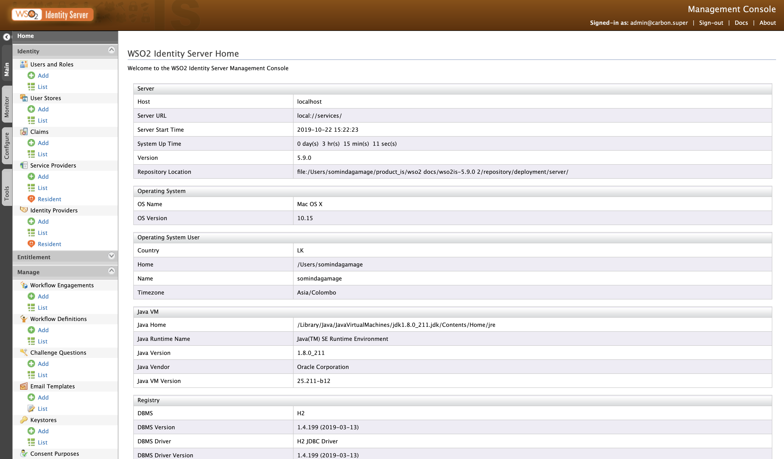
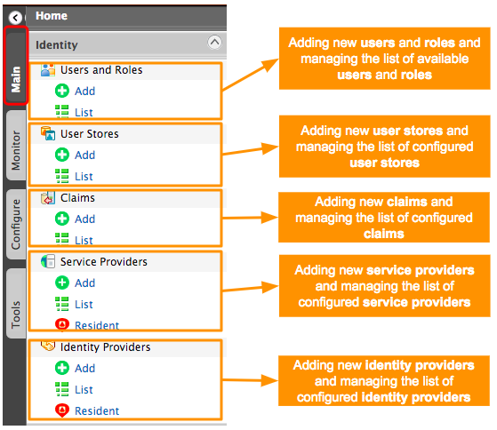
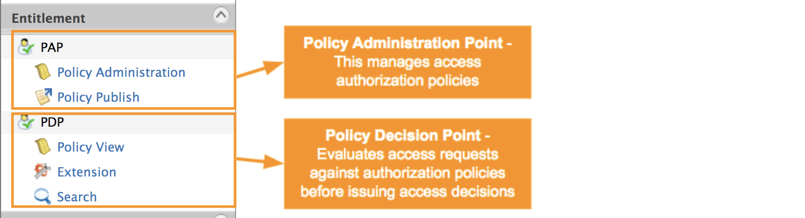
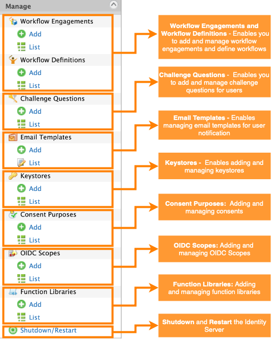
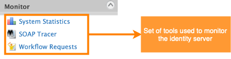
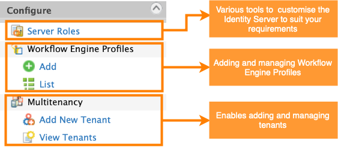
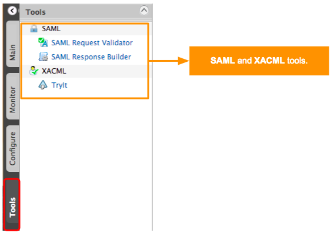

The WSO2 Identity Server Management Console is a web-based user
interface. It allows users to interact with a running identity server
instance, without having to intervene with any underlying
configuration files. The controls in the Management Console are usually
self-explanatory. This page provides an overview of the user interface of the 
management console. 

:::info
You can access the management console of the WSO2 Identity
server at `https://<server-host>:<server-port>/carbon`. When the server
is [running](../run-the-product.mdx) in your local setup:

```text
https://localhost:9443/carbon
```

The default credentials for an administrative user is as follows. It is a
must that you change this administrator credentials in the `<IS_HOME>/repository/conf/deployment.toml` file.

```java
username = admin
password = admin
```
:::

The following screen depicts the home screen of the management console.



The main menu items of the console appear in the left hand side of the 
home screen. Each of these menus carry a list of sub menus. These menus and subsections will 
navigate you via different configurations and features. The usable features for each
sub section will appear in the middle of the screen. 

The Management Console provides a list of tools and
features that you can use. These are divided among the following menu items.

-   Main menu
-   Monitor menu
-   Configure menu
-   Tools menu

:::note
The menus and sub menus of the management console may vary depending on the 
product version and any additional feature you have installed to provision the
server.
:::

---

## Main menu

The main menu in the Management Console includes the main list of
features that the WSO2 Identity Server provides. The main menu is
divided into different sections.

---

### Identity section



:::info[Related topics]
Refer to the following topics for instructions to use sub menu items.
-   [Guide: Manage User Operations](../../../guides/user-management/manage-users/manage-user-overview.mdx) 
    for configuring users and roles. 
-   [Guide: Manage User Roles](../../../guides/user-management/manage-roles/manage-roles-overview.mdx)
-   [Deploy: Configure the Realm](../../configure/deploy/configure-the-realm.mdx) for configuring user stores.
-   [Guide: Manage User Attributes](../../../guides/user-management/manage-users/manage-user-attributes.mdx) for configuring claims.
:::

---

### Entitlement section



{/*!!! info "Related topics"
    Refer to the following topics for instructions to use sub menu items.
    
    -   See [Configuring the Policy Administration Point](TO-DO:{{base_path}}/learn/configuring-the-policy-administration-point) 
        for configuring the policy administration point.
    -   See [Configuring the Policy Decision Point](TO-DO:{{base_path}}/learn/configuring-the-policy-decision-point) 
        for configuring the policy decision point.*/}

---

### Manage section



:::info[Related topics]
Refer to the following topics for instructions to use sub menu items.

-   [Guide: Manage Challenge Questions](../../../guides/user-management/manage-passwords/challenge-question.mdx)
    for information on configuring challenge questions. Also see [Account Recovery](../../../guides/my-account/recover-user-account.mdx) for
    information on challenge questions.
-   [Guide: Email Sender Configurations](../../configure/email-notifications/configure-email-sending.mdx) for configuring email
    sender. Also see [Customizing Automated Emails](../../configure/email-notifications/customize-automated-mails.mdx)
    for information on how to customize these templates.
-   [Deploy: Create New Keystores in the WSO2 Administration Guide](../../deploy/encryption/asymmetric-encryption/create-new-keystores.mdx) for configuring keystores.
{/*-   See [Workflow Management]({{base_path}}/guides/workflows/adding-a-workflow-engine/) for information on
    working with workflows.*/}
:::
---

## Monitor menu

The monitor menu includes a list of features focused on providing logs
and statistics related to the Identity Server. For more
information on these features and their usage, see the topics on
[monitoring the Identity Server](../../monitor/monitor-the-identity-server.mdx).



---

## Configure menu

The configure menu is mainly a list of administration features which can
help you customize and configure the Identity Server to suit your
specific requirements.



:::info[Related topics]
Refer to the following topics for instructions to use sub menu items.

-   See [Creating and Managing Tenants](../../../guides/tenant-mgt.mdx)
    for information on multitenancy.

{/*-   See [Using Workflows with User
    Management]({{base_path}}/guides/workflows/using-workflows-with-user-management) for information
    on Workflow Engine Profiles.*/}
:::

:::note
`Server Roles` are used with Carbon Apps. From WSO2 Identity Server 5.9.0, this feature is not available.
:::

---

## Tools menu

The tools menu includes SAML and XACML tools.

