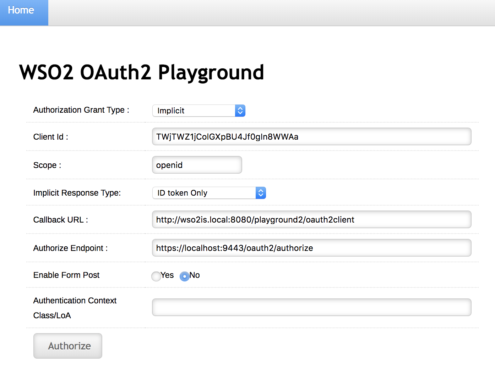
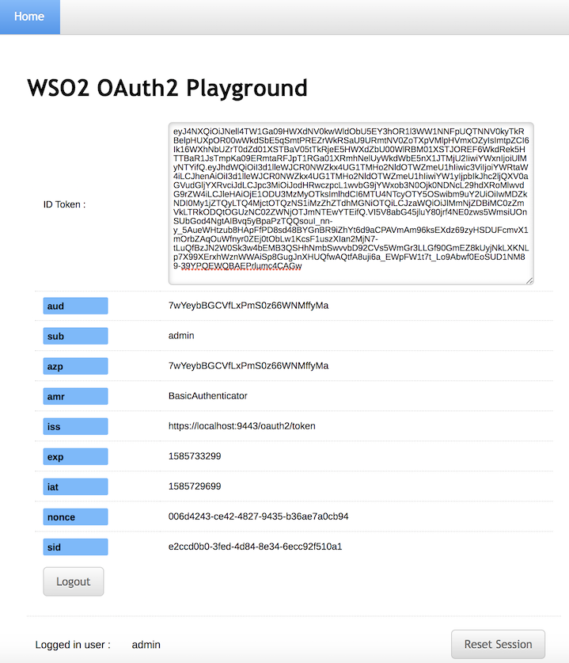

import DeployingSampleApps from '../../../../partials/deploying-sample-apps.mdx';
import DeployPlayground from '../../../../partials/deploy-playground.mdx';
import DeployPlaygroundWithCheckSession from '../../../../partials/deploy-playground-with-check-session.mdx';

This page guides you through using a sample Playground application to try out authentication to an OAuth 2.0/OpenID Connect web application using the [Implicit](../../../references/iam-topics/authorization/oauth-2-0/grant-types/implicit-grant.mdx) grant type.

----

## Set up the sample application

<DeployingSampleApps />

<DeployPlayground />

<DeployPlaygroundWithCheckSession />

---

## Register a service provider

1. On WSO2 Identity Server Management Console, go to **Main** > **Identity** > **Service Providers** and click **Add**.

2. Enter `playground2` as the **Service Provider Name** text box, and click **Register**.

3. Expand the **Inbound Authentication Configuration > OAuth/OpenID Connect Configuration** and click **Configure**.

4. Fill in the form that appears. By default, all **Allowed Grant Types** are selected; you can disable the grant types that are not required.

    :::note
    The **custom** grant type will only appear on the UI if you have configured the JWT grant type. The value specified as the `name` of the `oauth.custom_grant_type` in the `deployment.toml` file when creating the custom grant type is the value that will appear on the UI. For more information on writing a custom grant type, see [Write a Custom OAuth 2.0 Grant Type](../../../references/extend/authentication/oauth2/write-a-custom-oauth-2.0-grant-type.mdx).
    :::

5. Enter the **Callback Url** as `http://wso2is.local:8080/playground2/oauth2client`.

    :::tip
    For more information on other advanced configurations refer, [Advanced OpenID Connect](../../authentication/login/advanced-settings/oidc-advanced/oidc-parameters-in-auth-request.mdx).
    :::

7. Click **Add**. Note that `client key` and `client secret` are generated.

8. Click **Update**.

----

## Try Implicit grant

1.  Enter the following details.

    - **Authorization Grant Type**: Implicit

    - **Client ID**: The OAuth Client Key received when registering the service provider.

    - **Callback URL**: `http://<TOMCAT_HOST>:<TOMCAT_PORT>/playground2/oauth2client`

    - **Authorize Endpoint**: `https://<IS_HOST>:<IS_PORT>/oauth2/authorize`

    

2. Click **Authorize**. 

    The playground application will send an
    [authorization request](https://tools.ietf.org/html/rfc6749#section-4.1.1)
    to the **authorize** endpoint of the WSO2 Identity Server using the
    following format.

    :::info
    **Request Format**
    ```java
    https://<host>:<port>/oauth2/authorize?response_type=token
    &client_id=<client-ID>
    &redirect_uri=<callback-url>
    &scope=<scope>
    ```
    ---
    **Sample Request**
    ```java
    https://localhost:9443/oauth2/authorize?response_type=id_token+token
    &client_id=Cx4LKFNObeuXocx7xgOpz5vfzFoa
    &redirect_uri=http://wso2is.local:8080/playground2/oauth2client
    &scope=openid
    ```
    :::

3. Log in with user credentials (e.g., admin/admin). At this point, the application receives the ID token. 

    
