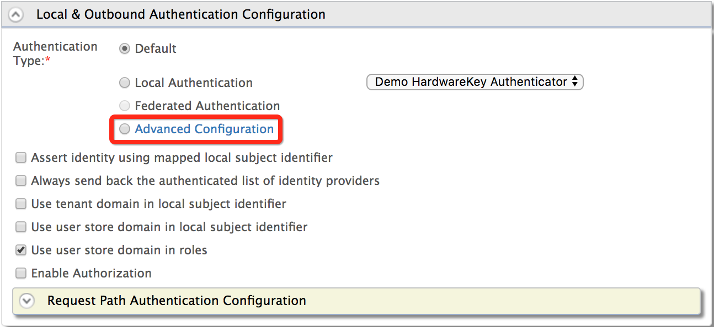

This page guides you through setting up [adaptive authentication](../../../references/iam-topics/authentication/adaptive-authentication.mdx) for an application.

## Prerequisites for adaptive authentication

You need to [register a service provider](../../../references/wso2-is-concepts/applications/register-sp.mdx) on the Management Console.

:::warning[Before you proceed (Only for JDK 17)]
If your system operates on JDK 17, refer to [Enable adaptive authentication](../../../deploy/deploy-2/enable-adaptive-authentication.mdx) to deploy WSO2 Identity Server with conditional authentication.
:::

## Add an adaptive authentication script

Make the following changes to the created service provider.

To add an authentication script to the service provider:

1. On the Management Console, go to **Main > Identity > Service Providers**.
2. Click **List**, select the service provider you want to configure, and click on the corresponding **Edit** link.
3. Expand **Local and Outbound Authentication Configuration** and click
    **Advanced Configuration**.  
    

4. You can add authentication steps or use a template to configure
    adaptive authentication depending on your requirement.

    If required, you can also use the script editor to introduce new functions and fields to an authentication script based on your requirement, and then engage the script to the service provider’s authentication step configuration. 

    :::note
    - To learn about the functions and fields related to authentication scripts, see [Adaptive Authentication JS API Reference](../../../references/adaptive-authentication-js-api-reference.mdx).

    - To learn about the guidelines on writing custom functions for adaptive authentication, see [Write Custom Functions for Adaptive Authentication](../../../references/extend/authentication/adaptive-authentication/write-custom-functions-for-adaptive-authentication.mdx).
    :::

    A sample authentication script is shown below. 

    ```java
    var onLoginRequest = function(context) {
        // Some possible initializations...
        executeStep(1, {
            onSuccess: function (context) {
                // Logic to execute if step 1 succeeded
                executeStep(2, {
                    onSuccess: function (context){
                        // Logic to execute if step 2 succeeded
                    },
                    onFail: function (context){
                        // Logic to execute if step 2 failed
                    }
                });
            }
            onFail: function(context){
                // Logic to execute if step 1 failed
                executeStep(3);
            }
        });
    }

    function someCommonFunction(context) {
        // Do some common things
    }
    ```

5. Click **Update** to save changes.

:::info[Related topics]
- [Concept: Adaptive Authentication](../../../references/iam-topics/authentication/adaptive-authentication.mdx)
- [Guide: Adaptive authenticaton scenarios - Overview](./adaptive-authentication-scenarios/adaptive-auth-overview.mdx)
:::