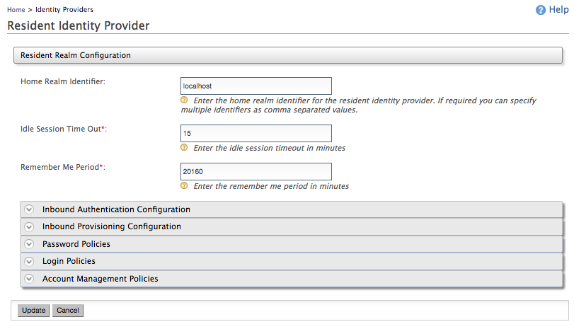

This guide walks you through the steps on how to configure session time out and the duration for which a user session will be remembered by the WSO2 Identity Server.

## Update timeout values per tenant

To configure the **Session Timeout** and **Remember Me period** tenant-wise, follow the steps below:

1. On the WSO2 IS management console (`https://<IS_HOST>:<PORT>/carbon`), go to **Main > Identity Providers > Resident**.

2. Enter the following details under **Resident Realm Configuration** section.  

    

    | Field name | Description |
    | --- | --- |
    | Home Realm Identifier | This is the domain name of the identity provider. |
    | Idle Session Time Out | This is the duration in minutes for which a single sign-on (SSO) session can be idle for. |
    | Remember Me period | This is the duration in weeks for which WSO2 Identity Server should remember an SSO session given that you have selected the \*\*Remember Me\*\* option in the WSO2 Identity Server login screen. |

3. Click **Update** to save the configurations.

The above configuration is effective only for the respective tenant. If it is required to apply the changes for all tenants [configure timeout values globally](#configure-timeout-values-globally).

## Configure timeout values globally

To configure session timeouts globally add the following section to the ```deployment.toml``` file.  

```toml
[session.timeout]
idle_session_timeout= "15m"
remember_me_session_timeout= "14d"
```
| Parameter | Definition |
| --- | --- |
| `idle_session_timeout` | Defines the session time-out period |
| `remember_me_session_timeout` | Defines the period for which the WSO2 IS will remember the user's SSO session. |

## Advanced settings

With every login, the value of `remember_me_session_timeout` is rest to the configured value, for each user.

For example, if you set `remember_me_session_timeout` as `14d` and log in to the management console every day, the`remember_me_session_timeout` keeps resetting to `14d`.

To disable resetting of the expiry time with each authentication request, add the following configuration to the `deployment.toml` file.

```toml
[session.timeout]
extend_remember_me_session_timeout_on_auth=false
```

---

:::info[Related topics]
- [Guide: Enable Single Sign-On for a SAML Application](../../single-sign-on/sso-for-saml.mdx)
- [Guide: Enable Single Sign-On for an OpenID Connect Application](../../single-sign-on/sso-for-oidc.mdx)
:::