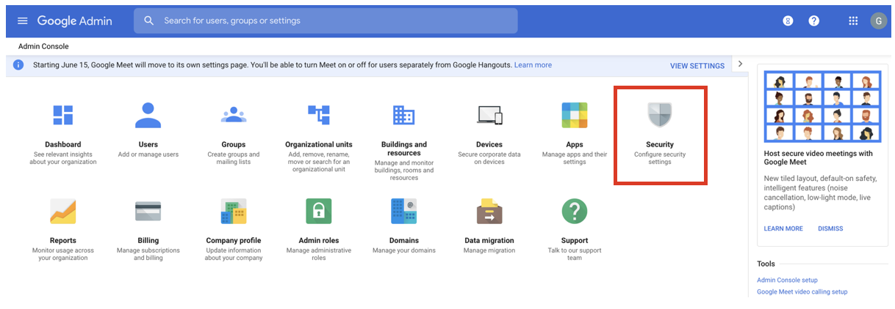
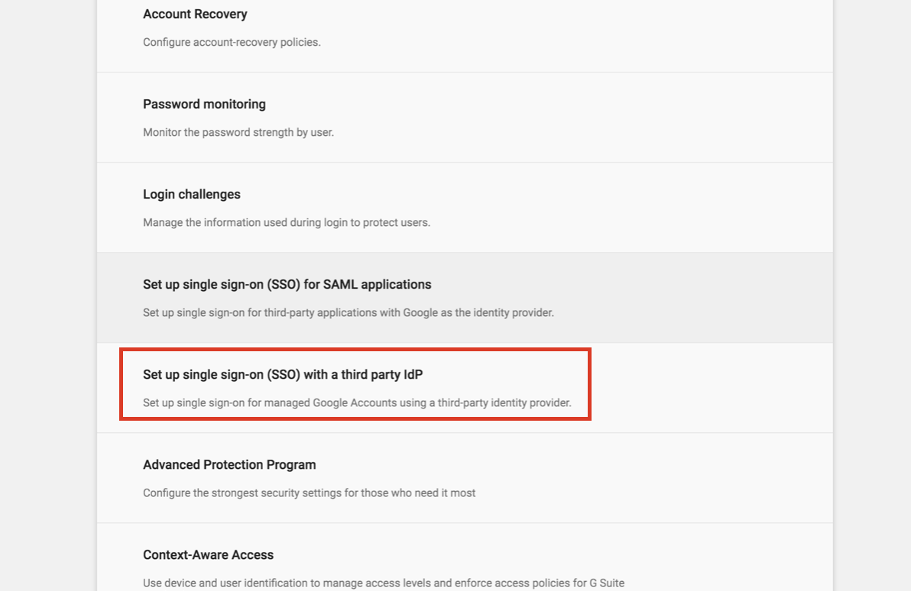
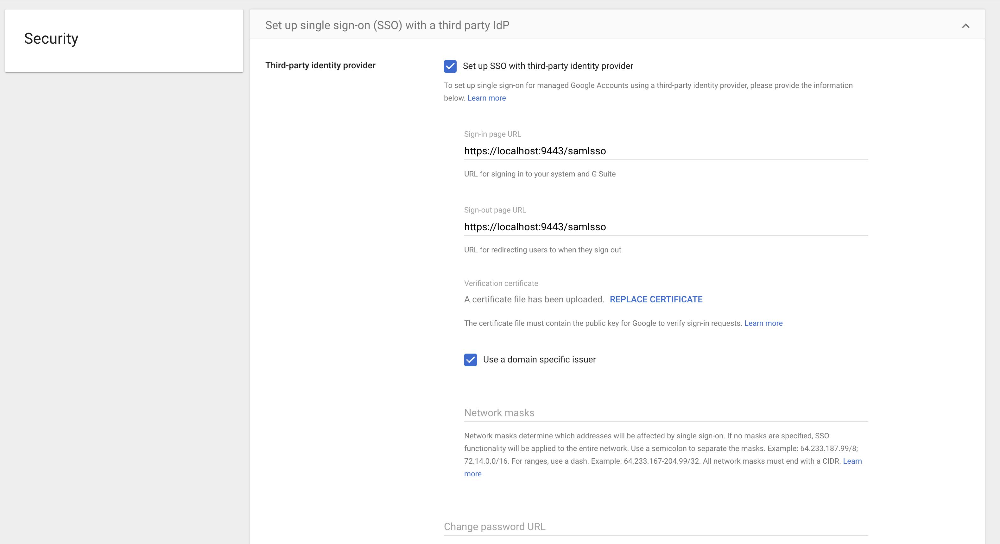
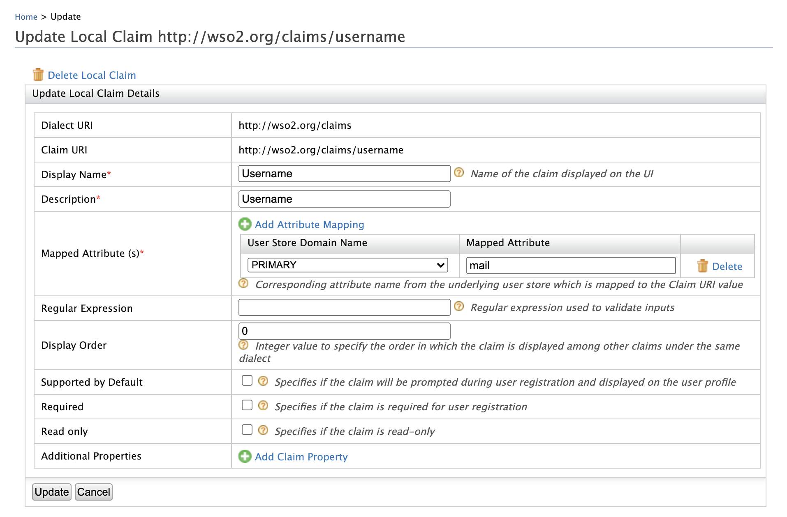

import RegisterAServiceProvider from '../../../../../partials/register-a-service-provider.mdx';
import CreateUserEmailUsername from '../../../../../partials/create-user-email-username.mdx';

This page guides you through using WSO2 Identity Server to log in to Google.

-----

:::tip[Before you begin!]
You need to have a Google domain. Click
[Create Google Apps Domain](https://www.bettercloud.com/monitor/the-academy/create-google-apps-domain-three-easy-steps/)
for more information on creating the domain.
:::

-----

## Configure Google

1. Access your domain's admin console via [https://admin.google.com](https://admin.google.com).

2. Click **Security**.

    :::info
    Can't see the Security section? Click the **MORE CONTROLS** bar at the bottom and you can see the Security section.
    :::

    

3. Click **Set up single sign-on (SSO) with a third party IdP**.

    

4. Enter the following URLs to your third-party Identity Provider
    (IdP).

    - **Sign-in page URL:**
        `https://<IS_HOSTNAME>:<IS_PORT>/samlsso`

    - **Sign-out page URL:**
        `https://<IS_HOSTNAME>:<IS_POST>/samlsso`

    

5. Upload the Identity Server certificate:
    The certificate file must contain the public key for Google to
    verify the sign-in requests.

    1. Navigate to the
        `<IS_HOME>/repository/resources/security`
        directory via the terminal.
    2. Run the command given below to import the public certificate
        from the keystore to a `.pem` file.

        ```java
        keytool -export -alias wso2carbon  -keystore wso2carbon.jks -storepass wso2carbon -file mycert.pem
        ```

        :::info
        The `mycert.pem` file is created in the same directory mentioned in **step** **a** above. If you want to change the name of the file that is being generated, enter a preferred name instead of `mycert` in the above command.
        :::

    3. Click **Replace certificate** and upload the
        `.pem` file you just generated.

    4. Click **Save**.

-----

## Configure Email Address as the Username

:::warning
Configuring the email address as the username in an **already running
Identity Server** is not the production recommended way. So,
**make sure to configure it before you begin working with WSO2 IS**.
:::

1. Log in to the Management Console and click **Claims > List > http://wso2.org/claims**.

2. Click the **Edit** link corresponding to the **Username** claim and configure the `Mapped Attribute` property to `mail`.

    

3. Click **Update** to save the changes.

4. Open the `<IS_HOME>/repository/conf/deployment.toml` file.

5. Add the following configuration to enable email authentication.

    ```toml
    [tenant_mgt]
    enable_email_domain= true
    ```

6. Configure the following set of parameters in the userstore
    configuration, depending on the type of userstore you are connected
    to (LDAP/Active Directory/ JDBC).
    <table>
      <thead>
        <tr>
          <th>Parameter</th>
          <th>Description</th>
        </tr>
      </thead>
      <tbody>
        <tr>
          <td>

            ` UserNameAttribute `

            <br />

          </td>
          <td>

            Set the mail attribute of the user. **LDAP/Active Directory only**

            ```text
            [user_store]user_name_attribute = "mail"
            ```

          </td>
        </tr>
        <tr>
          <td>` UserNameSearchFilter `</td>
          <td>

            Use the mail attribute of the user instead of ` cn ` or ` uid ` . **LDAP/Active Directory only** <br />For example:

            ```text
             In LDAP,[user_store]user_name_search_filter = `"(&(objectClass=person)(mail=?))"`  In Active Directory, [user_store]user_name_search_filter = `"(&(objectClass=user)(mail=?))"`
            ```

          </td>
        </tr>
        <tr>
          <td>` UserNameListFilter `</td>
          <td>

            Use the mail attribute of the user if **necessary. LDAP/Active Directory only** <br />For example:

            ```text
             In LDAP,[user_store]user_name_list_filter = `"(&(objectClass=person)(!(sn=Service)))"`  In Active Directory, [user_store]user_name_list_filter = `"(&(objectClass=user)(!(sn=Service)))"`
            ```

          </td>
        </tr>
        <tr>
          <td>` UsernameWithEmailJavaScriptRegEx `</td>
          <td>

            Change this property that is under the relevant userstore manager tag as follows. This property validates usernames when email is used as the username and allows special characters like "@" in the username.

            ```text
            [user_store.properties]UsernameWithEmailJavaScriptRegEx = '^[a-zA-Z0-9_@.+-]{5,200}$'
            ```

          </td>
        </tr>
        <tr>
          <td>` UsernameJavaRegEx `</td>
          <td>

            This is a regular expression to validate usernames. By default, strings have a length of 5 to 30. Only non-empty characters are allowed. You can provide ranges of alphabets, numbers and also ranges of ASCII values in the RegEx properties.

            ```text
            [user_store]username_java_regex = '^[a-zA-Z0-9._-]+@[a-zA-Z0-9.-]+\\.[a-zA-Z]{2,4}'
            ```

          </td>
        </tr>
        <tr>
          <td>Realm configurations</td>
          <td>

            The username must use the email attribute of the admin user.

            ```text
            [super_admin]username = "admin@wso2.com"password = "admin"
            ```

            :::note
            Before this configuration, the user having the username **admin** and password **admin** was considered the super administrator. The super administrator user cannot be deleted.

            After this configuration, the user having the username **` admin@wso2.com `** is considered the super administrator. The user having the username admin is considered as a normal administrator.<br /> 
            :::

          </td>
        </tr>
      </tbody>
    </table>

    :::info
    - With these configuration users can log in to super tenant with both
    email username (**`alex@gmail.com`**) or
    non-email usernames (`larry`). However, for tenants, only email usernames are allowed. (**`tod@gmail.com@wso2.com`**).
    - You can configure email username without enabling the **`enable_email_domain`** property (step 5). Then users can log in to both the super tenant and the tenant using email and non-email usernames. However, super tenant users should always use
    ***@carbon.super*** at the end of usernames.
    :::

7. Restart the server.

-----

## Create the service provider

<RegisterAServiceProvider />

-----

### SAML Configurations

Make the following changes to the created service provider.

1. Expand **Inbound Authentication Configuration > SAML Configuration** and click **Configure**.

2. Fill in the value for **Issuer** and **Assertion consumer URL** as shown below.

    <table>
      <thead>
        <tr>
          <th>Field</th>
          <th>Value</th>
          <th>Description</th>
        </tr>
      </thead>
      <tbody>
        <tr>
          <td>Issuer</td>
          <td>

            ` google.com `

          </td>
          <td>This is the ` <saml:Issuer> ` element that contains the unique identifier of the service provider.</td>
        </tr>
        <tr>
          <td>Assertion Consumer URL</td>
          <td>

            ```text
            https://www.google.com/a/<ENTER_YOUR_DOMAIN>/acs
            ```

          </td>
          <td>This is the URL to which the browser should be redirected to after the authentication is successful. This is the Assertion Consumer Service (ACS) URL of the service provider. The identity provider redirects the SAML2 response to this ACS URL. However, if the SAML2 request is signed and SAML2 request contains the ACS URL, the Identity Server will honor the ACS URL of the SAML2 request.</td>
        </tr>
      </tbody>
    </table>

3. Select **Enable Response Signing** to sign the SAML2 Responses returned after the authentication process.

4. Select **Enable Attribute Profile** and **Include Attributes in the Response Always** so that the the identity provider will always include the attribute values related to the selected claims in the SAML2 attribute statement.

5. Click **Register**.

-----

## Try it out

Now, you have successfully configured Google and WSO2 Identity Server.

:::note
The admin users of your Google domain do not get redirected to WSO2 IS.
To try out the tutorial, you need to use a user who is not an
admin in your Google account.
:::

1. Create a user in WSO2 Identity Server. Make sure that the same user
    exists in your Google domain.
    In this example, `alex@wso2support.com`
    is in the Google domain. So, we need to create the same user in WSO2 Identity Server.

    <CreateUserEmailUsername />

2. Navigate to
    `https://google.com/a/<ENTER_YOUR_DOMAIN>/acs`
    and enter the email address (username) of the user you created.
    You are navigated to WSO2 Identity Server's sign in screen.
3. Enter the username and password of the user you created.
    You are navigated to the G-Suite of that domain and you can select
    the application you need to use.

:::tip
If you want to only access Gmail, navigate to
[mail.google.com](http://mail.google.com), enter the username of the
user, enter the username and password of the user on the WSO2 Identity
Server sign in screen, and you are navigated to the user's mail account.
:::

:::info[Related topics]
- [Concept: Identity Federation](../../../../references/iam-topics/identity-federation.mdx)
:::
