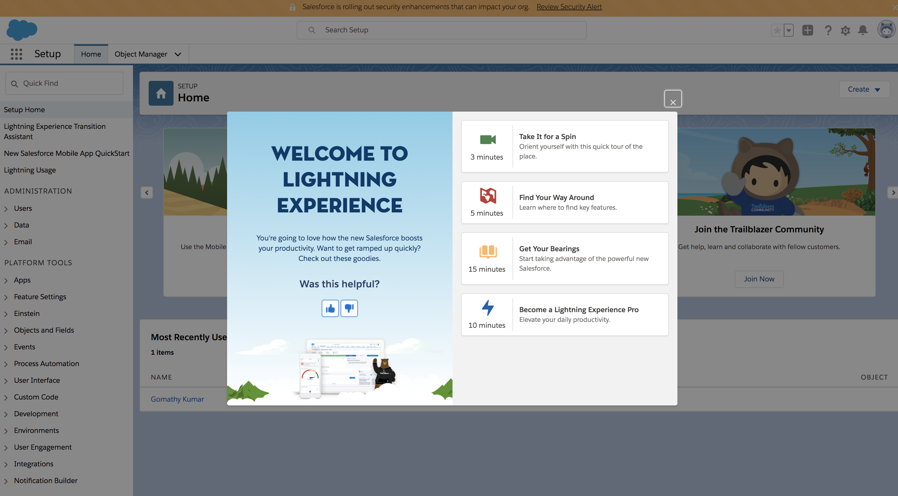
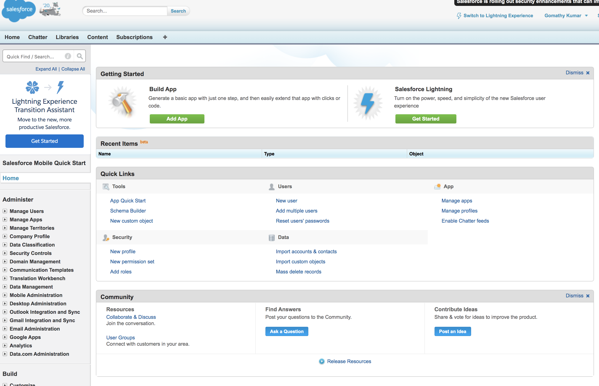
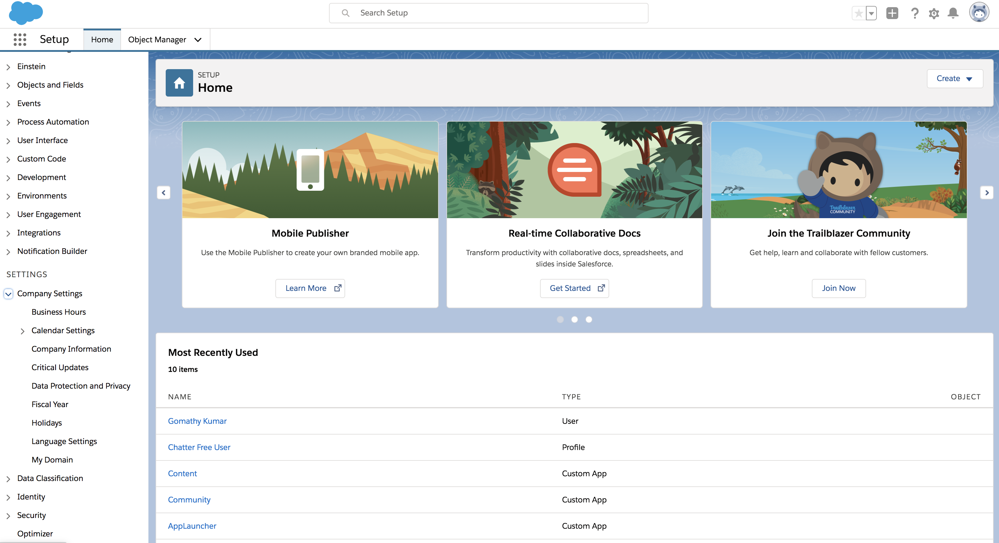
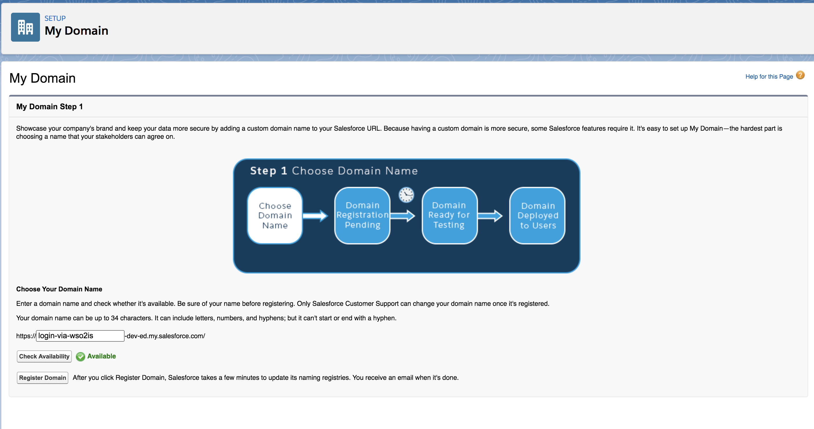
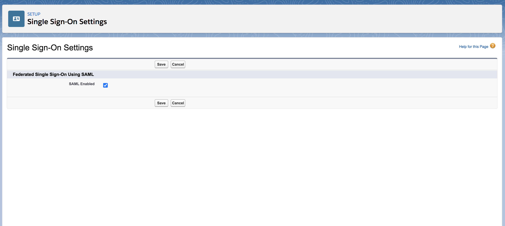
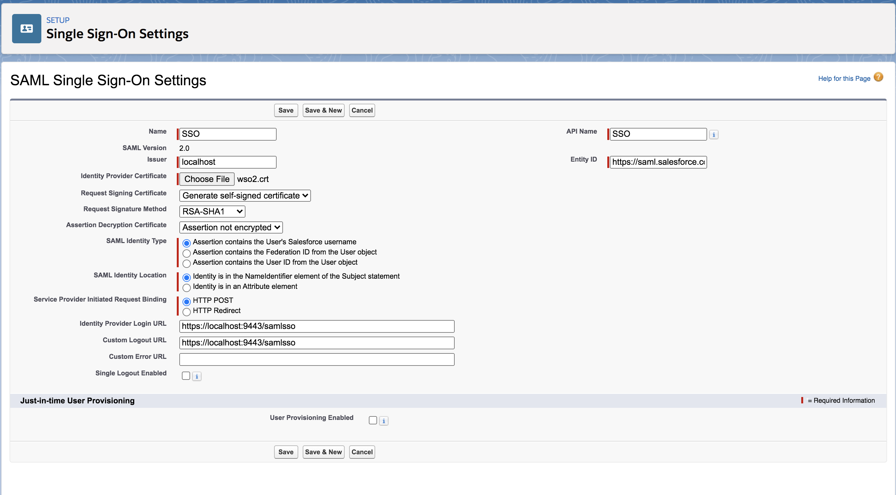
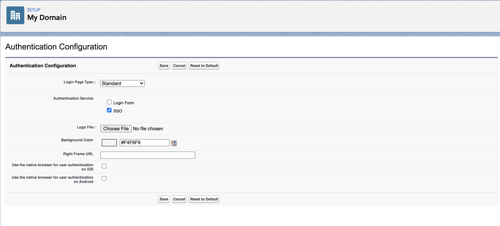
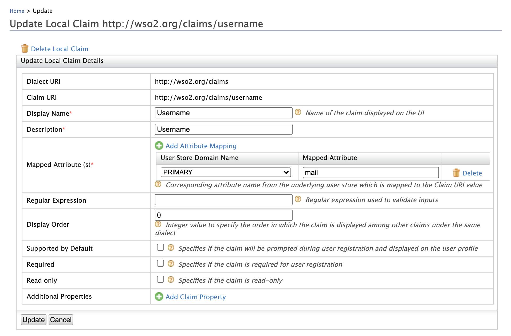
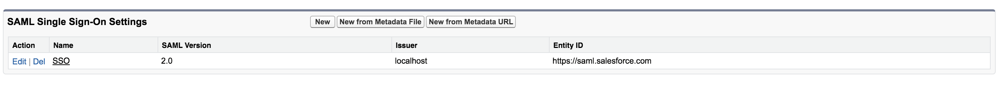
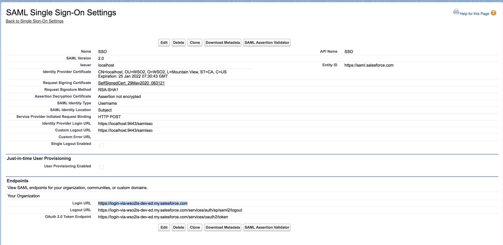

import RegisterAServiceProvider from '../../../../../../partials/register-a-service-provider.mdx';
import CreateUserEmailUsername from '../../../../../../partials/create-user-email-username.mdx';

This page guides you through using WSO2 Identity Server to log in to Salesforce.

-----

## Configure Salesforce

1. Sign up as a Salesforce developer.
    1. Fill out the relevant information found in the following URL:
        [https://developer.salesforce.com/signup](https://developer.salesforce.com/signup)
    2. Click **Sign me up**.
    3. Click **Allow** to enable Salesforce to access your basic
    information. This message pops up only when you log in to Salesforce
    for the first time.
    4. You will be navigated to the lightening theme of Salesforce.

       

    :::note
    This document is explained using the Salesforce lightning theme. If
    you are using the classic theme, click **Switch to Lightning Experience** on the top panel.

    
    :::

2. Once you are logged in, create a new domain and access it. To do
    this, do the following steps.
    1. Search for **My Domain** in the search bar that is on the left
        navigation panel.
        

    2. Click **My Domain**.
    3. On the page that appears, come up with a name for your domain.
        You can check if the domain is available by clicking the **Check
        Availability** button.

        :::info
        For the page given below to load on your browser, make sure that
        the Salesforce cookies are not blocked.
        :::

        

    4. If the domain is available, click **Register Domain** to register your new
        domain.

    5. The verification might take a few minutes. On successful verification, you will proceed to step 3 where you can test your login.

    6. Click **Log in**.

3. On the left navigation menu, search for **Single Sign-On Settings** and click on it.

4. On the page that appears, click **Edit** and then select the **SAML
    Enabled** check box to enable federated single sign-on using SAML.
    

5. Click **Save**.

6. Click **New** under **SAML Single Sign-On Settings**. The following
    screen appears.
    

    Ensure that you configure the following properties.

    <Anchor id="entity-id" />

    <table>
      <thead>
        <tr>
          <th>Field</th>
          <th>Value</th>
        </tr>
      </thead>
      <tbody>
        <tr>
          <td>Name</td>
          <td>SSO</td>
        </tr>
        <tr>
          <td>API Name</td>
          <td>SSO</td>
        </tr>
        <tr>
          <td>Issuer</td>
          <td>` localhost `</td>
        </tr>
        <tr>
          <td>Entity Id</td>
          <td>` https://saml.salesforce.com `</td>
        </tr>
        <tr>
          <td>Identity Provider Certificate</td>
          <td>

            ` wso2.crt `

            :::note
            To create the Identity Provider Certificate, open the terminal, traverse to the \`

            \<is_home\>/repository/resources/security\` directory. Next, execute the following command.

            ```text
            keytool -export -alias wso2carbon -file wso2.crt -keystore wso2carbon.jks -storepass wso2carbon
            ```

            Once this command is run, the `wso2.crt` file is generated and can be found in the \`

            \<is_home\>/repository/resources/security\` directory. Click **Choose File** and navigate to this location in order to obtain and upload this file.
            :::

          </td>
        </tr>
        <tr>
          <td>Request Signing Certificate</td>
          <td>Default Certificate</td>
        </tr>
        <tr>
          <td>Request Signature Method</td>
          <td>RSA-SHA1</td>
        </tr>
        <tr>
          <td>Assertion Decryption Certificate</td>
          <td>Assertion not encrypted</td>
        </tr>
        <tr>
          <td>SAML Identity Type</td>
          <td>

            Assertion contains user's salesforce username

          </td>
        </tr>
        <tr>
          <td>SAML Identity Location</td>
          <td>

            Identity is in the `NameIdentifier` element of the Subject statement

          </td>
        </tr>
        <tr>
          <td>Service Provider Initiated Request Binding</td>
          <td>HTTP POST</td>
        </tr>
        <tr>
          <td>Identity Provider Login URL</td>
          <td>` https://localhost:9443/samlsso `</td>
        </tr>
        <tr>
          <td>Custom Logout URL</td>
          <td>` https://localhost:9443/samlsso `</td>
        </tr>
        <tr>
          <td>Custom Error URL</td>
          <td>Leave blank</td>
        </tr>
        <tr>
          <td>User Provisioning Enabled</td>
          <td>Leave blank</td>
        </tr>
      </tbody>
    </table>

    Click **Save** to save your configurations.

7. Navigate to **Company Settings** in the left navigation pane and click **My Domain**.

8. Click **Deploy to Users**. Click **Ok** to the confirmation message
    that appears.

9. On the page that appears, you must configure the **Authentication Configuration** section. Scroll down to this section and click
    **Edit**.

10. Under **Authentication Service**, select **SSO** instead of **Login
    Page**.
    

11. Click **Save**.

-----

## Configure Email Address as the Username

:::warning
Configuring the email address as the username in an **already running
Identity Server** is not the production recommended way. So,
**make sure to configure it before you begin working with WSO2 IS**.
:::

1. Log in to the Management Console and click **Claims > List > http://wso2.org/claims**.

2. Click the **Edit** link corresponding to the **Username** claim and configure the `Mapped Attribute` property to `mail`.

    

3. Click **Update** to save the changes.

4. Open the `<IS_HOME>/repository/conf/deployment.toml` file.

5. Add the following configuration to enable email authentication.

    ```toml
    [tenant_mgt]
    enable_email_domain= true
    ```

6. Configure the following set of parameters in the userstore
    configuration, depending on the type of userstore you are connected
    to (LDAP/Active Directory/ JDBC).
    <table>
      <thead>
        <tr>
          <th>Parameter</th>
          <th>Description</th>
        </tr>
      </thead>
      <tbody>
        <tr>
          <td>

            ` UserNameAttribute `

            <br />

          </td>
          <td>

            Set the mail attribute of the user. **LDAP/Active Directory only**

            ```text
            [user_store]user_name_attribute = "mail"
            ```

          </td>
        </tr>
        <tr>
          <td>` UserNameSearchFilter `</td>
          <td>

            Use the mail attribute of the user instead of ` cn ` or ` uid ` . **LDAP/Active Directory only** <br />For example:

            ```text
             In LDAP,[user_store]user_name_search_filter = `"(&(objectClass=person)(mail=?))"`  In Active Directory, [user_store]user_name_search_filter = `"(&(objectClass=user)(mail=?))"`
            ```

          </td>
        </tr>
        <tr>
          <td>` UserNameListFilter `</td>
          <td>

            Use the mail attribute of the user if **necessary. LDAP/Active Directory only** <br />For example:

            ```text
             In LDAP,[user_store]user_name_list_filter = `"(&(objectClass=person)(!(sn=Service)))"`  In Active Directory, [user_store]user_name_list_filter = `"(&(objectClass=user)(!(sn=Service)))"`
            ```

          </td>
        </tr>
        <tr>
          <td>` UsernameWithEmailJavaScriptRegEx `</td>
          <td>

            Change this property that is under the relevant userstore manager tag as follows. This property validates usernames when email is used as the username and allows special characters like "@" in the username.

            ```text
            [user_store.properties]UsernameWithEmailJavaScriptRegEx = '^[a-zA-Z0-9_@.+-]{5,200}$'
            ```

          </td>
        </tr>
        <tr>
          <td>` UsernameJavaRegEx `</td>
          <td>

            This is a regular expression to validate usernames. By default, strings have a length of 5 to 30. Only non-empty characters are allowed. You can provide ranges of alphabets, numbers and also ranges of ASCII values in the RegEx properties.

            ```text
            [user_store]username_java_regex = '^[a-zA-Z0-9._-]+@[a-zA-Z0-9.-]+\\.[a-zA-Z]{2,4}'
            ```

          </td>
        </tr>
        <tr>
          <td>Realm configurations</td>
          <td>

            The username must use the email attribute of the admin user.

            ```text
            [super_admin]username = "admin@wso2.com"password = "admin"
            ```

            :::note
            Before this configuration, the user having the username **admin** and password **admin** was considered the super administrator. The super administrator user cannot be deleted.

            After this configuration, the user having the username **` admin@wso2.com `** is considered the super administrator. The user having the username admin is considered as a normal administrator.<br /> 
            :::

          </td>
        </tr>
      </tbody>
    </table>

    :::info
    - With these configuration users can log in to super tenant with both
    email username (**`alex@gmail.com`**) or
    non-email usernames (`larry`). However, for tenants, only email usernames are allowed. (**`tod@gmail.com@wso2.com`**).
    - You can configure email username without enabling the **`enable_email_domain`** property (step 5). Then users can log in to both the super tenant and the tenant using email and non-email usernames. However, super tenant users should always use
    ***@carbon.super*** at the end of usernames.
    :::

7. Restart the server.

-----

## Create the service provider

<RegisterAServiceProvider />

-----

### SAML Configurations

Make the following changes to the created service provider.

1. Expand **Inbound Authentication Configuration > SAML Configuration** and click **Configure**.

2. Enter the **Issuer** as `https://saml.salesforce.com`.

    :::note
    The **Issuer** is the unique identifier of the service provider. This is also the issuer value specified in the SAML Authentication Request issued by the service provider.
    :::

3. Enter **Assertion Consumer URL** and click **Add**.

    :::note
    The **Assertion Consumer URL** is the URL of the page to which the browser is redirected to after successful authentication.
    To get the **Assertion Consumer URL** from Salesforce, follow the below provided steps. <br />
    1. Navigate to **Identity > Single Sign-On Settings** from the left hand side panel.  <br />
    2. Click on the name of the SAML SSO component created.  <br />
    3. Note down the login URL.
    :::

4. Select **Enable Response Signing** to sign the SAML2 Responses returned after the authentication process.

5. Select **Enable Attribute Profile** and **Include Attributes in the Response Always** so that the the identity provider
    will always include the attribute values related to the selected claims in the SAML2 attribute statement.

6. Click **Register**.

:::tip
To configure more advanced configurations, see [Advanced SAML Configurations](../../advanced-settings/saml-advanced/saml-app-config-advanced.mdx).
:::

-----

## Test the configurations

Do the following steps to test out the configurations for a new user in
Salesforce and the Identity Server.

1. Create a user in WSO2 IS.

    <CreateUserEmailUsername />

2. Create a user in Salesforce. This user should have the same
    email address as the user in WSO2 IS
    1. Log in to the Salesforce developer account:
        [https://login.salesforce.com/](https://login.salesforce.com/?lt=de).
    2. On the left navigation pane, under **ADMINISTRATION**, click
        **Users** under **Users**.
    3. On the page that appears, click the **New User** button to
        create a new user.
    4. Create a user with the same username as the one you created in
        WSO2 Identity Server. Click **Save** to save your changes. An
        email will be sent to the email address you provided for the
        user.

        :::note
        This is mainly for testing purposes. In a real
        business scenario, you would be more likely to use Just-In-Time
        (JIT) provisioning to provision a user to Salesforce.
        :::

3. Access your Salesforce login URL on an incognito or private browser.

    :::info
    The salesforce login URL is unique to your Salesforce application.
    Follow the steps given below to get this URL:

    1. Search for **My Domain** in the search bar that is on the left
        navigation panel.

    2. Click **My Domain** and you are navigated to the domain you created
        under the section, [Configure
        Salesforce](#configure-salesforce).

    3. Click **Edit** under Authentication Configurations and you are
        navigated to a new page having the following URl:
        `https://<DOMAIN_NAME>/domainname/EditLogin.apexp`.

    4. On the left navigation menu, expand **Security Controls**, and
        click, **Single Sign-On Settings**.

    5. Click on the name of the created **Single Sign-On Setting**. For this example, click **SSO**.
        

    6. Copy the URL that is defined for **Login URL** to access
        Salesforce.
        
    :::

4. Log in using the new credentials of the user you just created. You
    are then redirected back to Salesforce.

-----

## Troubleshooting guidelines

Additional troubleshooting information about any Salesforce side SSO
failures can be retrieved by using Salesforce SAML Assertion Validator.
Further information about the steps are available
[in the Salesforce SAML validation errors documentation](https://developer.salesforce.com/docs/atlas.en-us.sso.meta/sso/sso_saml_validation_errors.htm#!).

:::info[Related topics]
- [Concept: Identity Federation](../../../../../references/iam-topics/identity-federation.mdx)
:::
