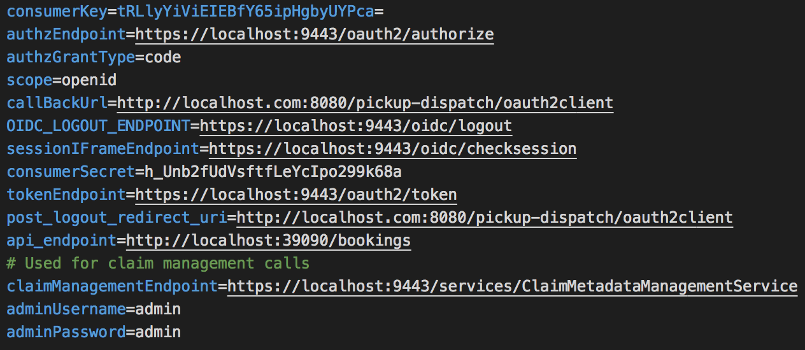

import DeployingSampleApps from '../../../../../partials/deploying-sample-apps.mdx';

This page guides you through enabling login for an [OpenID Connect](../../../../references/iam-topics/authentication/authentication-protocols/oidc/intro-oidc.mdx) web application.

<DeployingSampleApps />

- Download the [OIDC pickup dispatch application](https://github.com/wso2/samples-is/releases/download/v4.5.2/pickup-dispatch.war) from the latest release assets.

---
### Register a service provider

To configure the service provider:

1. On the Management Console, go to **Main** > **Identity** > **Service Providers** and click **Add**.

2. Enter `pickup-dispatch` as the **Service Provider Name**, and click **Register**.

3. Expand the **Inbound Authentication Configuration > OAuth/OpenID Connect Configuration** section and, click **Configure**.

4. Select the relevant grant types that you wish to try out from the **Allowed Grant Types** list.

5. Enter `http://wso2is.local:8080/pickup-dispatch/oauth2client` as the **Callback Url**, and click **Add**.

    :::tip
    - Note down the **OAuth Client Key** and **Client Secret**. You will need them when deploying the sample application.
    - For more information on `Callback URL` field and other advanced configurations refer, [Advanced OpenID Connect Configurations](../advanced-settings/oidc-advanced/oauth-app-config-advanced.mdx)
    :::

7. Click **Register** to add the service provider and save the configurations.

---

### Deploy the sample web app

To deploy the sample web app on a web container:

1. Extract the `pickup-dispatch.war` file and open the `dispatch.properties` file in the `<EXTRACT>/WEB-INF/classes` folder.

2. Replace the `consumerKey` and `consumerSecret` values with the **OAuth Client Key** and **Client Secret** obtained when configuring the service provider.

    

3. Copy the modified `pickup-dispatch` into the `webapps` directory of the Tomcat folder.

4. Start the Tomcat server.

## Try it out

Now, let's log in to the application.

1. Start the Tomcat server and access the following URL on your browser: `http://localhost:8080/pickup-dispatch/home.jsp`.
2. Click **Login** and enter your user credentials.
3. Provide the required consent. You will be redirected to the Pickup Dispatch application home page.

You have successfully configured authentication for a SAML application.

:::info[Related topics]
- [Concept: OpenID Connect](../../../../references/iam-topics/authentication/authentication-protocols/oidc/intro-oidc.mdx)
- [Guide: Advanced OpenID Connect Configurations](../advanced-settings/oidc-advanced/oauth-app-config-advanced.mdx)
- [Guide: Authorization Code Grant](../../../access-delegation/oauth-2-0-grant-types/auth-code-playground.mdx)
- [Guide: Manage User Sessions](../../single-logout/oidc-flows/session-management-logout.mdx)
- [Guide: OpenID Connect Back-Channel Logout](../../single-logout/oidc-flows/oidc-backchannel-logout.mdx)
- [Guide: OpenID Connect Discovery](../oidc-flows/oidc-discovery.mdx)
:::