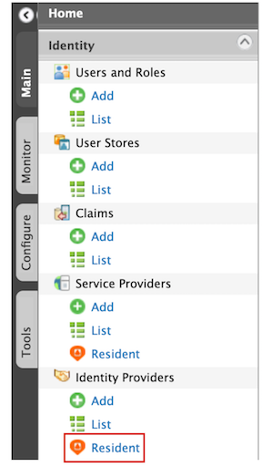
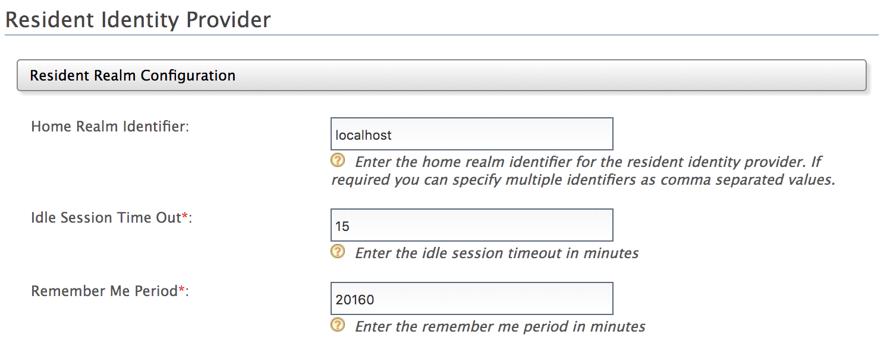
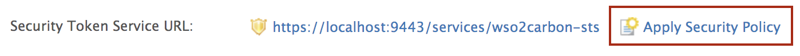
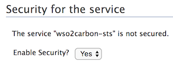
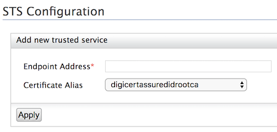

import RegisterAServiceProvider from '../../../../partials/register-a-service-provider.mdx';
import RunningAnStsClient from '../../../../partials/running-an-sts-client.mdx';

This page guides you through enabling authentication to a WS-Trust Security Token Service (STS) web application. 

---

This guide assumes you have your own application. If you wish to try out this flow with a sample application, click the button below. 

Try it with the sample

----

## Configure the resident IdP

1. Log in to the Management Console using admin/admin credentials. 

2. Click **Identity Providers > Resident**. 

    

3. Configure the following. 

    - **Home Realm Identifier**: This is the domain name of the identity provider. If you do not enter a value here, when an authentication request comes to WSO2 Identity Server, a user will be prompted to specify a domain. You can enter multiple identifiers as a comma-separated list.

    - **Idle Session Time Out**: This is the duration in minutes for which an SSO session can be idle for. If WSO2 Identity Server does not receive any SSO authentication requests for the given duration, a session time out occurs. 

    - **Remember Me Period**: This is the duration in weeks for which WSO2 Identity Server should remember an SSO session given that the **Remember Me** option is selected in the WSO2 Identity Server login screen.

        

----

## Configure STS for the IdP

1. Expand **Inbound Authentication Configuration > Security Token Service Configuration** and click **Apply Security Policy**.

    

2. Select **Yes** in the **Enable Security?** drop down and select a pre-configured security scenario according to your requirements. 

    

3. Click **Next**. 

4. The next step depends on the selected security scenario. Follow the wizard and click **Finish**. 

You have successfully configured and secured the Security Token Service. 

Next, configure the client application for WS-Trust STS.
----

<RegisterAServiceProvider />

----

## Configure STS for the client app

1. Expand **Inbound Authentication Configuration > WS-Trust Security Token Service Configuration** and click **Configure**.

2. Enter the **Endpoint Address** and the **Certificate Alias**. 

    - The **Endpoint Address** is the trusted relying party's endpoint address, which is the endpoint address of the Security Token Service. The endpoint must be used as the service URL to which the token gets delivered by the STS client.

    - The **Certificate Alias** is the name given to the CA certificate that is imported to the keystore.  

        

3. Click **Update** to save the changes. 

----

<RunningAnStsClient />

----

### Session Management

### ETC.
