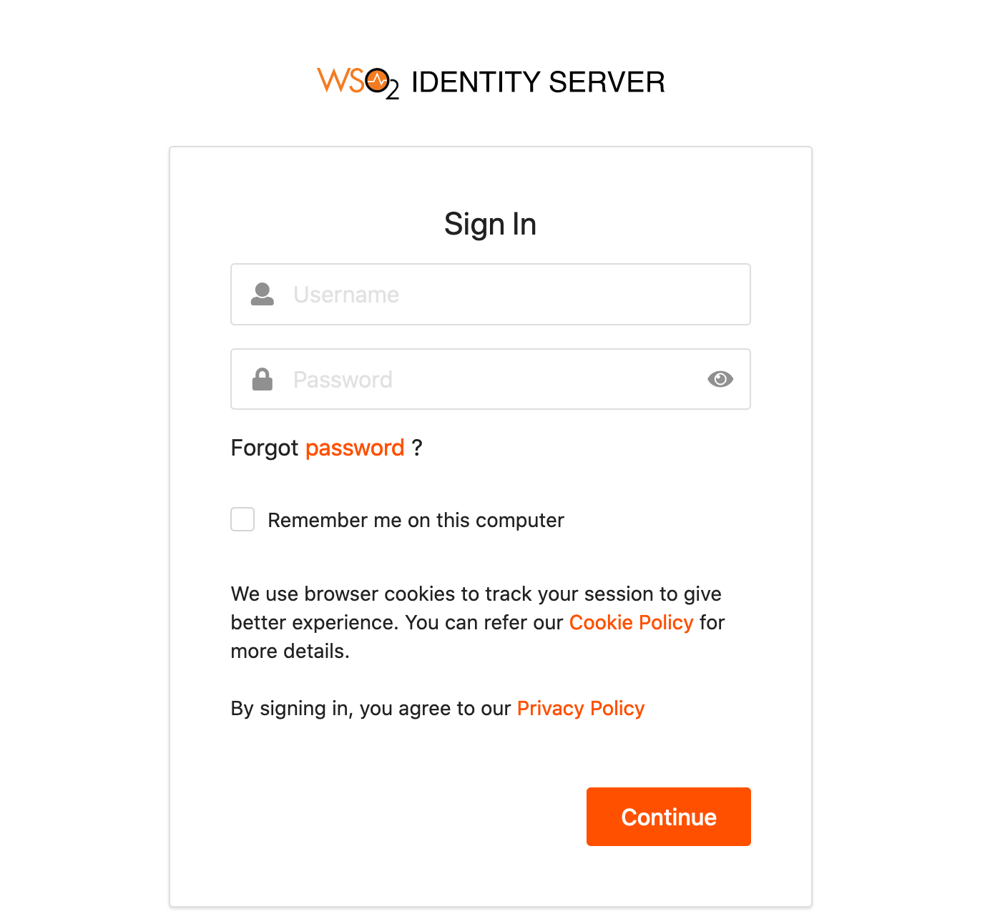

This page guides you through configuring password-based authentication for a web application as the first factor.

----

:::info
When you configure the authentication flow of a service provider, the `Username & Password` authenticator will be added as the first authentication step by default.
:::

1. Go to the My Account (`https://<HOST>:<PORT>/myaccount`) application.

2. Enter the **Username** and **Password** and log in.

:::info[Related topics]
- [Concept: Single Factor Authentication](../../../references/iam-topics/authentication/intro-authentication.mdx#single-factor-authentication)
- [Guide: Multi-Factor Authentication overview](./mfa-overview.mdx)
{/*- - [Quick Start: Multi-Factor Authentication]({{base_path}}/quickstarts/mfa-sample) */}
:::
