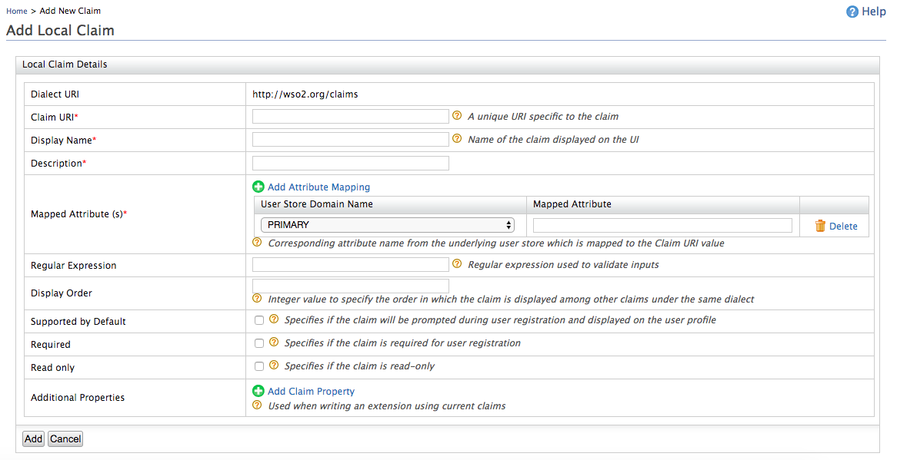
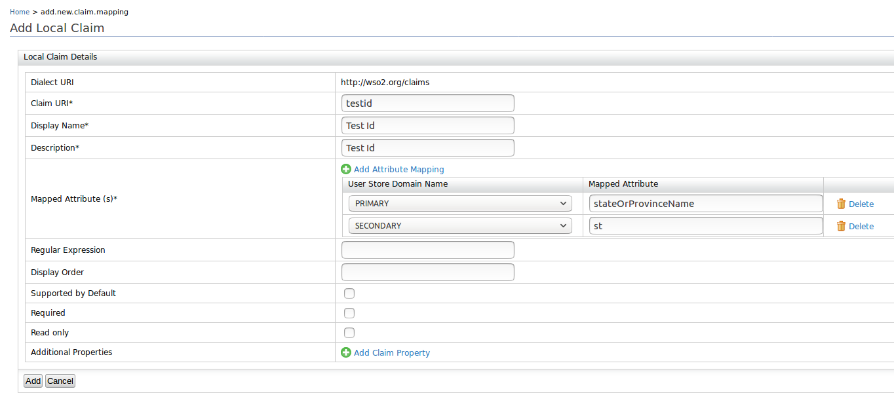
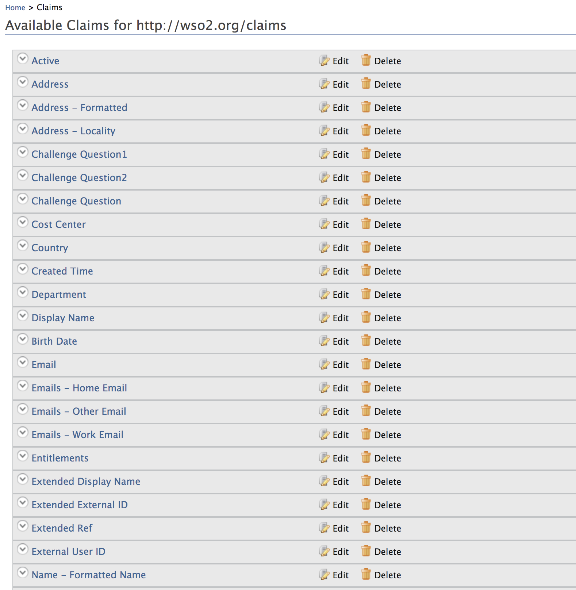
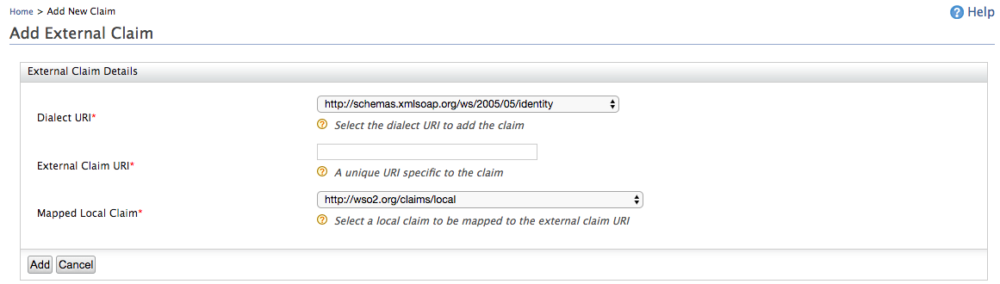

import ClaimConfigNote from '../../../partials/claim-config-note.mdx';

You can add new claim mappings to an existing [claim dialects](./add-claim-dialects.mdx). You can add either a new local claim or an external claim:

-   [Add Local Claim](#add-local-claim)
-   [Add External Claim](#add-external-claim)

---

## Use the management console

Use the options given below to add claim mappings from the management console.

### Add local claim

Follow the steps given below to add a new claim to the `https://wso2.org/claims` (local) claim dialect.

1.  Access the Management Console (`https://<IS_HOST>:<PORT>/carbon`).
2.  Go to **Main** > **Identity** > **Claims** and click **Add**.
3.  Click **Add Local Claim** to add a new claim to the
    `https://wso2.org/claims` (local) claim dialect.

4.  Enter the required information from the list given below.

     

    <table>
      <colgroup>
        <col style={{width: "50%"}} />
        <col style={{width: "50%"}} />
      </colgroup>
      <thead>
        <tr>
          <th>Claim details</th>
          <th>Description</th>
        </tr>
      </thead>
      <tbody>
        <tr>
          <td>**Claim URI**</td>
          <td>This is the URI defined under the dialect specific to the claim. There are different URIs available in WSO2 Identity Server and these are equal to user attributes displayed in the profile of users. These URIs are mapped to the attributes in the underlying user store.</td>
        </tr>
        <tr>
          <td>**Display Name**</td>
          <td>This is the name of the claim displayed on the UI. This can be viewed in the user's profile. You can navigate to the **Main** tab in the management console and click **List** in **Users and Roles**. In the resulting page, click **Users** and in the list of users that are displayed, click **User Profile** next to the one you wish to check.</td>
        </tr>
        <tr>
          <td>**Description**</td>
          <td>This gives you the option to describe the functionality of the claim.</td>
        </tr>
        <tr>
          <td>**Mapped Attribute**</td>
          <td>

            This is the corresponding attribute name from the underlying user store that is mapped to the Claim URI value.<br /> <br />

            When you have multiple user stores connected to WSO2 Identity Server, this maps the equivalent attribute in all of them to the Claim URI you are configuring.<br /> For example, if you specify the `cn` attribute, this is mapped to the `cn` attribute in all the connected user stores. If you want to specify the attribute in a specific user store, you must add the domain name in addition to the mapped claim. For example, in a scenario where you have a primary user store configured called PRIMARY and secondary user stores called AD (representing Active Directory), you can map an attribute from each of these user stores to the Claim URI value by clicking **Add Attribute Mapping**, selecting the respective user store from the drop-down list, and mentioning the attribute of the user store to which the attribute needs to be mapped.<br /> Example:<br /> 

          </td>
        </tr>
        <tr>
          <td>**Regular Expression**</td>
          <td>This is the regular expression used to validate inputs. Example : For a claim URI like `http://wso2.org/claims/email`, the regex should be something like " **^(\[a-zA-Z0-9_\\-\\.\]+)@(\[a-zA-Z0-9_\\-\\.\]+)\\.(\[a-zA-Z\]\{2,5\})$** ". This will validate the claim value and will not let other values except an email.</td>
        </tr>
        <tr>
          <td>**Display Order**</td>
          <td>This enables you to specify the order in which the claim is displayed among the other claims defined under the same dialect.</td>
        </tr>
        <tr>
          <td>**Supported by Default**</td>
          <td>If cleared, this claim will not be prompted during user registration.</td>
        </tr>
        <tr>
          <td>**Required**</td>
          <td>This specifies whether the claim is required for user registration.</td>
        </tr>
        <tr>
          <td>**Read-only**</td>
          <td>This specifies whether the claim is read-only or not. If the claim is read-only, it can't be updated by the user.</td>
        </tr>
        <tr>
          <td>**Additional Properties**</td>
          <td>These properties are not currently used in WSO2 Identity server. These property values are used to write extensions using current claims.</td>
        </tr>
      </tbody>
    </table>

5.  Click **Add** and view the new claim mapping on the list.  

    

----

### Add external claim

Follow the steps given below to add a new claim to any claim dialect other than the local (`https://wso2.org/claims`) dialect. To do this,
    map the relevant local claim from the local claim dialect (`https://wso2.org/claims`).

1.  Access the Management Console (`https://<IS_HOST>:<PORT>/carbon`).
2.  Go to **Main** > **Identity** > **Claims** and click **Add**.
3.  Click **Add External Claim** to add a new claim to any existing
    dialect other than the local dialect.
4.  Select the **Dialect URI** of the dialect you want to add the claim
    to and enter the required information.  

    

    | Parameter | Description |
    | --- | --- |
    | External Claim URI | This is the URI defined under the dialect specific to the claim. There are different URIs available in WSO2 Identity Server and these are equal to user attributes displayed in the profile of users. These URIs are mapped to local claims in the `https://wso2.org/claims` dialect, which are in turn mapped to the relevant attributes in the underlying user store. |
    | Mapped Local Claim | This is the claim that is defined in the local claim dialect (`https://wso2.org/claims`) that is mapped to the relevant attribute in the underlying user store. |

5.  Click **Add** to save the mapping.

## Use the configuration file

Alternatively, you can also add a claim mapping using the configuration file.

::::note
<ClaimConfigNote />

:::tip
The claims configured in the `<IS_HOME>/repository/conf/claim-config.xml` file get applied only when you start the product for the first time, or for any newly created tenants. With the first startup, claim dialects and claims will be loaded from the file and persisted in the database. Any consecutive updates to the file will not be picked up and claim dialects and claims will be loaded from the database.
:::
::::

1.  Open the `claim-config.xml` file found in the
    `<IS_HOME>/repository/conf/` folder and add the
    necessary claim mapping under the relevant claim dialect.

    A sample claim mapping is given below.

    ```xml
    <Claim>
        <ClaimURI>country</ClaimURI>
        <DisplayName>Country</DisplayName>
        <AttributeID>country</AttributeID>
        <Description>Country name component</Description>
        <MappedLocalClaim>http://wso2.org/claims/country</MappedLocalClaim>
    </Claim>
    ```

2.  Save the file and restart the server.
