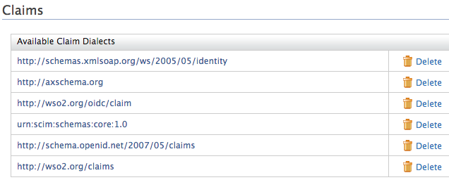
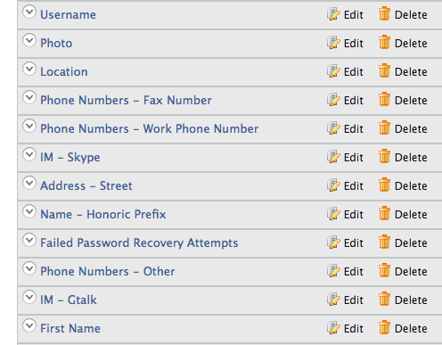
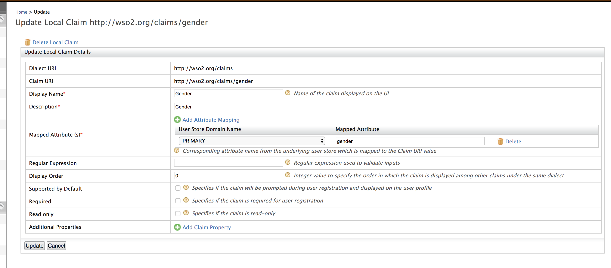
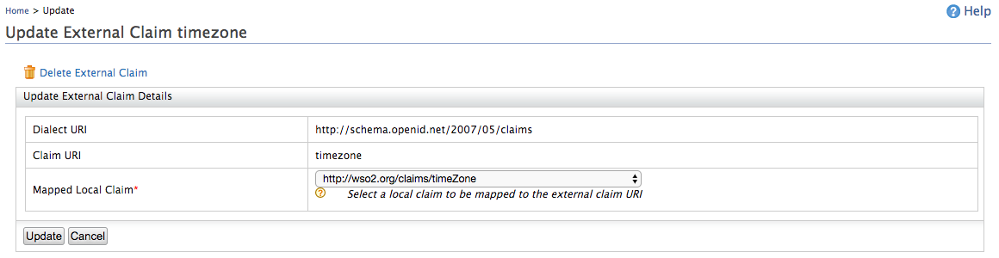

import ClaimConfigNote from '../../../partials/claim-config-note.mdx';

There are two ways to edit a claim mapping.

## Use the management console

Follow the steps given below to edit a claim mapping.

1.  Access the Management Console (`https://<IS_HOST>:<PORT>/carbon`).
2.  Go to **Main** > **Identity** > **Claims** and click  **List**.
3.  Click on any available dialect.  
    
4.  From the **Claim Dialect** view, you can view the claims defined for
    that particular dialect. 
    
5.  Click **Edit**, enter the new claim information in the required fields, and click **Update**.

    -   If you are editing a local claim, you will see the following:

         

    -   If you are editing an external claim, you will see the following:

        

## Use the configuration file

Alternatively, you can do this by editing claim mappings from the `claim-config.xml` file (located in the `<IS_HOME>/repository/conf/` folder).

:::note
<ClaimConfigNote />
:::

A sample claim mapping is given below.

```xml
<Claim>
    <ClaimURI>country</ClaimURI>
    <DisplayName>Country</DisplayName>
    <AttributeID>country</AttributeID>
    <Description>Country name component</Description>
    <MappedLocalClaim>http://wso2.org/claims/country</MappedLocalClaim>
</Claim>
```

:::info[Related topics]
-   [Guides: Configure Claims](./configure-claims.mdx)
-   [Concepts: Claim Management](../../references/wso2-is-concepts/claim-management.mdx)
:::
