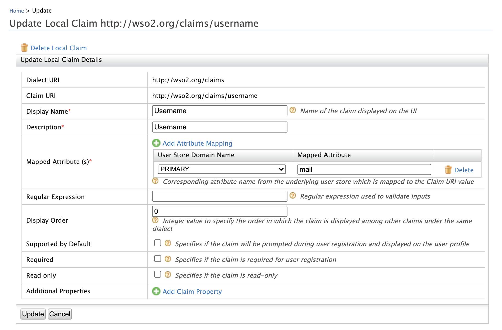

## Configure Email Address as the Username

:::warning
Configuring the email address as the username in an **already running
Identity Server** is not the production recommended way. Therefore,
**make sure to configure it before you begin working with WSO2 IS**.
:::

1. Log in to the Management Console and click **Claims > List > http://wso2.org/claims**.

2. Click the **Edit** link corresponding to the **Username** claim and configure the `Mapped Attribute` property to `mail`.

    

3. Click **Update** to save the changes.

4. Open the `<IS_HOME>/repository/conf/deployment.toml` file.

5. Add the following configuration to enable email authentication.

    ```toml
    [tenant_mgt]
    enable_email_domain= true
    ```

6. Configure the following set of parameters in the userstore
    configuration, depending on the type of userstore you are connected
    to (LDAP/Active Directory/ JDBC).
    <table>
      <thead>
        <tr>
          <th>Parameter</th>
          <th>Description</th>
        </tr>
      </thead>
      <tbody>
        <tr>
          <td>

            ` UserNameAttribute `

            <br />

          </td>
          <td>

            Set the mail attribute of the user. **LDAP/Active Directory only**

            ```text
            [user_store]user_name_attribute = "mail"
            ```

          </td>
        </tr>
        <tr>
          <td>` UserNameSearchFilter `</td>
          <td>

            Use the mail attribute of the user instead of ` cn ` or ` uid ` . **LDAP/Active Directory only** <br />For example:

            ```text
             In LDAP,[user_store]user_name_search_filter = `"(&(objectClass=person)(mail=?))"`  In Active Directory, [user_store]user_name_search_filter = `"(&(objectClass=user)(mail=?))"`
            ```

          </td>
        </tr>
        <tr>
          <td>` UserNameListFilter `</td>
          <td>

            Use the mail attribute of the user if **necessary. LDAP/Active Directory only** <br />For example:

            ```text
             In LDAP,[user_store]user_name_list_filter = `"(&(objectClass=person)(!(sn=Service)))"`  In Active Directory, [user_store]user_name_list_filter = `"(&(objectClass=user)(!(sn=Service)))"`
            ```

          </td>
        </tr>
        <tr>
          <td>` UsernameWithEmailJavaScriptRegEx `</td>
          <td>

            Change this property that is under the relevant userstore manager tag as follows. This property validates usernames when email is used as the username and allows special characters like "@" in the username.

            ```text
            [user_store.properties]UsernameWithEmailJavaScriptRegEx = '^[a-zA-Z0-9_@.+-]{5,200}$'
            ```

          </td>
        </tr>
        <tr>
          <td>` UsernameJavaRegEx `</td>
          <td>

            This is a regular expression to validate usernames. By default, strings have a length of 5 to 30. Only non-empty characters are allowed. You can provide ranges of alphabets, numbers and also ranges of ASCII values in the RegEx properties.

            ```text
            [user_store]username_java_regex = '^[a-zA-Z0-9._-]+@[a-zA-Z0-9.-]+\\.[a-zA-Z]{2,4}'
            ```

          </td>
        </tr>
        <tr>
          <td>Realm configurations</td>
          <td>

            The username must use the email attribute of the admin user.

            ```text
            [super_admin]username = "admin@wso2.com"password = "admin"
            ```

            :::note
            Before this configuration, the user having the username **admin** and password **admin** was considered the super administrator. The super administrator user cannot be deleted.

            After this configuration, the user having the username **` admin@wso2.com `** is considered the super administrator. The user having the username admin is considered as a normal administrator.<br /> 
            :::

          </td>
        </tr>
      </tbody>
    </table>

    :::info
    - With these configuration users can log in to super tenant with both
    email username (**`alex@gmail.com`**) or
    non-email usernames (`larry`). However, for tenants, only email usernames are allowed. (**`tod@gmail.com@wso2.com`**).
    - You can configure email username without enabling the **`enable_email_domain`** property (step 5). Then users can log in to both the super tenant and the tenant using email and non-email usernames. However, super tenant users should always use
    ***@carbon.super*** at the end of usernames.
    :::

7. Restart the server.
