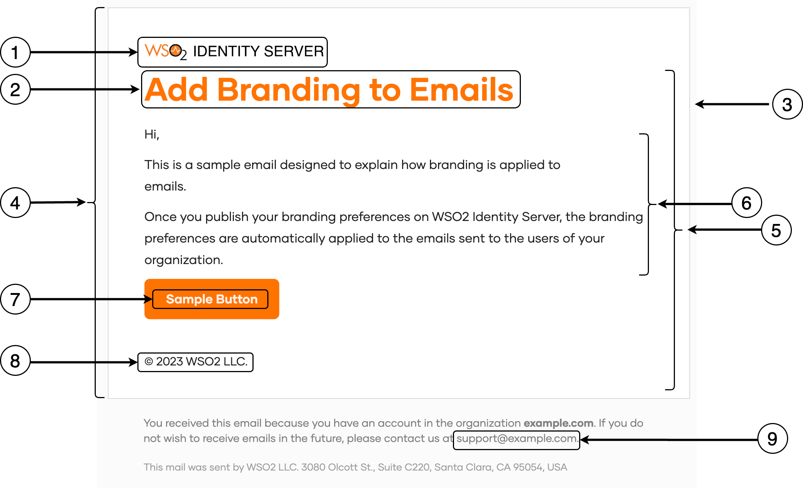

The following topics explain how you can customize email notifications that are sent to users of your {edition.productName} organization.

## Customize email branding

Once you publish your [branding preferences](./configure-ui-branding.mdx#general-preferences) on {edition.productName}, the branding preferences are automatically applied to emails sent to the users of your organization.

:::note[Email templates for B2B applications]
If you have set up [organizations](../../organization-management/manage-organizations.mdx), refer [email template inheritance](../../organization-management/customize-organizations/inheritance-in-organizations/email-sms-templates-inheritance.mdx) to see how email templates are inherited.
:::

The branding variables that affect the email templates are as follows:

<table>
  <tbody>
    <tr>
      <th></th>
      <th>Template variable</th>
      <th>Branding preference</th>
    </tr>
    <tr>
      <td rowSpan="2">1</td>
      <td>Organization Logo</td>
      <td>Design &gt; Theme Preferences &gt; Images &gt; Logo URL</td>
    </tr>
    <tr>
      <td>Logo alternative text</td>
      <td>Design &gt; Theme Preferences &gt; Images &gt; Logo Alt Text</td>
    </tr>
    <tr>
      <td>2</td>
      <td>Primary color</td>
      <td>Design &gt; Theme Preferences &gt; Color Palette &gt; Primary Color</td>
    </tr>
    <tr>
      <td>3</td>
      <td>Email background color</td>
      <td>Design &gt; Theme Preferences &gt; Color Palette &gt; Body Background &gt; Main Background Color</td>
    </tr>
    <tr>
      <td>4</td>
      <td>Email body color</td>
      <td>Design &gt; Theme Preferences &gt; Color Palette &gt; Surface Background &gt; Main Surface Background Color</td>
    </tr>
    <tr>
      <td>5</td>
      <td>Email font</td>
      <td>Design &gt; Theme Preferences &gt; Font &gt; Font Family</td>
    </tr>
    <tr>
      <td>6</td>
      <td>Email body font color</td>
      <td>Design &gt; Theme Preferences &gt; Color Palette &gt; Text Colors &gt; Primary Text Color</td>
    </tr>
    <tr>
      <td>7</td>
      <td>Email button font color</td>
      <td>Design &gt; Theme Preferences &gt; Buttons &gt; Primary Button &gt; Font Color</td>
    </tr>
    <tr>
      <td>8</td>
      <td>Copyright text</td>
      <td>General &gt; Copyright Text</td>
    </tr>
    <tr>
      <td>9</td>
      <td>Support email</td>
      <td>General &gt; Contact Email</td>
    </tr>
  </tbody>
</table>

## Customize email content

You can tailor the **subject**, **body**, and **footer** of email notifications to your preferences by following the steps below.

:::note
This feature is only available for the most frequently used email templates. You can customize [all available email templates](../../../references/notification-templates/email-templates.mdx) using the [Email Templates API](../../../apis/email-templates-rest-api/index.mdx).
:::

1. On the {edition.productName}, go to **Branding** > **Email Templates**.
2. Select the email template and the relevant locale that you wish to modify.

    :::note
    {edition.productName} gives you the option to automatically copy a template from one locale to another so that you don't have to create email templates from scratch. To do so, select a locale with an existing email template, switch over to the new locale and click confirm when the **Replicate content?** prompt appears.
    :::

    

3. Make your modifications in the **Content** tab and use the **Preview** tab for a real-time preview.

4. Click **Save** to publish your changes.

:::warning[Apply changes to user profiles]
To apply these changes to each user's profile in your organization:

1. Display the `local` attribute on the user's profile. Learn how to do so in [updating user attributes](../../users/attributes/user-attributes/manage-attributes.mdx).

2. Update the `local` attribute value with the [required locale code](./localization.mdx#supported-languages). The value should be updated by,

    - the admin, if the admin onboards the user to the organization.

    - the user, if the user self-registers to the organization.
:::

Alternatively, you can customize the content of email templates using the [Email Templates API](../../../apis/email-templates-rest-api/index.mdx) provided by {edition.productName}.
