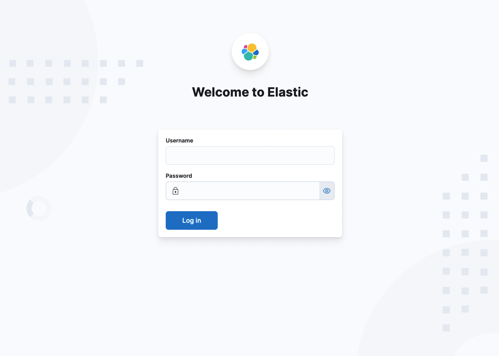
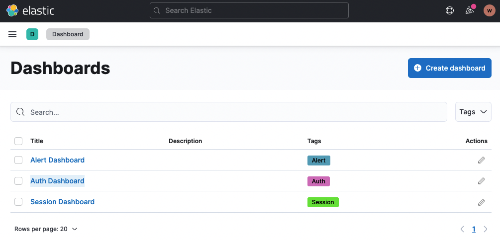
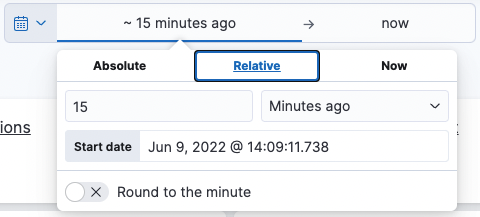
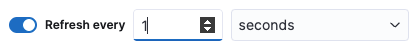
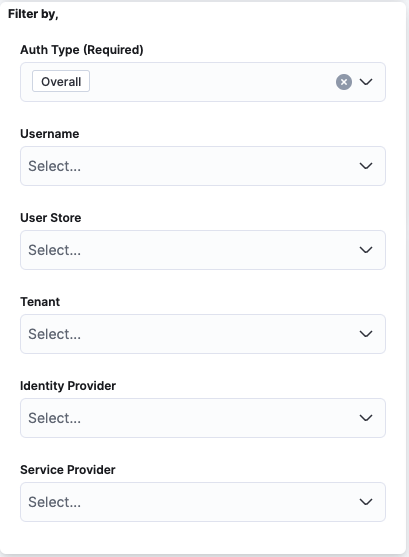

Once you have [setup ELK analytics dashboards](../../deploy/configure/analytics/elk-analytics-installation-guide.mdx), follow the guide below to learn how to access the analytics dashboard.

1.  Access Kibana using the following URL:
    http://&lt;KIBANA\_HOST&gt;:5601

     

2.  You can login to Kibana with the default `elastic` user or refer to the elastic [documentation](https://www.elastic.co/guide/en/elasticsearch/reference/current/users-command.html) and learn how to create a new user.

3.  On the left panel, navigate to **Analytics** > **Dashboard** and click on **Auth Dashboard**.  
     

    {/* Use the navigation panel to explore other dashboards and Kibana features. */}

    {/*   */}

4.  Use the filter to set the time range in which to view the statistics and click **Update**.

     

5.  To synchronize analytics automatically:
    1. Click the calendar icon in the time range filter.
    2. Toggle **Refresh every** at the bottom of the dropdown.
    3. Set your desired time interval.

        

6. You can use the following filters to narrow down your analytics further.

    

## What's Next?

Explore the following topics:

   -   [Analyze Login Attempts](./elk-analyzing-login-attempts.mdx)
   -   [Analyze Session Statistics](./elk-analyzing-session-statistics.mdx)