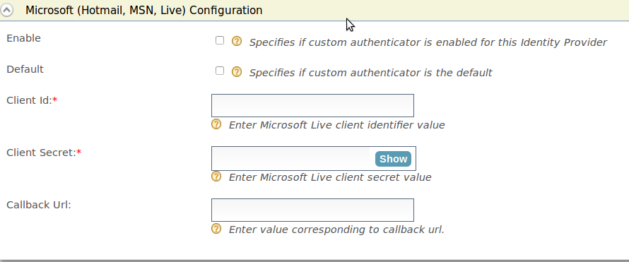

import RegisterAnIdentityProvider from '../../../../partials/register-an-identity-provider.mdx';

Microsoft login can be used as a federated authenticator in the
Identity Server.

Follow the steps given below to configure WSO2 Identity Server to
authenticate users with their Microsoft accounts.

## Register WSO2 Identity Server on Microsoft

You need to register WSO2 Identity Server as an OAuth2.0 application on Microsoft Entra ID.

:::note
For detailed instructions, you can follow the [Microsoft documentation](https://learn.microsoft.com/en-us/entra/identity-platform/quickstart-register-app).
:::

1. Sign in to the [Microsoft Entra admin center](https://entra.microsoft.com/) using an account with administrator permission.

    :::note
    You must use an account in the same Microsoft 365 subscription (tenant) with which you intend to register the app.
    :::

2. Go to **Identity** > **Applications** > **App registrations** and select **New registration**.

3. Click **Add** and select **App registration** from the list.

4. Provide the required information for app registration.

   

    | Parameter | Description |
    | --- | --- |
    | Name | Enter a meaningful name for your application. |
    | Supported Account Type | Select the supported account type.  **Value:** `Accounts in any organizational directory (Any Microsoft Entra ID tenant - Multitenant) and personal Microsoft accounts (e.g., Skype, Xbox)` |
    | Redirect URI | Select **Web** as the platform and provide the URL to redirect after the login is completed. **Value:** `{{ product_url_format }}/commonauth` |

5. Click **Register** to create the application.

    :::note
    Take note of the client ID after the application is created.
    :::

Now, let's generate a client secret for the application.

1. Go to **Certificates & secrets** on the left navigation and click **+ New client secret**.
2. Enter a description for the client secret and select the expiry time.
3. Click **Add** to add the client secret.

    :::note[Important]
    Take note of the generated **Value**. Microsoft Entra will allow copying this value only once. This value is the newly generated client secret for your Microsoft connection in WSO2 Identity Server.
    :::

<RegisterAnIdentityProvider />
4.  Expand the **Microsoft (Hotmail, MSN, Live) Configuration** section and specify the following values:  

    

    <table>
      <tbody>
        <tr>
          <th>Parameter</th>
          <th>Description</th>
        </tr>
        <tr>
          <td>Enable</td>
          <td>Selecting this option enables Microsoft to be used as an authenticator for users provisioned to the Identity Server.</td>
        </tr>
        <tr>
          <td>Default</td>
          <td>Selecting the **Default** checkbox signifies that Microsoft is the main/default form of authentication. This removes the selection made for any other **Default** checkboxes for other authenticators.</td>
        </tr>
        <tr>
          <td>Client Secret</td>
          <td>This is the password from the Yahoo application. Click **Show** to view the value you enter.</td>
        </tr>
        <tr>
          <td>Callback URL</td>
          <td>

            This is the URL to which the browser should be redirected after the authentication is successful. It should have this format: `https://(host-name):(port)/acs`.

            **Example**: `https://localhost:9443/commonauth`.

          </td>
        </tr>
        <tr>
          <td>Client Id</td>
          <td>This is the username from the Microsoft application.</td>
        </tr>
      </tbody>
    </table>
