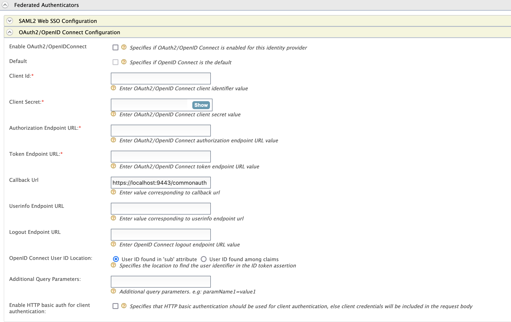

import RegisterAnIdentityProvider from '../../../partials/register-an-identity-provider.mdx';

Yahoo can be used as a federated authenticator in WSO2 Identity
Server. 

Follow the steps given below to configure the Identity Server to
authenticate users using their Yahoo user accounts.

## Create a Yahoo app

1.  [Create a Yahoo developer account](https://developer.yahoo.com/oauth2/guide/openid_connect/getting_started.html#getting-started-setup=).
2.  You need to have an application registered in Yahoo. 

    :::info
    See [Getting Started](https://developer.yahoo.com/oauth2/guide/openid_connect/getting_started.html) for instructions.
    :::

    

<RegisterAnIdentityProvider />
3. Expand the **OAuth2/OpenID Connect Configuration** section and specify the following values:

    <table>
      <tbody>
        <tr>
          <th>Parameter</th>
          <th>Description</th>
        </tr>
        <tr>
          <td>Enable</td>
          <td>Selecting this option enables Yahoo to be used as an authenticator for users provisioned to WSO2 Identity Server.</td>
        </tr>
        <tr>
          <td>Default</td>
          <td>Selecting the **Default** checkbox signifies that Yahoo is the main/default form of authentication. This removes the selection made for any other **Default** checkboxes for other authenticators.</td>
        </tr>
        <tr>
          <td>Client Id</td>
          <td>This is the username from the Yahoo application.</td>
        </tr>
        <tr>
          <td>Client Secret</td>
          <td>This is the password from the Yahoo application. Click **Show** to view the value you enter.</td>
        </tr>
        <tr>
          <td>Authorization Endpoint URL</td>
          <td>

            This is a standard OAuth Authorization Endpoint URL of Yahoo.

            `https://api.login.yahoo.com/oauth2/request_auth`.

          </td>
        </tr>
        <tr>
          <td>Token Endpoint URL</td>
          <td>

            This is a standard OAuth Token Endpoint URL of Yahoo.

            `https://api.login.yahoo.com/oauth2/get_token`.

          </td>
        </tr>
        <tr>
          <td>Callback URL</td>
          <td>

            This is the URL to which the browser should be redirected after the authentication is successful. It should have this format: `https://(host-name):(port)/commonauth`.

            **Example**: `https://localhost:9443/commonauth`.

          </td>
        </tr>
        <tr>
          <td>Userinfo Endpoint URL</td>
          <td>

            This is a standard UserInfo Endpoint URL of Yahoo.

            `https://api.login.yahoo.com/openid/v1/userinfo`.

          </td>
        </tr>
      </tbody>
    </table>