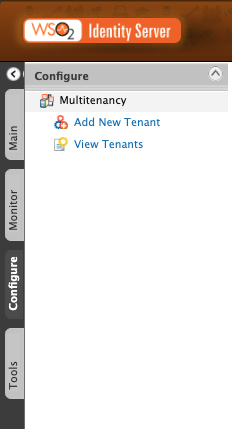
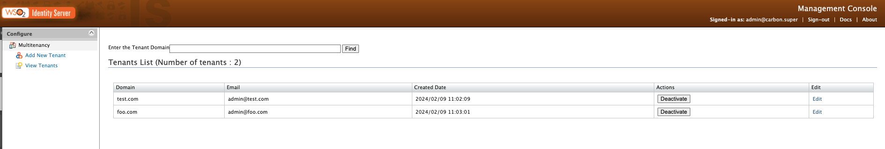

By default,  {edition.productName} is configured with a single tenant named `carbon.super`. If you have the required permissions, you can configure more tenant domains and maintain multiple isolated user bases on a single server/cluster at the same time.

:::info
Learn more about [multi-tenancy](./index.mdx).
:::

## Add new tenants

Follow the steps given below to add a new tenant from the Management Console.

:::note
You can access the Management Console using the following URL: `https://<hostname>:<port>/carbon`.
:::

1.  Sign in to the super tenant on the Management Console.

    :::info
    To add and manage tenants using the Management Console, you need to be signed in as a super user.
    :::

2.  Go to **Configure** > **Multitenancy** and click **Add New Tenant**.

    

3.  On the **Register A New Organization** page that opens, enter the tenant details and click **Save**.

    | Parameter Name | Description |
    | --- | --- |
    | `Domain` | The domain name (e.g., abc.com), which is used as a unique identifier for your domain. You can use it to sign in to the Management Console to be redirected to your specific tenant. The domain is also used in URLs to distinguish one tenant from another. |
    | `Select Usage Plan for Tenant` | The usage plan defines limitations (such as the number of users, bandwidth, etc.) for the tenant. |
    | `First Name` / `Last Name` | The name of the tenant admin. |
    | `Admin Username` | The sign-in username of the tenant admin. The username always ends with the domain name (e.g., admin@abc.com). |
    | `Admin Password` | The password used to sign in using the admin username specified. |
    | `Admin Password (Repeat)` | Repeat the password to confirm. |
    | `Email` | The email address of the admin. |

4. Once a new tenant is created, the tenant details appear in the **Tenants List** as shown below.

## View tenant details

To view tenant details, follow the steps given below.

1. Sign in to the super tenant on the Management Console.
2. Go to **Configure** > **Multitenancy** and click **View Tenants**.

    :::info
    You will see information of all the tenants that currently exist in the system. 
    :::

3. If you want to view only tenants of a specific domain, enter the domain name and click **Find**.

:::note
To try out the Tenant Management REST API, refer [here](../../apis/tenant-management-rest-api/index.mdx).
:::
