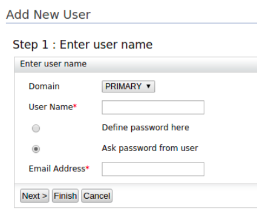
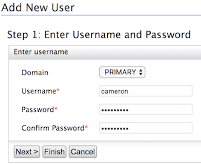

Administrators can add new users in a tenant by manually registering the user details from the management console.

## Use the management console

1. Log in to the WSO2 Identity Server Management Console (`https://<IS_HOST>:<PORT>/carbon`) using administrator credentials (`admin:admin`).

2. Navigate to **Main** > **Identity** > **Users and Roles** > **Add**.

3.  Click **Add New User**.

    

3. In the **Domain** list, select the user store in which you want to create this user account (e.g., `Primary`). This list includes the user stores you have configured. 

4. Enter a unique username and password. These are the credentials that the user will use to log in. 

    :::note
    Note that by default, the password must be atleast 5 characters.
    :::

    

5. Click **Finish** or you can click **Next** to assign the user to a specific role. For more information about assigning a role, see the next section. 

---

## Use the SCIM 2.0 REST API

You can create a new user using a SCIM 2.0 request as shown below. 

**Request**

```bash
curl -v -k --user [username]:[password] --data '{"schemas":[],"name":{"familyName":[last name],"givenName":[name]},"userName":[username],"password":[password],"emails":[{"primary":[true/false],"value":[email address],"type":[home/work]},{"value":[email address 2],"type":[home/work]}]}--header "Content-Type:application/json" https://localhost:9443/scim2/Users
```

Below is a sample request to create a user and its corresponding response using SCIM 2.0. 

:::info
**Sample Request**
```text
curl -v -k --user admin:admin --data '{"schemas":[],"name":{"familyName":"jackson","givenName":"kim"},"userName":"kim","password":"kimwso2","emails":[{"primary":true,"value":"kim.jackson@gmail.com","type":"home"},{"value":"kim_j@wso2.com","type":"work"}]}' --header "Content-Type:application/json" https://localhost:9443/scim2/Users
```
---
**Sample Response**
```text
{
    "emails":[
        {
            "type":"home",
            "value":"kim.jackson@gmail.com",
            "primary":true
        },
        {
            "type":"work",
            "value":"kim_j@wso2.com"
        }
    ],
    "meta":{
        "created":"2018-08-15T14:55:23Z",
        "location":"https://localhost:9443/scim2/Users/c8c821ba-1200-495e-a775-79b260e717bd",
        "lastModified":"2018-08-15T14:55:23Z",
        "resourceType":"User"
    },
    "schemas":[
        "urn:ietf:params:scim:schemas:core:2.0:User",
        "urn:ietf:params:scim:schemas:extension:enterprise:2.0:User"
    ],
    "name":{
        "familyName":"jackson",
        "givenName":"kim"
    },
    "id":"c8c821ba-1200-495e-a775-79b260e717bd",
    "userName":"kim"
}
```
:::

:::info[Related topics]
- [Guide: Invitation Workflow](./invitation-workflow.mdx) 
- [Guide: User Self Registration Workflow](./self-registration-workflow.mdx)
 - [Guide: Just in Time User Provisioning Workflow](../../../references/wso2-is-concepts/identity-federation/configure-an-idp/jit-workflow.mdx)
- [Guide: Bulk Import Users](./bulk-import-users.mdx)
- [Guide: Outbound Provisioning](../provisioning/outbound-provision-users/outbound-provisioning.mdx)
- [Concept: Users](../../../references/wso2-is-concepts/user-management/users.mdx)
{/*- [Guide: Email Templates](TODO:dev-portal-link)-*/}
:::