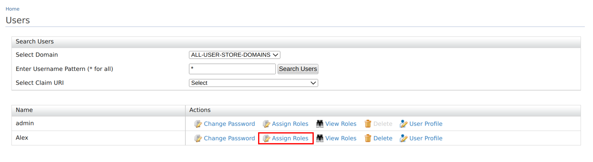
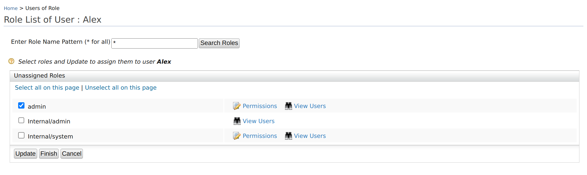
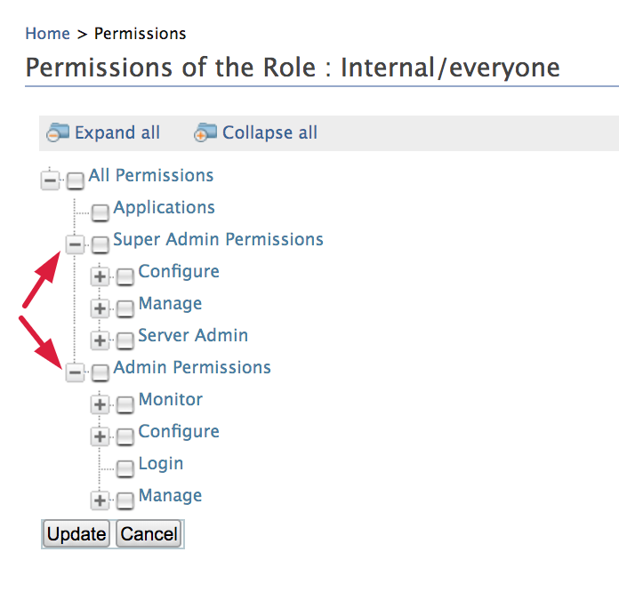
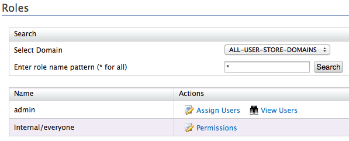
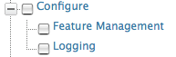
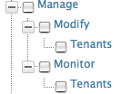
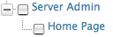

Permission can be granted to a role at two levels:

- **Super tenant level:** A role with super tenant permissions is used for managing all the tenants in the system and also for managing the key features in the system which are applicable to all the tenants.

- **Tenant level:** A role with tenant-level permissions is only applicable to individual tenant spaces.

You need to first have roles created in your tenant with the required permissions. You can then assign the role to users.

Users with the `admin` role are granted all permissions by default. Let's see how to configure a user with `admin` permissions.

## Configure admin permissions for a user

:::note[Prerequisites]
You need to [create a new user](../identity-lifecycles/admin-creation-workflow.mdx) on the management console.
:::

To configure admin permissions for a user:

1. On the Management Console, go to **Users and Roles > List > Users**.
2. Click **Assign Roles** to assign all administrative permissions for the created user.
    
3. Select **admin** and click **Update**.
    

The user will be granted login permissions for the management console along with other admin permissions. See the complete list of [access permissions](#access-permissions) given below.

## Access permissions

The permissions navigator that you use to enable permissions for a role is divided into two categories (**Super Admin** permissions and **Admin** permissions), as shown below. However, note that there may be other categories of permissions enabled for a WSO2 product depending on the type of features that are installed in the product.

You can access the permissions navigator for a particular role by clicking **Permissions** as shown below.  

By default, every WSO2 Identity Server comes with the default [user](../../../references/wso2-is-concepts/user-management/users.mdx) and [role](../../../references/wso2-is-concepts/user-management/roles-and-permissions.mdx).

- The **Admin** role has all the permissions in the system enabled by default. Therefore, this is a super tenant with all permissions enabled.

    :::tip
    You can change the default role name '**admin**' of the Administrative role as described [here](./edit-delete-roles.mdx)
    :::

You can create new users and roles and configure permissions for the roles using the management console. However, note that you cannot modify the permissions of the **Admin** role. The possibility of managing users, roles, and permissions is granted by the **User Management** permission.

## Permissions

The descriptions of permissions in the **Permissions** navigator are as follows:

- The **Login** permission defined under **Admin** permissions allows users to log in to the product's management console. Therefore, this is the primary permission required for using the management console.

- The following table describes the permissions at the **Super Tenant** level. These are also referred to as **Super Admin** permissions.

    <table>
      <colgroup>
        <col style={{width: "50%"}} />
        <col style={{width: "50%"}} />
      </colgroup>
      <thead>
        <tr>
          <th>Permission</th>
          <th>Description of UI menus enabled</th>
        </tr>
      </thead>
      <tbody>
        <tr>
          <td>**Configuration** permissions:  </td>
          <td>The **Super Admin/Configuration** permissions are used to grant permission to the key functions in a product server, which is common to all the tenants. In each WSO2 product, several configuration permissions will be available depending on the features installed in the product.    **- Feature Management** permission ensures that a user can control the features installed in the product using the management console. That is, the **Features** option will be enabled under the **Configure** menu.  **- Logging** permission enables the possibility to configure server logging from the management console. That is, the **Logging** option will be enabled under the **Configure** menu.</td>
        </tr>
        <tr>
          <td>**Management** permissions:  </td>
          <td>

            The **Super Admin/Manage** permissions are used for adding new tenants and monitoring them.

            **- Modify/Tenants** permission enables the **Add New Tenant** option in the **Configure** menu of the management console, which allows users to add new tenants.  **- Monitor/Tenants** permission enables the **View Tenants** option in the **Configure** menu of the management console.

          </td>
        </tr>
        <tr>
          <td>**Server Admin** permissions:  </td>
          <td>Selecting the **Server Admin** permission enables the **Shutdown/Restart** option in the **Main** menu of the management console.</td>
        </tr>
      </tbody>
    </table>

- The following table describes the permissions at the **Tenant** level. These are also referred to as **Admin** permissions.

    :::info
    Note that when you select a node in the **Permissions** navigator, all the subordinate permissions that are listed under the selected node are also automatically enabled.
    :::

    :::note
    Also, not all permissions in the permission tree are listed here. You can get the information related to them throughout the documentation wherever applicable.
    :::

    <table>
      <colgroup>
        <col style={{width: "50%"}} />
        <col style={{width: "50%"}} />
      </colgroup>
      <thead>
        <tr>
          <th>Permission level</th>
          <th>Description of UI menus enabled</th>
        </tr>
      </thead>
      <tbody>
        <tr>
          <td>Admin</td>
          <td>

            When the **Admin** permission node is selected, the following menus are enabled in the management console:

            **- User Store Management:** This permission allows users to add new user stores and manage them with the management console. Note that only secondary user stores can be added using this option. See the topic on [user store management](../../../deploy/configure/deploy/configure-user-stores/configure-user-stores.mdx) for more details.  **- Identity Providers:**

            \- All permissions listed under **Admin** in the permissions navigator are selected automatically.

          </td>
        </tr>
        <tr>
          <td>Admin/Configure</td>
          <td>When the **Admin/Configure** permission node is selected, the following menus are enabled in the management console:  **  - Main** menu **/PAP:** - Main menu **/PDP:** - Tools menu **/Tryit (XACML):** - All permissions listed under **Configure** in the permissions navigator are selected automatically.</td>
        </tr>
        <tr>
          <td>Admin/Configure/Security</td>
          <td>When the **Admin/Configure/Security** permission node is selected, the following menus are enabled in the **Configure** menu of the management console:    **- Claim Management:** See the topic on [claim management](../../claim-management/configure-claims.mdx) for details on how to use this option.  **- Keystores:** See the topic on [keystores](../../../deploy/deploy/encryption/asymmetric-encryption/create-new-keystores.mdx) for details on how to use this option. ** ** **- Email Templates:** See the topics on [email templates](../../../deploy/configure/email-notifications/customize-automated-mails.mdx) for details on how to use this option.    - This permission will also enable the **Roles** option under **Configure/Users and Roles** . See the topics on configuring Users, and [roles](./manage-roles-overview.mdx) for more information.    - Additionally, all permissions listed under **Security** in the permissions navigator are selected automatically.</td>
        </tr>
        <tr>
          <td>Admin/Configure/Security/Identity Management/User Management</td>
          <td>This permission allows adding users from the management console. That is, the **Users** option will be enabled under **Configure/Users and Roles** .</td>
        </tr>
        <tr>
          <td>Admin/Configure/Security/Identity Management/Password Management</td>
          <td>This permission enables the **Change Password** option for the users listed in the **User Management/Users and Roles/Users** screen, which allows the logged-in user to change the passwords</td>
        </tr>
        <tr>
          <td>Admin/Configure/Security/Identity Management/Profile Management</td>
          <td>This permission enables the **User Profile** option for the users listed in the **User Management/Users and Roles/Users** screen, which allows the logged-inuser to update user profiles.</td>
        </tr>
        <tr>
          <td>Admin/Manage</td>
          <td>When the **Admin/Manage** permission is selected, the following menus will be enabled in the management console:    **- Main** menu **/Service Providers:** **- Tools** menu **/SAML:**   - Additionally, all permissions listed under **Admin/Manage** in the permissions navigator will be enabled automatically.</td>
        </tr>
        <tr>
          <td>Admin/Manage/Resources/Browse</td>
          <td>This permission enables the **Browse** option under the **Registry** menu in the main navigator. This option allows users to browse the resources stored in the registry using the **Registry** tree navigator. ** **</td>
        </tr>
        <tr>
          <td>Admin/Manage/Search</td>
          <td>This permission enables the **Search** option under the **Registry** sub-menu in the **Main** menu. This option allows users to search for specific resources stored in the registry by filling in the search criteria. ** **</td>
        </tr>
        <tr>
          <td>Admin/Monitor</td>
          <td>When the **Admin/Monitor** permission node is selected, the following menus are enabled in the management console:    **- Monitor** menu **/System Statistics:** See the topic on [system statistics](../../../deploy/monitor/system-statistics.mdx) for information on how to use this option.    - Additionally, all permissions listed under **Admin/Monitor** in the permissions navigator will be enabled automatically.</td>
        </tr>
        <tr>
          <td>Admin/Monitor/Logs</td>
          <td>When the **Admin/Monitor/Logs** permission node is selected, the following menus are enabled in the management console:    **- Monitor** menu **/Application Logs**  **- Monitor** menu **/System Logs**    See the topic on [system logs](../../../deploy/monitor/monitor-logs/monitor-logs.mdx) for information on how to use these options.</td>
        </tr>
      </tbody>
    </table>

{/* ## Manage role-based permissions using SOAP API

The following operations on permissions on roles are available through SOAP APIs.

### authorizeRole

<table>
<tr>
<th>Description</th>
<td>This operation authorizes the given role to perform the specified action on the given resource.</td>
</tr>
<tr>
<th>Input Parameters</th>
<td>
    <ul>
    <li><code>roleName</code>: This is the name of the role, e.g. <code>role1</code>.</li>
    <li><code>resourceId</code>: This is the resource path, e.g., <code>/permission/admin/login</code>.</li>
    <li><code>action</code>: This is the name of the action to be performed on the resource, e.g., <code>ui.execute</code>.</li>
    </ul>
</td>
</tr>
<tr>
<th>Request</th>
<td>
    

    <pre><code>&lt;soapenv:Envelope xmlns:soapenv="http://schemas.xmlsoap.org/soap/envelope/"
xmlns:ser="http://service.ws.um.carbon.wso2.org"&gt;
&lt;soapenv:Header/&gt;
&lt;soapenv:Body&gt;
&lt;ser:authorizeRole&gt;
&lt;!­­--Optional:­­--&gt;
&lt;ser:roleName&gt;role1&lt;/ser:roleName&gt;
&lt;!--­­Optional:­­--&gt;
&lt;ser:resourceId&gt;/permission/admin/login&lt;/ser:resourceId&gt;
&lt;!--­­Optional:­­--&gt;
&lt;ser:action&gt;ui.execute&lt;/ser:action&gt;
&lt;/ser:authorizeRole&gt;
&lt;/soapenv:Body&gt;
&lt;/soapenv:Envelope&gt;</code></pre>

</td>
</tr>
<tr>
<th>Response</th>
<td>No response on success</td>
</tr>
<tr>
<th>Error Codes</th>
<td>
    <ul>
    <li>Invalid data provided</li>
    <li>Error in connection rollback</li>
    <li>Error! DB error occurred while checking is existing system role for : <code>roleName</code> & tenant id : <code>tenantId</code></li>
    <li>Error! Error occurred while getting UI permission ID for resource id : <code>resourceId</code> & action : <code>action</code> </li>
    <li>Error! Error occurred while adding UI permission ID for resource id : <code>resourceId</code> & action : <code>action</code></li>
    <li>Error! Using sql : <code>sqlStmt</code></li>
    <li>Error! Error while authorizing role: roleName in permission tree for resource id: <code>resourceId</code> for action: <code>action</code></li>
    <li>Error! Error while denying role: roleName in permission tree for resource id: <code>resourceId</code> for action: <code>action</code></li>
    </ul>
</td>
</tr>
</table>

### clearAllRoleAuthorization

<table>
<tr>
<th>Description</th>
<td>This operation clears all authorizations of the role.</td>
</tr>
<tr>
<th>Input Parameters</th>
<td>
    <ul>
    <li><code>roleName</code>: This is the name of the role, e.g., <code>role1</code>.</li>
    </ul>
</td>
</tr>
<tr>
<th>Request</th>
<td>
    

    <pre><code>&lt;soapenv:Envelope xmlns:soapenv="http://schemas.xmlsoap.org/soap/envelope/"
xmlns:ser="http://service.ws.um.carbon.wso2.org"&gt;
&lt;soapenv:Header/&gt;
&lt;soapenv:Body&gt;
&lt;ser:clearAllRoleAuthorization&gt;
&lt;!­­--Optional:­­--&gt;
&lt;ser:roleName&gt;role1&lt;/ser:roleName>
&lt;/ser:clearAllRoleAuthorization&gt;
&lt;/soapenv:Body&gt;
&lt;/soapenv:Envelope&gt;</code></pre>

</td>
</tr>
<tr>
<th>Response</th>
<td>No response on success</td>
</tr>
<tr>
<th>Error Codes</th>
<td>
    <ul>
    <li>Error occurred while clearing role authorizations for role : <code>roleName</code></li>
    </ul>
</td>
</tr>
</table>

### clearResourceAuthorizations

<table>
<tr>
<th>Description</th>
<td>This operation clears all the authorizations for the given resource.</td>
</tr>
<tr>
<th>Input Parameters</th>
<td>
    <ul>
    <li><code>resourceId</code>: This is the resource path, e.g., <code>/permission/admin/login</code>.</li>
    </ul>
</td>
</tr>
<tr>
<th>Request</th>
<td>
    

    <pre><code>&lt;soapenv:Envelope xmlns:soapenv="http://schemas.xmlsoap.org/soap/envelope/"
xmlns:ser="http://service.ws.um.carbon.wso2.org"&gt;
&lt;soapenv:Header/&gt;
&lt;soapenv:Body&gt;
&lt;ser:clearResourceAuthorizations&gt;
&lt;!--­­Optional:­­--&gt;
&lt;ser:resourceId&gt;/permission/admin/login&lt;/ser:resourceId&gt;
&lt;/ser:clearResourceAuthorizations&gt;
&lt;/soapenv:Body&gt;
&lt;/soapenv:Envelope&gt;</code></pre>

</td>
</tr>
<tr>
<th>Response</th>
<td>No response on success</td>
</tr>
<tr>
<th>Error Codes</th>
<td>
    <ul>
    <li>Error occurred while clearing resource authorizations for resource id : <code>resourceId</code></li>
    </ul>
</td>
</tr>
</table>

### clearRoleActionOnAllResources

<table>
<tr>
<th>Description</th>
<td>This operation removes the authorization from the role to perform the specified action on all the resources.</td>
</tr>
<tr>
<th>Input Parameters</th>
<td>
    <ul>
    <li><code>action</code>: This is the action name of the action to be performed on the resource, e.g., <code>ui.execute</code>.</li>
    </ul>
</td>
</tr>
<tr>
<th>Request</th>
<td>
    

    <pre><code>&lt;soapenv:Envelope xmlns:soapenv="http://schemas.xmlsoap.org/soap/envelope/"
xmlns:ser="http://service.ws.um.carbon.wso2.org"&gt;
&lt;soapenv:Header/&gt;
&lt;soapenv:Body&gt;
&lt;ser:clearRoleActionOnAllResources&gt;
&lt;!--­­Optional:­­--&gt;
&lt;ser:action&gt;ui.execute&lt;/ser:action&gt;
&lt;/ser:clearRoleActionOnAllResources&gt;
&lt;/soapenv:Body&gt;
&lt;/soapenv:Envelope&gt;</code></pre>

</td>
</tr>
<tr>
<th>Response</th>
<td>No response on success</td>
</tr>
<tr>
<th>Error Codes</th>
<td>
    <ul>
    <li>Error occurred while clearing role action on all resources for role : <code>roleName</code> & action : <code>action</code></li>
    </ul>
</td>
</tr>
</table>

### clearRoleAuthorization

<table>
<tr>
<th>Description</th>
<td>This operation clears the authorization of the specified role to perform the given action on the resource.</td>
</tr>
<tr>
<th>Input Parameters</th>
<td>
    <ul>
    <li><code>roleName  </code>: This is the name of the role, e.g., <code>role1"</code>.</li>
    <li><code>resourceId</code>: This is the resource path e.g., <code>/permission/admin/login</code>.</li>
    <li><code>action</code>: This is the action name of the action to be performed on the resource, e.g., <code>ui.execute</code>.</li>
    </ul>
</td>
</tr>
<tr>
<th>Request</th>
<td>
    

    <pre><code>&lt;soapenv:Envelope xmlns:soapenv="http://schemas.xmlsoap.org/soap/envelope/"
xmlns:ser="http://service.ws.um.carbon.wso2.org"&gt;
&lt;soapenv:Header/&gt;
&lt;soapenv:Body&gt;
&lt;ser:clearRoleAuthorization&gt;
&lt;!­­--Optional:­­--&gt;
&lt;ser:roleName&gt;role1&lt;/ser:roleName&gt;
&lt;!--­­Optional:­­--&gt;
&lt;ser:resourceId&gt;/permission/admin/login&lt;/ser:resourceId>
&lt;!--­­Optional:­­--&gt;
&lt;ser:action&gt;ui.execute&lt;/ser:action&gt;
&lt;/ser:clearRoleAuthorization&gt;
&lt;/soapenv:Body&gt;
&lt;/soapenv:Envelope&gt;</code></pre>

</td>
</tr>
<tr>
<th>Response</th>
<td>No response on success</td>
</tr>
<tr>
<th>Error Codes</th>
<td>
    <ul>
    <li>Error occurred while clearing role authorizations for role : <code>roleName</code> + & resource id : <code>resourceId</code> & action : <code>action</code></li>
    </ul>
</td>
</tr>
</table>

### denyRole

<table>
<tr>
<th>Description</th>
<td>This operation removes the authorization of the role to perform the given action on the specified resource.</td>
</tr>
<tr>
<th>Input Parameters</th>
<td>
    <ul>
    <li><code>roleName  </code>: This is the name of the role, e.g., <code>role1</code>.</li>
    <li><code>resourceId</code>: This is the resource path, e.g., <code>/permission/admin/login</code>.</li>
    <li><code>action</code>: This is the action name of the action to be performed on the resource, e.g., <code>ui.execute</code>.</li>
    </ul>
</td>
</tr>
<tr>
<th>Request</th>
<td>
    

    <pre><code>&lt;soapenv:Envelope xmlns:soapenv="http://schemas.xmlsoap.org/soap/envelope/"
xmlns:ser="http://service.ws.um.carbon.wso2.org"&gt;
&lt;soapenv:Header/&gt;
&lt;soapenv:Body&gt;
&lt;ser:denyRole&gt;
&lt;!­­--Optional:­­--&gt;
&lt;ser:roleName&gt;role1&lt;/ser:roleName&gt;
&lt;!--­­Optional:­­--&gt;
&lt;ser:resourceId&gt;/permission/admin/login&lt;/ser:resourceId&gt;
&lt;!--­­Optional:­­--&gt;
&lt;ser:action&gt;ui.execute&lt;/ser:action&gt;
&lt;/ser:denyRole&gt;
&lt;/soapenv:Body&gt;
&lt;/soapenv:Envelope&gt;</code></pre>

</td>
</tr>
<tr>
<th>Response</th>
<td>No response on success</td>
</tr>
<tr>
<th>Error Codes</th>
<td>
    <ul>
    <li>Invalid data provided</li>
    </ul>
</td>
</tr>
</table>

### getAllowedRolesForResource

<table>
<tr>
<th>Description</th>
<td>This operation retrieves the list of authorized roles to perform the given action on the specified resource.</td>
</tr>
<tr>
<th>Input Parameters</th>
<td>
    <ul>
    <li><code>resourceId</code>: This is the resource path, e.g., <code>/permission/admin/login</code>.</li>
    <li><code>action</code>: This is the action name of the action to be performed on the resource, e.g., <code>ui.execute</code>.</li>
    </ul>
</td>
</tr>
<tr>
<th>Request</th>
<td>
    

    <pre><code>&lt;soapenv:Envelope xmlns:soapenv="http://schemas.xmlsoap.org/soap/envelope/"
xmlns:ser="http://service.ws.um.carbon.wso2.org"&gt;
&lt;soapenv:Header/&gt;
&lt;soapenv:Body&gt;
&lt;ser:getAllowedRolesForResource&gt;
&lt;!--­­Optional:­­--&gt;
&lt;ser:resourceId&gt;/permission/admin/login&lt;/ser:resourceId&gt;
&lt;!--­­Optional:­­--&gt;
&lt;ser:action&gt;ui.execute&lt;/ser:action&gt;
&lt;/ser:getAllowedRolesForResource&gt;
&lt;/soapenv:Body&gt;
&lt;/soapenv:Envelope&gt;</code></pre>

</td>
</tr>
<tr>
<th>Response</th>
<td>
    <pre><code>&lt;soapenv:Envelope xmlns:soapenv="http://schemas.xmlsoap.org/soap/envelope/"&gt;
&lt;soapenv:Body&gt;
&lt;ns:getAllowedRolesForResourceResponse xmlns:ns="http://service.ws.um.carbon.wso2.org"
xmlns:ax2599="http://core.user.carbon.wso2.org/xsd"
xmlns:ax2600="http://api.user.carbon.wso2.org/xsd"&gt;
&lt;ns:return&gt;admin&lt;/ns:return&gt;
&lt;ns:return&gt;myrole&lt;/ns:return&gt;
&lt;/ns:getAllowedRolesForResourceResponse&gt;
&lt;/soapenv:Body&gt;
&lt;/soapenv:Envelope&gt;</code></pre>
</td>
</tr>
<tr>
<th>Error Codes</th>
<td>
    <ul>
    <li>Error loading authorizations. Please check the database. Error message is + <code>errorMessage</code></li>
    <li>Error! Error while authorizing role: <code>roleName</code> in permission tree for resource id: <code>resourceId</code> for action: <code>action</code></li>
    <li>Error! Error while denying role: <code>roleName</code> in permission tree for resource id: resourceId for action: <code>action</code></li>
    </ul>
</td>
</tr>
</table>

### getAllowedUIResourcesForUser

<table>
<tr>
<th>Description</th>
<td>This operation retrieves the list of UI resources in the specified root patch for which the user has authorization.</td>
</tr>
<tr>
<th>Input Parameters</th>
<td>
    <ul>
    <li><code>userName</code>: This is the username of the specific user, e.g., <code>admin</code>.</li>
    <li><code>permissionRootPath</code>: This is the permission root path.</li>
    </ul>
</td>
</tr>
<tr>
<th>Request</th>
<td>
    

    <pre><code>&lt;soapenv:Envelope xmlns:soapenv="http://schemas.xmlsoap.org/soap/envelope/"
xmlns:ser="http://service.ws.um.carbon.wso2.org"&gt;
&lt;soapenv:Header/&gt;
&lt;soapenv:Body&gt;
&lt;ser:getAllowedUIResourcesForUser&gt;
&lt;!--­­Optional:­­--&gt;
&lt;ser:userName&gt;admin&lt;/ser:userName&gt;
&lt;!--­­Optional:­­--&gt;
&lt;ser:permissionRootPath&gt;/&lt;/ser:permissionRootPath&gt;
&lt;/ser:getAllowedUIResourcesForUser&gt;
&lt;/soapenv:Body&gt;
&lt;/soapenv:Envelope&gt;</code></pre>

</td>
</tr>
<tr>
<th>Response</th>
<td>
    <pre><code>&lt;soapenv:Envelope xmlns:soapenv="http://schemas.xmlsoap.org/soap/envelope/"&gt;
&lt;soapenv:Body&gt;
&lt;ns:getAllowedUIResourcesForUserResponse xmlns:ns="http://service.ws.um.carbon.wso2.org"
xmlns:ax2599="http://core.user.carbon.wso2.org/xsd"
xmlns:ax2600="http://api.user.carbon.wso2.org/xsd"&gt;
&lt;ns:return&gt;/permission&lt;/ns:return&gt;
&lt;ns:return&gt;/permission/admin/configure/&lt;/ns:return&gt;
&lt;ns:return&gt;/permission/admin/login/&lt;/ns:return&gt;
&lt;ns:return&gt;/permission/admin/manage/&lt;/ns:return&gt;
&lt;ns:return&gt;/permission/admin/monitor/&lt;/ns:return&gt;
&lt;ns:return&gt;/permission/protected/&lt;/ns:return&gt;
&lt;ns:return&gt;/permission/testlogin/&lt;/ns:return&gt;
&lt;/ns:getAllowedRolesForResourceResponse&gt;
&lt;/soapenv:Body&gt;
&lt;/soapenv:Envelope&gt;</code></pre>
</td>
</tr>
<tr>
<th>Error Codes</th>
<td>
    <ul>
    <li>Invalid Permission root path provided</li>
    <li>Error loading authorizations. Please check the database. Error message is <code>message</code></li>
    </ul>
</td>
</tr>
</table>

### isRoleAuthorized

<table>
<tr>
<th>Description</th>
<td>This operation checks whether the given role is authorized to perform the action on the specified resource.</td>
</tr>
<tr>
<th>Input Parameters</th>
<td>
    <ul>
    <li><code>roleName</code>: This is the name of the role, e.g., <code>role1</code>.</li>
    <li><code>resourceId</code>: This is the resource path, e.g., <code>/permission/admin/login</code>.</li>
    <li><code>action</code>: This is the action name of the action to be performed on the resource, e.g., <code>ui.execute</code>.</li>
    </ul>
</td>
</tr>
<tr>
<th>Request</th>
<td>
    

    <pre><code>&lt;soapenv:Envelope xmlns:soapenv="http://schemas.xmlsoap.org/soap/envelope/"
xmlns:ser="http://service.ws.um.carbon.wso2.org"&gt;
&lt;soapenv:Header/&gt;
&lt;soapenv:Body&gt;
&lt;ser:isRoleAuthorized&gt;
&lt;!­­--Optional:­­--&gt;
&lt;ser:roleName&gt;role1&lt;/ser:roleName&gt;
&lt;!--­­Optional:­­--&gt;
&lt;ser:resourceId&gt;/permission/admin/login&lt;/ser:resourceId&gt;
&lt;!--­­Optional:­­--&gt;
&lt;ser:action&gt;ui.execute&lt;/ser:action&gt;
&lt;/ser:isRoleAuthorized&gt;
&lt;/soapenv:Body&gt;
&lt;/soapenv:Envelope&gt;</code></pre>

</td>
</tr>
<tr>
<th>Response</th>
<td>
    <pre><code>&lt;soapenv:Envelope xmlns:soapenv="http://schemas.xmlsoap.org/soap/envelope/"&gt;
&lt;soapenv:Body&gt;
&lt;ns:isRoleAuthorized xmlns:ns="http://service.ws.um.carbon.wso2.org"&gt;
&lt;ns:return&gt;false&lt;/ns:return&gt;
&lt;/ns:isRoleAuthorized&gt;
&lt;/soapenv:Body&gt;
&lt;/soapenv:Envelope&gt;</code></pre>
</td>
</tr>
<tr>
<th>Error Codes</th>
<td>
    <ul>
    <li>Error loading authorizations. Please check the database. Error message is + <code>errorMessage</code></li>
    </ul>
</td>
</tr>
</table>

*/}

:::info[Related topics]
- [Concept: Roles and Permissions](../../../references/wso2-is-concepts/user-management/roles-and-permissions.mdx)
- [Guide: Edit/Delete Roles](./edit-delete-roles.mdx)
:::