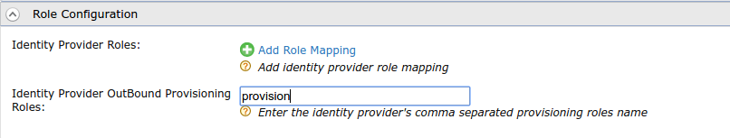
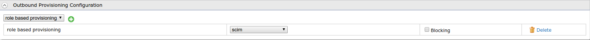

import RegisterAnIdentityProvider from '../../../../partials/register-an-identity-provider.mdx';
import ConfigureOutboundProvisioning from '../../../../partials/configure-outbound-provisioning.mdx';
import RemoveUsers from '../../../../partials/remove-users.mdx';

This page guides you through provisioning users {/*[provisioning users](TODO:link-to-concept)*/} based on the roles they are assigned to. With role-based provisioning, the user is provisioned when the user is added to a pre-configured role, and the user is deleted from the trusted identity provider when the user is removed from the role.

Follow the steps given below to configure role-based provisioning in WSO2 Identity Server. 

----

<RegisterAnIdentityProvider />

1.    Expand the **Outbound Provisioning Connectors** section and select
    [Google](./outbound-provision-users/outbound-provisioning-with-google.mdx),
    [SCIM](./outbound-provision-users/outbound-provisioning-with-scim.mdx)
    or [Salesforce connecter](./outbound-provision-users/outbound-provisioning-with-salesforce.mdx).
2.    Expand the **Role Configuration** section and enter a role name (or
    set of roles as a comma-separated list) for the **Identity Provider
    OutBound Provisioning Roles** field as seen below.  
    For this flow, a role named "provision" was created and has been
    entered here.

    :::info
    If you do not have roles already, see the [Add a User Role](../manage-roles/add-user-roles.mdx)
    topic to add roles.
    :::

    

3.  Click **Update** to save changes.

---

## Configure outbound provisioning

<ConfigureOutboundProvisioning />

1.  Click **Update** to save changes.

    

---

## Try it out

1.  Navigate to **Main** > **Identity** > **Users and Roles** > **Add**.
2.  Click **Add New User**. See [Configuring Users](../identity-lifecycles/admin-creation-workflow.mdx) for
    more information.
3.  Provide a username and a password(with confirmation) and click
    **Next**.
4.  Click **Finish** to create the user.

    :::note
    At this point, the user is **not** yet provisioned to the identity
    provider.
    :::

5.  On the **Main** tab in the management console, click **List** under
    **Users and Roles** in the **Identity** menu.
6.  Click **Users** and then click the **Assign Roles** action of the
    newly created user. Select the "provision" role (or any role added
    in the **Role Configuration** section of the identity provider) and
    click **Finish**.

    :::note
    The user is now provisioned to the identity provider.
    :::

---

## Remove users

<RemoveUsers />

:::info[Related topics]
 - [Concepts: Provisioning Framework](../../../references/iam-topics/concepts/provisioning-framework.mdx#outbound-provisioning)
 - [Guide: Rule-Based Provisioning](./rule-based-provisioning.mdx)
{/*- [Concept: Role-Based Provisioning](TODO:link-to-concept)*/}
:::
