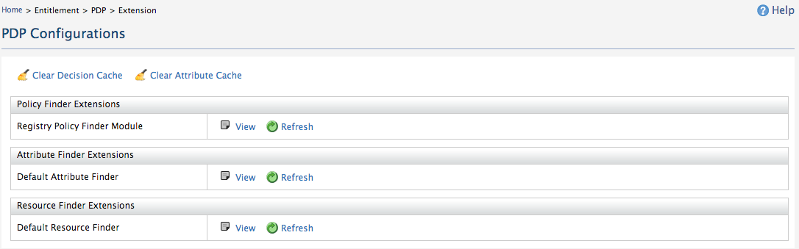

A cache is a temporary storage area which helps to store attribute
values and decision values during policy evaluation. This helps to
improve the performance of the XACML engine. Cache clearing should be
done during an "UPDATE" or "DELETE" of a policy. Once the cache is
cleared, all the temporary values will be deleted and the policy will be
re-evaluated.

:::info[For more details]
Refer [Improving XACML PDP Performance with Caching
Techniques](../../working-with-xacml/improving-xacml-pdp-performance-with-caching-techniques.mdx)
to get more information about caching techniques used in WSO2 Identity
Server.
:::

WSO2 Identity Server allows you to clear the decision cache and the
attribute cache. Follow the instructions below to clear a cache.

1.  Sign in. Enter your username and password to log on to the
    [Management Console](../../../../../setup/install/getting-started-with-the-management-console/getting-started-with-the-management-console.mdx).
2.  Navigate to the **Main** menu to access the **Entitlement** menu.
    Click **Extension** under **PDP**.
3.  Click on **Clear Decision Cache** or **Clear Attribute Cache**.  
    
4.  Wait a moment while the cache is cleared.
