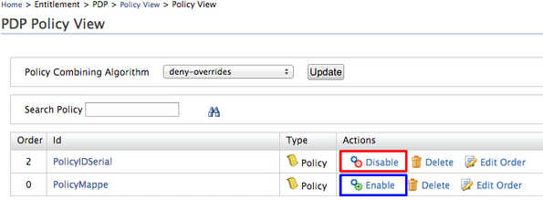

This topic provides instructions on how to enable or disable a XACML
policy that has been published to the PDP.

See [Publishing a XACML Policy](../configuring-the-policy-administration-point/publishing-a-xacml-policy.mdx) for
information on how to enable or disable a policy before it is published
to the PDP.

Follow the instructions below to enable/disable a XACML policy.

1.  Sign in. Enter your user name and password to log in to the
    [Management Console](../../../../../setup/install/getting-started-with-the-management-console/getting-started-with-the-management-console.mdx).
2.  Navigate to the **Main** menu to access the **Entitlement** menu.
    Click **Policy View** under **PDP**.
3.  Locate the policy you want to enable/disable in the list of policies
    published to PDP. Click on **Enable** to activate the policy and
    click on **Disable** to deactivate the policy.  
    
