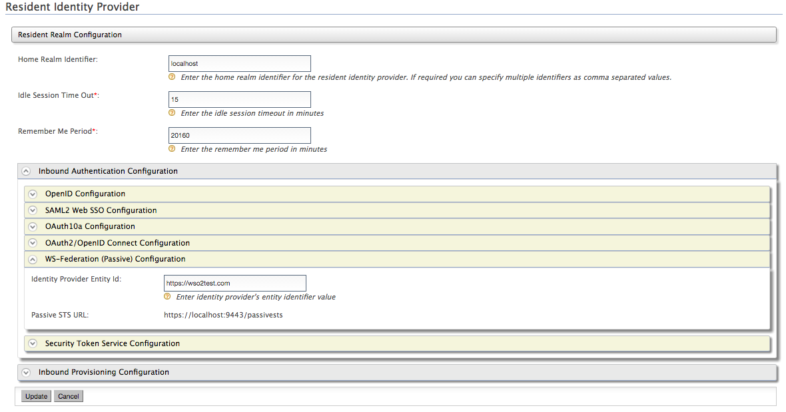
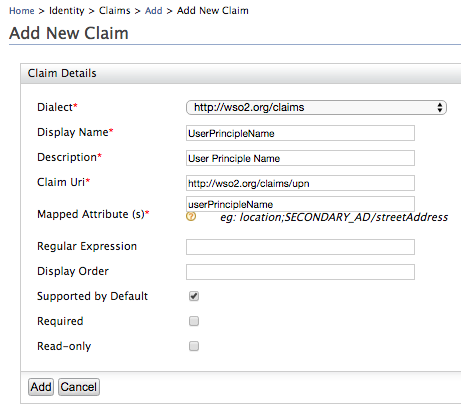
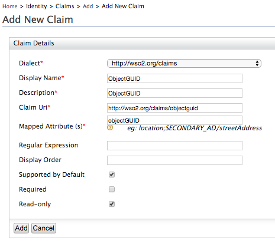
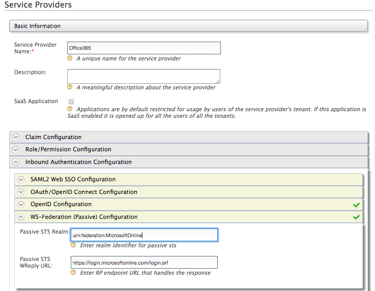
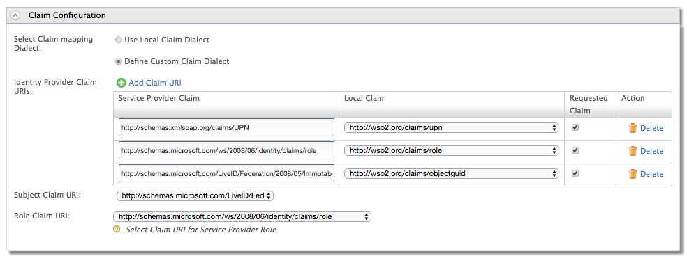
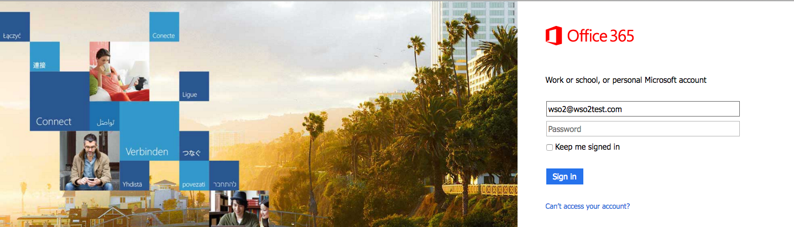
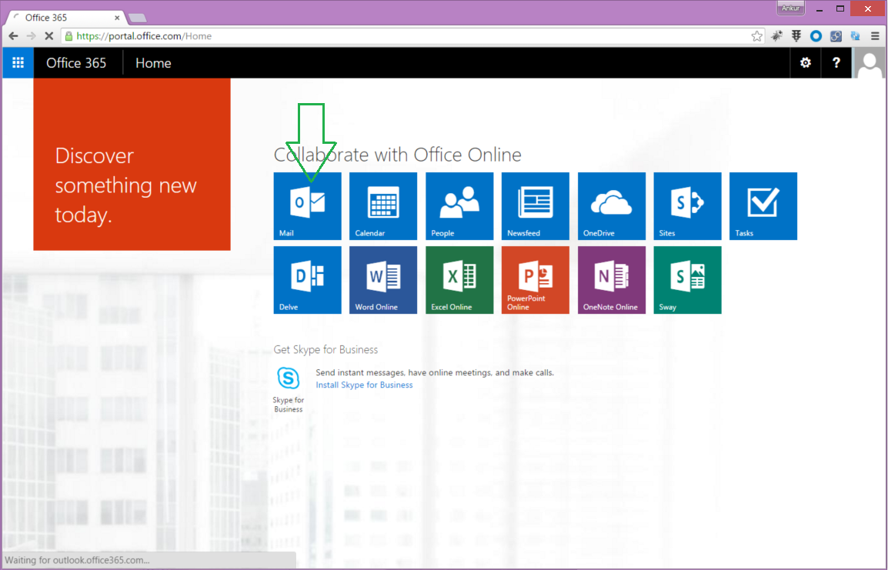

This section provides instructions on configuring the WSO2 Identity
Server for WS-Federation with Office 365. The following sections guide
you through this process.

### Prerequisites

-   Configure Azure Active Directory (AD) to trust WSO2 Identity Server.
    For more information on how to do this, see [Configuring Azure
    Active Directory toTrust WSO2 Identity
    Server](./configuring-azure-active-directory-to-trust-wso2-identity-server.mdx).
-   Configure an Active Directory user store as the primary user store
    in WSO2 Identity Server. For more information on how to do this, see
    [Configuring a Read-write Active Directory User
    Store](../../../../setup/deploy/data-stores/working-with-users-roles-and-permissions/configuring-the-user-realm/configuring-user-stores/configuring-the-primary-user-store/configuring-a-read-write-active-directory-user-store.mdx).  
-   Configure WSO2 Identity Server to authenticate users using the email
    address as the username. For more information on how to do this, see
    [Using Email Address as the
    Username](../../../using-wso2-identity-server/identity-administration-and-provisioning/using-email-address-as-the-username.mdx).

Azure AD expects to receive the following attributes with a SAML 2.0
message.

<table>
  <thead>
    <tr>
      <th>Claim</th>
      <th>Claim URI</th>
      <th>Purpose</th>
    </tr>
  </thead>
  <tbody>
    <tr>
      <td>

        UserPrincipal

      </td>
      <td>

        [http://schemas.xmlsoap.org/claims/UPN](http://schemas.xmlsoap.org/claims/UPN)

      </td>
      <td>

        This must be the email address of the Office365 user. Usually this is the userPrincipalName attribute in AD. Basically this is the login username that a user tries out to login for Office365. It should match with the domain name. (ex: [wso2@wso2test.com](mailto:wso2@wso2test.com) ).<br />

        :::note
        Since this attribute requires an email address as the username, make sure you have configured the IS to authenticate users using the email address. See [Using Email Address as the Username](../../../using-wso2-identity-server/identity-administration-and-provisioning/using-email-address-as-the-username.mdx) for more information.
        :::

      </td>
    </tr>
    <tr>
      <td>

        ImmutableID

      </td>
      <td>

        [http://schemas.microsoft.com/LiveID/Federation/2008/05/ImmutableID](http://schemas.microsoft.com/LiveID/Federation/2008/05/ImmutableID)

      </td>
      <td>

        This is the Immutable ID that is set by the Azure AD sync service out of the box. If you use a different value, then this claim must be populated with that value for each user. So in this case we will use the ObjectGUID attribute in AD which is unique per user

      </td>
    </tr>
    <tr>
      <td>

        Role

      </td>
      <td>

        [http://schemas.microsoft.com/ws/2008/06/identity/claims/role](http://schemas.microsoft.com/ws/2008/06/identity/claims/role)

      </td>
      <td>

        The URI for a claim that specifies the role of a Windows user

      </td>
    </tr>
  </tbody>
</table>

### Configuring Office 365 WS-Federation

1.  Start the WSO2 Identity Server and log in to the management console

2.  Click **Resident** under **Identity Providers** on the **Main**
    menu. Expand the **Inbound Authentication Configuration** section
    and then the **WS-Federation(Passive) Configuration.**

3.  Replace the value of the **Identity Provider Entity Id** with the
    value given for the parameter **$issueruri** when configuring Azure
    AD (configured in step 3 of [this
    topic](./configuring-azure-active-directory-to-trust-wso2-identity-server.mdx)
    ) , and click **Update** to save changes.

    

4.  Navigate to **Claims\>Add** in the **Main** menu and click **Add New
    Claim**. Set 'User Principle' and 'ImmutableID' as claims as seen
    below. See [Adding Claim
    Mapping](../../../using-wso2-identity-server/identity-administration-and-provisioning/claim-management/configuring-claims/adding-claim-mapping.mdx)
    for more information.

    
    

5.  Navigate to **Claims\>List** and click on the
    [http://wso2.org/claims](https://localhost:9443/carbon/claim-mgt/claim-view.jsp?store=Internal&dialect=http%3A%2F%2Fwso2.org%2Fclaims)
    claim dialect. Click on **Edit** for each of the claims below and
    deselect the **Supported by Default** check box.

    :::info[Why do these claims need to be edited?]
    These attributes are not supported by Active Directory by default.
    Therefore, if these attributes are ticked as **Supported by
    Default** in Identity Server, they will be shown in the default user
    profile and you will receive an error once you try to update the
    user profile.
    :::

    -   Country - http://wso2.org/claims/country

    -   Organization - http://wso2.org/claims/organization

    -   IM - http://wso2.org/claims/im

2.  Navigate to **Service Providers \> Add** in the **Main** menu and
    add a new Service Provider named ' Office365'.

3.  Expand the **Inbound Authentication Configuration** section, then
    the **WS-Federation(Passive) Configuration** and enter the following
    details. See [Configuring WS-Federation Single
    Sign-On](../../single-sign-on/ws-federation/configuring-ws-federation-single-sign-on.mdx)
    for more information about these fields.

    -   **Passive STS Realm** -
        [urn:federation:MicrosoftOnline](http://urnfederationmicrosoftonline/)
    -   **Passive STS WReply URL** -
        [https://login.microsoftonline.com/login.srf](https://login.microsoftonline.com/login.srf)

    

4.  Expand the **Claim Configuration** section and configure the
    following attributes required by Azure AD as seen below.

    | Service Provider Claim | Local Claim | Requested Claim |
    | --- | --- | --- |
    | [http://schemas.xmlsoap.org/claims/UPN](http://schemas.xmlsoap.org/claims/UPN) | [http://wso2.org/claims/upn](http://wso2.org/claims/upn) | Ticked (True) |
    | [http://schemas.microsoft.com/ws/2008/06/identity/claims/role](http://schemas.microsoft.com/ws/2008/06/identity/claims/role) | [http://wso2.org/claims/role](http://wso2.org/claims/role) | Ticked (True) |
    | [http://schemas.microsoft.com/LiveID/Federation/2008/05/ImmutableID](http://schemas.microsoft.com/LiveID/Federation/2008/05/ImmutableID) | [http://wso2.org/claims/objectguid](http://wso2.org/claims/objectguid) | Ticked (True) |

    

5.  Set the **Subject Claim URI** to the Immutable ID claim and the
    **Role Claim URI** to the role claim. Click **Update** to save
    changes.
6.  Create a user and update the user's profile with a User Principle
    Name as seen below.

    :::note
    -   If you are configuring the secondary user store, select **Return
        objectGUID in UUID Canonical Format** that is under the
        **Advanced** configuration when creating a new user store using
        the management console.  
    -   If you are configuring the primary user store and want the
        configuration to be available for all the tenants, follow the
        configuration given below to return the objectGUID claim
        attribute.  
        ObjectGUID is a binary attribute. Add the following user store
        property to the
        `              <IS_HOME>/repository/conf/deployment.toml            `
        file.

        ```java
        <Property name="transformObjectGUIDToUUID">false</Property>
        ```
    :::

### Testing Office 365 WS-Federation with WSO2 IS

WS-Federation eliminates the need to send passwords between Active
Directory and Office 365, but it still requires synchronizing the user
accounts with Azure AD. You can do this manually or you can automate the
process.

-   **Manually** - Add Office 365 users that match each Active Directory
    user account
-   **Automate** - Automate the process with the [Microsoft Directory
    Synchronization Tool](https://docs.microsoft.com/en-us/office365/enterprise/deploy-office-365-directory-synchronization-dirsync-in-microsoft-azure).

The following steps describe how to **manually** to synchronize a user
with Azure AD.

1.  Connect with Windows Azure AD Powershell module by executing the
    following commands.
    1.  This command prompts  user credentials.

        ```powershell
        Run $cred=Get-Credential
        ```

        :::info
        This will prompt for Windows Azure AD Admin credentials for the
        Office365 domain. The admin user’s domain credentials are
        usually in the following format: [user@domain.onmicrosoft.com](mailto:user@domain.onmicrosoft.com).
        :::

    2.  This command connects with the stored credentials. Provided that
        the credentials are accurate, the connection will be successful.

        ```powershell
        Connect-MsolService -Credential $cred
        ```

    3.  This command verifies the availability of the validated domain.
        This will return the **Status** and **Authentication**. The
        ‘Status’ of our domain should be ‘Verified’, and
        ‘Authentication’ should be ‘Managed’.

        ```powershell
        Get-MsolDomain
        ```

2.  Run the following command to create a new user.

    :::note
    Use the value specified under objectGUID as -ImmutableId and the
    value specified under userPrincipalName, as the UserPrincipalName.
    :::

    ```java
    New-MsolUser -UserPrincipalName wso2@wso2test.com -ImmutableID eDONEoBWe0SatxWqbZYobw== -LastName test -FirstName wso2 -DisplayName "WSO2 Test User"
    ```

You can now attempt to login to the Office365 Web Portal with this user
you created. The user’s identity will be represented and authenticated
by the on premises identity provider (i.e., the WSO2 Identity server).

1.  Access the following URL on your browser:
    [https://login.microsoftonline.com/](https://login.microsoftonline.com/)

2.  Enter the username along with the federated domain following this
    format: [wso2@wso2test.com](mailto:wso2@wso2test.com)

    :::info
    Note that this username is the same value specified as the
    userPrincipleName.
    :::
    

3.  You will be redirected to the login page of the WSO2 Identity
    Server’s authentication end point. Enter the correct user
    credentials and login.

4.  You will be successfully logged on to the Office365 portal.  

    :::info
    If you sign out of Office 365, the WSO2 IS will receive a Passive
    STS Logout Request and the user will be logged out of the IdP as
    well.
    :::
    
