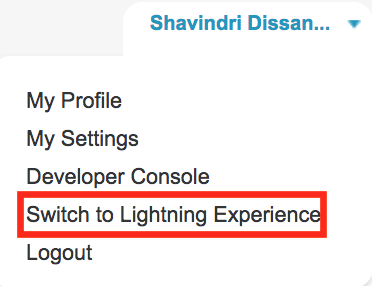
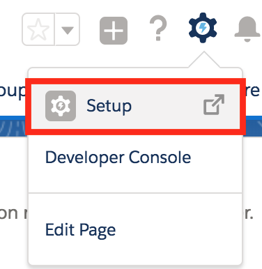
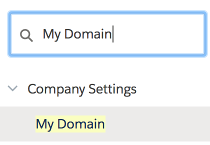
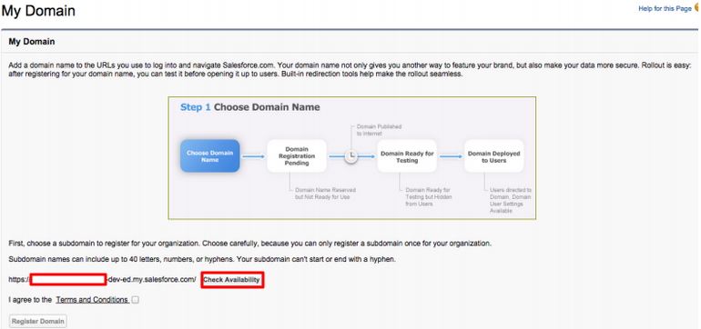
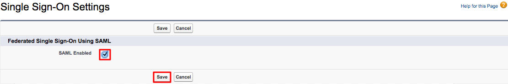
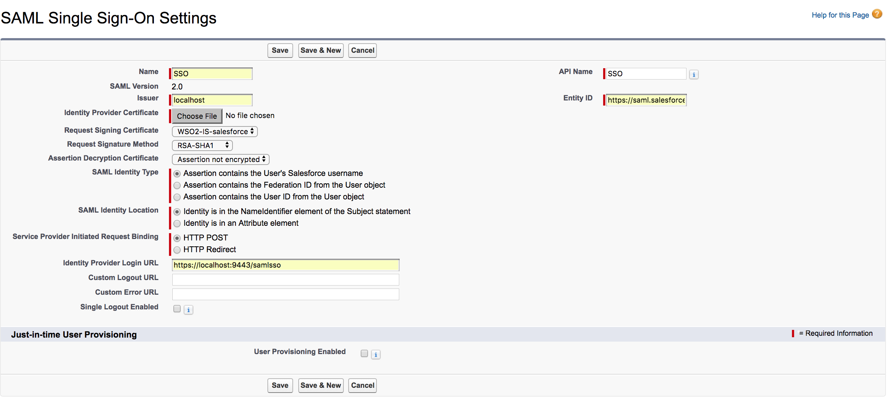
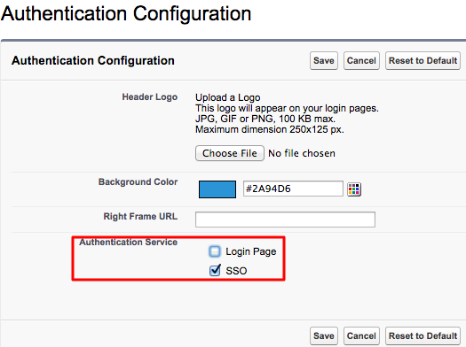
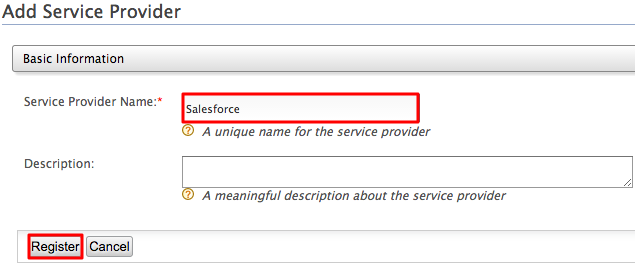
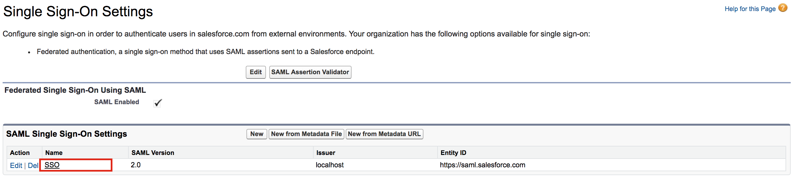
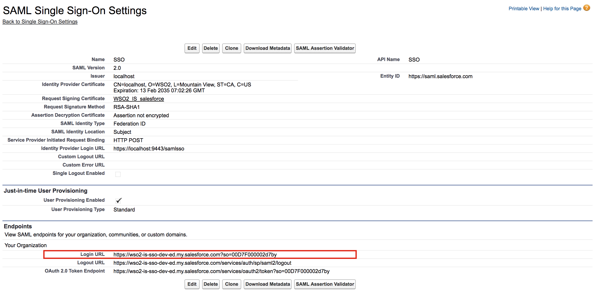

This topic provides instructions on how to log into
[Salesforce](https://developer.salesforce.com/) using your WSO2 Identity
Server credentials.

::::tip[Before you begin!]
When you log into Salesforce, you normally use an email address. So, to
integrate this with the Identity Server, you need to configure WSO2 IS
to enable users to log in using their email addresses.

<details>
<summary>Click here to get the steps on how configure the email address as the username.</summary>

:::warning
Configuring the email address as the username in an **already running
Identity Server** is not the production recommended way. Therefore,
**make sure to configure it before you begin working with WSO2 IS**.
:::

1.  Open the `<IS_HOME>/repository/conf/deployment.toml` file and add the following configuration.

    ```xml
    [tenant_mgt]
    enable_email_domain=true
    ```

2.  Open the ` <IS_HOME>/repository/conf/claim-config.xml `
    file and configure the `               AttributeID              `
    property as mail for the
    `                               http://wso2.org/claims/username                             `
    claim URI as shown below. 

    :::warning
    This file is checked only when WSO2 IS is starting for the first
    time. Therefore, if you haven't configured this property at the time
    of starting up the server for the first time, you will get errors at
    the start up.
    :::

    ```java
    <Claim>
       <ClaimURI>http://wso2.org/claims/username</ClaimURI>
       <DisplayName>Username</DisplayName>
       <AttributeID>mail</AttributeID>
       <Description>Username</Description>
    </Claim>
    ```

3.  Open the ` <IS_HOME>/repository/conf/identity/identity-mgt.properties `
    file and set the following property to
    `               true              `.

    :::info
    This step is required due to a known issue that prevents the
    confirmation codes from being removed after they are used when email
    usernames are enabled. This occurs because the '@' character and
    some special characters are not allowed in the registry. To
    overcome this issue, enable hashed usernames when saving the
    confirmation codes by configuring the properties below.
    :::

    ```xml
    UserInfoRecovery.UseHashedUserNames=true
    ```

    Optionally, you can also configure the following property to
    determine which hash algorithm to use.

    ```xml
    UserInfoRecovery.UsernameHashAlg=SHA-1
    ```

4.  Configure the following set of parameters in the user store
    configuration, depending on the type of user store you are connected
    to (LDAP/Active Directory/ JDBC).
    <table border="1">
      <thead>
        <tr>
          <th>Parameter</th>
          <th>Description</th>
        </tr>
      </thead>
      <tbody>
        <tr>
          <td>

            ` user_name_attribute `

            <br />

          </td>
          <td>

            Set the mail attribute of the user. **LDAP/Active Directory only**

            ```text
            [user_store]user_name_attribute  =  "mail"
            ```

          </td>
        </tr>
        <tr>
          <td>` user_name_search_filter `</td>
          <td>

            Use the mail attribute of the user instead of ` cn ` or ` uid `. **LDAP/Active Directory only**

            ```text
            [user_store]user_name_search_filter  =  "(&(objectClass=person)(uid=?))"
            ```

          </td>
        </tr>
        <tr>
          <td>` user_name_list_filter `</td>
          <td>

            Use the mail attribute of the user. **LDAP/Active Directory only**

            ```text
            [user_store]user_name_list_filter  =  "(&(objectClass=identityPerson)(mail=*)))"
            ```

          </td>
        </tr>
        <tr>
          <td>` username_javas_cript_regex `</td>
          <td>

            Change this property that is under the relevant user store manager tag as follows. This property allows you to add special characters like "@" in the username.

            ```text
            [user_store]username_javas_cript_regex = "^[a-zA-Z0-9._-]+@[a-zA-Z0-9.-]+.[a-zA-Z]{2,4}\$"
            ```

          </td>
        </tr>
        <tr>
          <td>` username_java_regex `</td>
          <td>

            This is a regular expression to validate usernames. By default, strings have a length of 5 to 30. Only non-empty characters are allowed. You can provide ranges of alphabets, numbers and also ranges of ASCII values in the RegEx properties.

            ```text
            [user_store]username_java_regex = "^[a-zA-Z0-9._-]+@[a-zA-Z0-9.-]+.[a-zA-Z]{2,4}$"
            ```

          </td>
        </tr>
        <tr>
          <td>Realm configurations</td>
          <td>

            The ` [super_admin] ` username must use the email attribute of the admin user.

            ```text
            [admin_user]username="admin@wso2.com"password="admin"
            ```

            :::note
            Before this configuration, the user having the username admin and password admin was considered the super administrator. The super administrator user cannot be deleted.

            After this configuration, the user having the username admin@wso2.com is considered the super administrator. The user having the username admin is considered as a normal administrator.

            
            :::

            :::tip
            If you changed the password of the admin user to something other than 'admin', start the WSO2 IS server using the -Dsetup parameter as shown in the command below.

            ` sh wso2server.sh -Dsetup `
            :::

          </td>
        </tr>
      </tbody>
    </table>

    :::info
    With these configuration users can log in to super tenant with both
    email user name ( *[bob@gmal.com](mailto:bob@wso2.com)* ) or
    non-email user names (alice). But for tenant only email user names
    allowed (tod@ [gmail.com](http://gmail.com) @
    [wso2.com](http://wso2.com) )
    :::

    :::note
    You can configure email user name without enabling
    **`                EnableEmailUserName               `** property,
    then users can login to both super tenant and tenant using email and
    non-email user names. But super tenant users should always use
    ***@carbon.super*** at the end of user names.
    :::

5.  Restart the server.

:::info[Related Topics]
For more information on how to configure primary and secondary user
stores, see [Configuring User
Stores](../../../setup/deploy/data-stores/working-with-users-roles-and-permissions/configuring-the-user-realm/configuring-user-stores/configuring-user-stores.mdx).
:::

</details>
::::

Let's get started!

## Configuring Salesforce

1.  Sign up as a Salesforce developer if you don't have an account. If
    you already have an account, move on to step 2 and log in to
    Salesforce.
    1.  Fill out the relevant information found in the following URL:
        [https://developer.salesforce.com/signup](https://developer.salesforce.com/signup)
    2.  Click **Sign me up**.
    3.  You will receive a security token by email to confirm your new
        account. If you did not receive the email successfully, you will
        be able to reset it by following the steps given
        [here](https://help.salesforce.com/apex/HTViewHelpDoc?id=user_security_token.htm&language=en_US).

2.  Log in with your new credentials as a Salesforce developer. Do this
    by clicking the **Login** link in the top right hand side of
    [https://login.salesforce.com/](https://login.salesforce.com/?lt=de).

    :::note
    This document is explained using the Salesforce lightning theme. If
    you are using the classic theme, follow the steps given below to
    switch to the lightning theme.

    <details>
    <summary>Click here to find the steps on how to switch from the classic to the lightning theme.</summary>

    1.  Click your username to expand the drop down.
    2.  Click **Switch to Lightning Experience**.  
        
    3.  Click the settings icon on the top-right-hand corner, and click
        **Set Up**.  
        

    Now you are navigated to the lightening theme of Salesforce.

    </details>
    :::

3.  Click **Allow** to enable Salesforce to access your basic
    information.
4.  Once you are logged in, create a new domain and access it. To do
    this, do the following steps.  
    1.  Search for My Domain in the search bar that is on the left
        navigation panel.  
        
    2.  Click **My Domain**.
    3.  In the page that appears, come up with a name for your domain.
        You can check if the domain is available by clicking the **Check
        Availability** button.

        :::info
        For the page given below to load on your browser, make sure that
        the Salesforce cookies are not blocked.
        :::

        

    4.  If the domain is available, select **I agree to Terms and
        Conditions** and click **Register Domain** to register your new
        domain.

    5.  Once the domain is registered to your account, click the **Click
        here to login** button to test this out.

5.  On the left navigation menu, search for **Single Sign-On Settings**
    , and click it.

6.  In the page that appears, click **Edit** and then select the **SAML
    Enabled** check box to enable federated single sign-on using SAML.  
    

7.  Click **Save** to save this configuration change.

8.  Click **New** under **SAML Single Sign-On Settings**. The following
    screen appears.  
    

    Ensure that you configure the following properties.

    <Anchor id="entity-id" />

    <table>
      <thead>
        <tr>
          <th>Field</th>
          <th>Value</th>
        </tr>
      </thead>
      <tbody>
        <tr>
          <td>Name</td>
          <td>SSO</td>
        </tr>
        <tr>
          <td>API Name</td>
          <td>SSO</td>
        </tr>
        <tr>
          <td>Issuer</td>
          <td>` localhost `</td>
        </tr>
        <tr>
          <td>Entity Id</td>
          <td>` https://saml.salesforce.com `</td>
        </tr>
        <tr>
          <td>Identity Provider Certificate</td>
          <td>

            ` wso2.crt `

            :::note
            To create the Identity Provider Certificate, open your Command Line interface, traverse to the

            &lt;is_home&gt;/repository/resources/security/

            directory. Next you must execute the following command.

            ```text
            keytool -export -alias wso2carbon -file wso2.crt -keystore wso2carbon.jks -storepass wso2carbon
            ```

            Once this command is run, the wso2.crt file is generated and can be found in the

            &lt;is_home&gt;/repository/resources/security/

            directory. Click Choose File and navigate to this location in order to obtain and upload this file.
            :::

          </td>
        </tr>
        <tr>
          <td>Request Signing Certificate</td>
          <td>Default Certificate</td>
        </tr>
        <tr>
          <td>Request Signature Method</td>
          <td>RSA-SHA1</td>
        </tr>
        <tr>
          <td>Assertion Decryption Certificate</td>
          <td>Assertion not encrypted</td>
        </tr>
        <tr>
          <td>SAML Identity Type</td>
          <td>

            Assertion contains User's salesforce.com username

          </td>
        </tr>
        <tr>
          <td>SAML Identity Location</td>
          <td>

            Identity is in the NameIdentifier element of the Subject statement

          </td>
        </tr>
        <tr>
          <td>Service Provider Initiated Request Binding</td>
          <td>HTTP POST</td>
        </tr>
        <tr>
          <td>Identity Provider Login URL</td>
          <td>` https://localhost:9443/samlsso `</td>
        </tr>
        <tr>
          <td>Custom Logout URL</td>
          <td>` https://localhost:9443/samlsso `</td>
        </tr>
        <tr>
          <td>Custom Error URL</td>
          <td>Leave blank</td>
        </tr>
        <tr>
          <td>User Provisioning Enabled</td>
          <td>Leave blank</td>
        </tr>
      </tbody>
    </table>

    Click **Save** to save your configurations.

9.  Go to **Custom Settings** in the left navigation pane and click **My
    Domain**.

10. Click **Deploy to Users**. Click **Ok** to the confirmation message
    that appears.

11. In the page that appears, you must configure the **Authentication
    Configuration** section. Scroll down to this section and click
    **Edit**.

12. Under **Authentication Service**, select **SSO** instead of **Login
    Page**.  
    

13. Click **Save**.

## Configuring the service provider

Follow the steps given below to configure salesforce as a service
provider in WSO2 IS.

1.  Sign in. Enter your username and password to log on to the
    [Management Console](../../../setup/install/getting-started-with-the-management-console/getting-started-with-the-management-console.mdx).

    The default username and password of the administrator is both
    **admin**.

2.  Navigate to the **Main** menu to access the **Identity** menu. Click
    **Add** under **Service Providers**.

3.  Fill in the **Service Provider Name** and provide a brief
    **Description** of the service provider. Only **Service Provider
    Name** is a required field and we use Salesforce as the name for
    this example.  
    

4.  Click **Register**.

5.  Expand the **Inbound Authentication Configuration** and the **SAML2
    Web SSO Configuration** and click **Configure**.

6.  In the form that appears, fill out the following configuration
    details required for single sign-on. For more details about
    attributes in the following configuration refer [SAML2 Web SSO
    Configuration](../../using-wso2-identity-server/identity-bus/adding-and-configuring-a-service-provider/configuring-inbound-authentication-for-a-service-provider.mdx#configuring-inbound-authentication-with-saml2-web-sso)
.

    <table>
      <thead>
        <tr>
          <th>Field</th>
          <th>Value</th>
          <th>Description</th>
        </tr>
      </thead>
      <tbody>
        <tr>
          <td>Issuer</td>
          <td>` https://saml.salesforce.com `</td>
          <td>This is the ` <saml:Issuer> ` element that contains the unique identifier of the service provider. This is [the same value](#entity-id) you entered as the Entity-ID when creating the salesforce application. This is also the issuer value specified in the SAML Authentication Request issued by the service provider. When configuring single-sign-on across Carbon servers, ensure that this value is equal to the service_provider_id value mentioned in the ` deployment.toml ` file of the relying party Carbon server.</td>
        </tr>
        <tr>
          <td>Assertion Consumer URL</td>
          <td nowrap="">

            <details open>
            <summary>Click here and follow the steps to get the Assertion Consumer URL.</summary>

            Follow the steps given below to get the Salesforce URL:

            1. Login to the Salesforce developer account: [https://login.salesforce.com/](https://login.salesforce.com/?lt=de).
            2. Search for My Domain in the search bar that is on the left navigation panel.
            3. Click My Domain and you are navigated to the domain you created under the section [Configuring Salesforce](#configuring-salesforce).
            4. Click **Edit** under Authentication Configurations and you are navigated to a new page having the following URl: ` https://<DOMAIN_NAME>/domainname/EditLogin.apexp `
            5. On the left navigation menu, search for **Single Sign-On Settings** , and click it.
            6. Click on the name of the Single Sign-On Setting you created. In this use case click **SSO**<br />. 
            7. Copy the URL that is defined for Login URL to access Salesforce.<br /> 

            </details>

          </td>
          <td width="40%">This is the URL to which the browser should be redirected to after the authentication is successful. This is the Assertion Consumer Service (ACS) URL of the service provider. The identity provider redirects the SAML2 response to this ACS URL. However, if the SAML2 request is signed and SAML2 request contains the ACS URL, the Identity Server will honor the ACS URL of the SAML2 request. In this case, you must use your Salesforce login URL. In Salesforce, click **Security Controls** on your left menu and then click **Single Sign-On Settings**. In the page that appears, click on the SSO settings that you created to view the details. Use the **Salesforce Login URL** listed there for this value.</td>
        </tr>
        <tr>
          <td>NameID Format</td>
          <td>The default value can be used here.</td>
          <td>This defines the name identifier formats supported by the identity provider. The service provider and identity provider usually communicate with each other regarding a specific subject. That subject should be identified through a Name-Identifier (NameID) , which should be in some format so that It is easy for the other party to identify it based on the format. Name identifiers are used to provide information regarding a user.</td>
        </tr>
        <tr>
          <td>Enable Response Signing</td>
          <td>Selected</td>
          <td>

            Select **Enable Response Signing** to sign the SAML2 Responses returned after the authentication process.

          </td>
        </tr>
        <tr>
          <td>Enable Attribute Profile</td>
          <td>Selected</td>
          <td>Select **Enable Attribute Profile** to enable this and add a claim by entering the claim link and clicking the **Add Claim** button. The Identity Server provides support for a basic attribute profile where the identity provider can include the user’s attributes in the SAML Assertions as part of the attribute statement. Once you select the check box to **Include Attributes in the Response Always** , the identity provider always includes the attribute values related to the selected claims in the SAML attribute statement.</td>
        </tr>
      </tbody>
    </table>

7.  Click **Update** to save your configurations.

## Testing the configurations

Do the following steps to test out the configurations for a new user in
Salesforce and the Identity Server.

1.  Create a user in WSO2 IS.  
    1.  Once you log in to the Identity Server, navigate to the **Main**
        menu in the Management Console, click **Add** under **Users and
        Roles**.
    2.  Click **Users**. This link is only visible to users with the
        Admin role.
    3.  Click **Add New User**.  When adding a new user, use an email
        address as the username.  
        Since it is not mandatory to assign a role to a user in this
        tutorial, click **Finish**.

2.  Create a user in Salesforce. This user should have the same
    email address as the user in WSO2 IS  
    1.  Log in to the Salesforce developer account:
        [https://login.salesforce.com/](https://login.salesforce.com/?lt=de).
    2.  On the left navigation pane, under **ADMINISTRATION**, click
        **Users** under **Users**.
    3.  On the page that appears, click the **New User** button to
        create a new user.
    4.  Create a user with the same username as the one you created in
        the Identity Server. Click **Save** to save your changes. An
        email will be sent to the email address you provided for the
        user.

        :::note
        This is mainly for testing purposes. In a real
        business scenario, you would be more likely to use Just-In-Time
        (JIT) provisioning to provision a user to Salesforce.
        :::

3.  Access your Salesforce login URL on an incognito or private browser.

    :::info
    The salesforce login URL is unique to your Salesforce application.
    Follow the steps given below to get this URL:

    1.  Search for My Domain in the search bar that is on the left
        navigation panel.

    2.  Click My Domain and you are navigated to the domain you created
        under the section [Configuring
        Salesforce](#configuring-salesforce).

    3.  Click **Edit** under Authentication Configurations and you are
        navigated to a new page having the following URl:
        `              https://<DOMAIN_NAME>/domainname/EditLogin.apexp             `

    4.  On the left navigation menu, expand **Security Controls**, and
        click, **Single Sign-On Settings**.

    5.  Click on the name of the Single Sign-On Setting you created. In
        this use case click **SSO**.  
        

    6.  Copy the URL that is defined for Login URL to access
        Salesforce.  
        
    :::

4.  Log in using the new credentials of the user you just created. You
    are then redirected back to Salesforce.

### Troubleshooting guidelines

Additional troubleshooting information regarding any Salesforce side SSO
failures can be retrieved by using Salesforce SAML Assertion Validator.
Further information regarding the steps are available
[here](https://developer.salesforce.com/docs/atlas.en-us.sso.meta/sso/sso_saml_validation_errors.htm#!)
.
