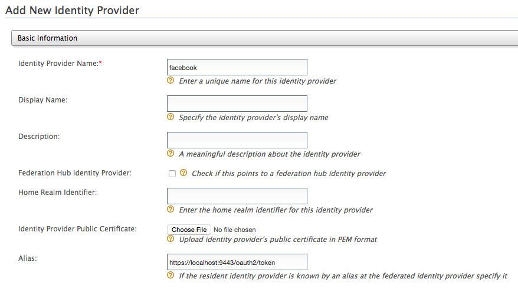
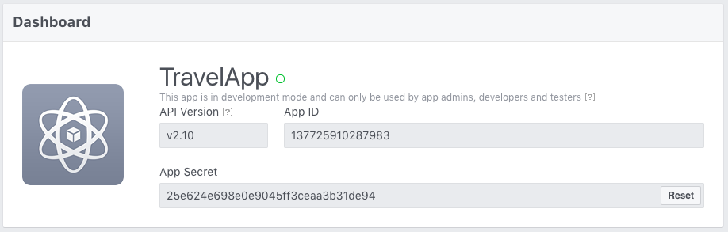
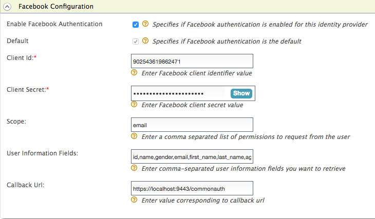

Facebook can be used as a federated authenticator in the Identity
Server. Do the following to configure the Identity Server to
authenticate users using their Facebook credentials.

:::note
This section gives you a quick understanding of configuring Facebook as
Identity provider so that it acts as a federated authenticator. **Check
out the [Logging in to your application via Identity Server using
Facebook
Credentials](../../authentication/logging-in-to-your-application-via-identity-server-using-facebook-credentials.mdx)
tutorial** to try out an end to end scenario of using Facebook as a
federated authenticator.
:::

:::tip[Before you begin]
1.  Create a Facebook account and [register an application on
    Facebook](https://www.facebook.com/business/help/444614902378217).
2.  Sign in to the WSO2 Identity Server [Management
    Console](../../../../setup/install/getting-started-with-the-management-console/getting-started-with-the-management-console.mdx) at
    `          https://<Server Host>:9443/carbon         ` using your
    `          username         ` and `          password         ` .
:::

Follow the steps given below to [add a new identity
provider](../../../using-wso2-identity-server/identity-bus/adding-and-configuring-an-identity-provider/adding-and-configuring-an-identity-provider.mdx) in WSO2
Identity Server.

1.  Download the WSO2 Identity Server from
    [here](https://wso2.com/products/identity-server/) and [run
    it](../../../../setup/install/running-the-product.mdx).  
    Log in to the [Management
    Console](../../../../setup/install/getting-started-with-the-management-console/getting-started-with-the-management-console.mdx) as
    administrator.

2.  In the **Identity** section under the **Main** tab of the Management
    Console, click **Add** under **Identity Providers**.

3.  Give a suitable name as the **Identity Provider Name**.  
    

4.  Go to **Facebook Configuration** under **Federated Authenticators**.

5.  Enter the following values in the form that appears:

    <table>
      <thead>
        <tr>
          <th>Field</th>
          <th>Description</th>
          <th>Sample Value</th>
        </tr>
      </thead>
      <tbody>
        <tr>
          <td>Client Id</td>
          <td>

            This refers to the App ID you received from the Facebook app you created.

            :::info[Don't know the client ID?]
            1. Go to [https://developers.facebook.com/](https://developers.facebook.com/) and log in using your Facebook credentials.
            2. Click on your app from the **My Apps** drop-down list.  You are navigated to the **Dashboard** of the application. Note down the App ID and the App secret.

            
            :::

          </td>
          <td>

            &lt;Application ID of the Facebook App&gt;

             

          </td>
        </tr>
        <tr>
          <td>Client Secret</td>
          <td>This refers to the App Secret you received from the Facebook app you created.</td>
          <td>&lt;App Secret of the Facebook App&gt;</td>
        </tr>
        <tr>
          <td>Scope</td>
          <td>Defines the permission to access particular information from a Facebook profile. See the [Permissions Reference](https://developers.facebook.com/docs/facebook-login/permissions) for a list of the different permission groups in Facebook APIs.</td>
          <td>email</td>
        </tr>
        <tr>
          <td>User Information Fields</td>
          <td>These are the claims related to the user account on Facebook. WSO2 Identity Server requests these fields from Facebook when a user is authenticated with Facebook through the IS. See [public_profile permission](https://developers.facebook.com/docs/facebook-login/permissions#reference-public_profile) for more information about these fields.</td>
          <td>id,name,gender,email,first_name,last_name,age_range,link</td>
        </tr>
        <tr>
          <td>Callback Url</td>
          <td>This is the URL to which the browser should be redirected after the authentication is successful. This should be the commonauth endpoint of Identity server.</td>
          <td>[https://localhost:9443/commonauth](https://localhost:9443/commonauth)</td>
        </tr>
      </tbody>
    </table>

    

6.  Select both checkboxes to **Enable Facebook Authenticator** and make
    it the **Default**.

7.  Click **Register**.

You have now added the identity provider.

:::info[Related Topics]
-   Identity Federation is part of the process of configuring an
    identity provider. For more information on how to configure an
    identity provider, see [Configuring an Identity
    Provider](../../../using-wso2-identity-server/identity-bus/adding-and-configuring-an-identity-provider/adding-and-configuring-an-identity-provider.mdx).
-   See the following topics for samples of configuring Facebook for
    federated authentication:
    -   [Logging in to your application via Identity Server using
        Facebook Credentials](../../authentication/logging-in-to-your-application-via-identity-server-using-facebook-credentials.mdx)
    -   [Logging in to Salesforce with Facebook](../../authentication/logging-in-to-salesforce-with-facebook.mdx)
:::
