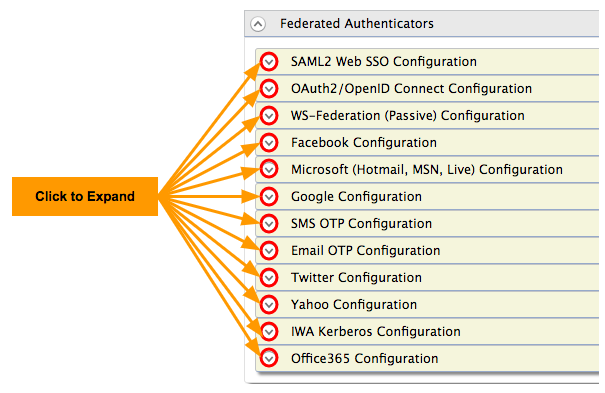

This topic includes information on how to configure federated
authenticators in WSO2 Identity Server.

:::info[Before you begin]
For more information on what federated authenticators are, see [Outbound/federated authenticators in the Identity Server architecture](../../../../get-started/architecture/architecture.mdx#outboundfederated-authenticators).
:::

To navigate to the federated authenticators configuration section, do the following.

1. Sign in. Enter your username and password to log on to the [Management Console](../../../../setup/install/getting-started-with-the-management-console/getting-started-with-the-management-console.mdx). 

2. Navigate to the **Main** menu to access the **Identity** menu. Click Add under Identity Providers. 
For more information, see [Adding and Configuring an Identity Provider](../../../using-wso2-identity-server/identity-bus/adding-and-configuring-an-identity-provider/adding-and-configuring-an-identity-provider.mdx).  

3. Fill in the details in the **Basic Information** section. 

:::warning
OpenID 2.0 has been removed from the base product as it is now
an obsolete specification and has been superseded by OpenID Connect. We
recommend using [OpenID Connect](./configuring-oauth2-openid-connect.mdx)
instead.
:::

You can configure the following federated authenticators by expanding
the **Federated Authenticators** section followed by the required
subsections.

:::tip[More Federated Authenticators]
Some authenticators such as LinkedIn are not provided OOTB with WSO2
Identity Server but can be downloaded from the [WSO2
store](https://store.wso2.com/store/) and plugged in to work with WSO2
IS. For more information on those authenticators and connectors, see the
WSO2 Identity Server Connectors documentation.
:::
