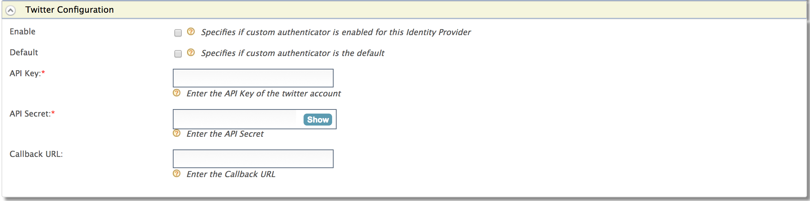

Twitter can be used as a federated authenticator in WSO2 Identity
Server. Follow the steps below to configure WSO2 Identity Server to
authenticate users using their Twitter login credentials:

:::tip[Before you begin]
1.  Go to [https://twitter.com/](https://twitter.com/) , create an account, and [register an
    application on
    Twitter](http://docs.inboundnow.com/guide/create-twitter-application/)
    .
2.  Sign in to the WSO2 Identity Server [Management
    Console](../../../../setup/install/getting-started-with-the-management-console/getting-started-with-the-management-console.mdx)
    at `          https://<Server Host>:9443/carbon         ` using your
    `          username         ` and `          password         ` .
:::

In the WSO2 Identity Server management console, 

1.  Navigate to the **Identity Provider** section under **Main \>
    Identity** menu-item.
2.  Click **Add**.
3.  Provide values for the following fields under the **Basic
    Information** section: For more information, see
    [Adding and Configuring an Identity
        Provider](../../../using-wso2-identity-server/identity-bus/adding-and-configuring-an-identity-provider/adding-and-configuring-an-identity-provider.mdx#adding-an-identity-provider).

4.  Expand **Twitter Configuration** under **Federated Authenticators**
    .
    
    Fill in the following fields details according to the application
    [registered in the Twitter](http://docs.inboundnow.com/guide/create-twitter-application/):

    <table>
      <thead>
        <tr>
          <th>Field</th>
          <th>Description</th>
          <th>Sample Value</th>
        </tr>
      </thead>
      <tbody>
        <tr>
          <td>Enable</td>
          <td>This option enables Twitter to be used as an authenticator for user provisioned to the WSO2 Identity Server.</td>
          <td>Checked</td>
        </tr>
        <tr>
          <td>Default</td>
          <td>This options sets the Twitter to be used as the default authentication mechanism. If you have already selected any other Identity Provider as the default federated authenticator, selecting this option deselects it.</td>
          <td>Checked</td>
        </tr>
        <tr>
          <td>API Key</td>
          <td>This is the ` consumer key ` generated at the Twitter application registration.</td>
          <td>` wuerRmdgwlqX0oE1WNDdsh17o `</td>
        </tr>
        <tr>
          <td>API Secret</td>
          <td>This is the ` consumer secret ` generated at the Twitter application registration.</td>
          <td>

            ` 771tqnkpcbRyTBSCRQvVud1x8j1uQlCDpNZo3hRG0s4cEtsFky `

          </td>
        </tr>
        <tr>
          <td>Callback URL</td>
          <td>

            This is the Callback URL you entered at the Twitter application registration. This is the URL to which the browser should be redirected after the authentication is successful.

            URL format: ` https://<host-name>:<port>/acs `

            The acs indicates the Assertion Consumer URL of the WSO2 Identity Server endpoint that accepts the responses sent by Twitter.

          </td>
          <td>` https://wso2.com:9443/commonauth `</td>
        </tr>
      </tbody>
    </table>

5.  Click **Register**.
