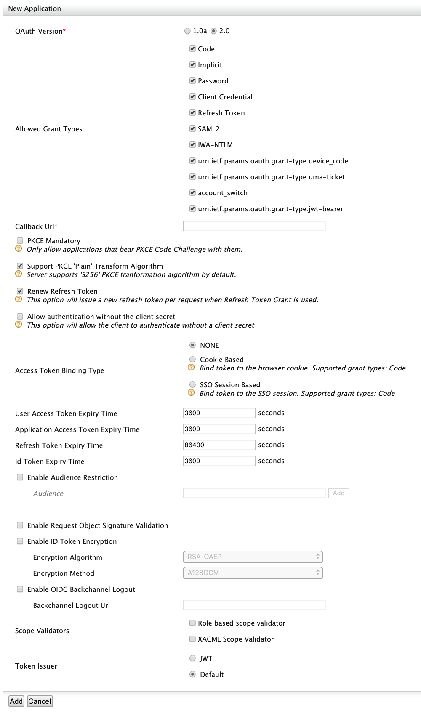
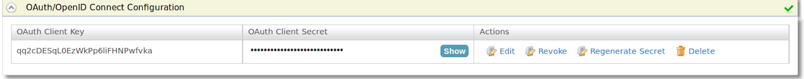

[OAuth 2.0](https://oauth.net/2/) has three main phases. They are:

- Requesting an Authorization Grant
- Exchanging the Authorization Grant for an Access Token 
- Accessing the resources using the obtained Access Token

[OpenID Connect](http://openid.net/connect/) is another identity layer
on top of OAuth 2.0. OAuth applications can get authentication event
information over the IDToken and can get the extra claims of the
authenticated user from the OpenID Connect UserInfo endpoint.  

To enable OAuth support for your client application, you must first
register your application. Follow the instructions below to add a new
application.

:::tip[Before you begin]
You must first
[register a service provider](../../../using-wso2-identity-server/identity-bus/adding-and-configuring-a-service-provider/adding-and-configuring-a-service-provider.mdx#adding-a-service-provider).
To register a service provider:

 1. Sign in to WSO2 Identity Server Management Console as an admin.
 2. On the Main menu, click **Identity** > **Service Providers** > **Add**.
 3. Enter a service provider name.
 4.    Click Register. The Service Provider Details page appears.
:::

Let's get started to configure the service provider you created!

1.  Expand the **Inbound Authentication Configuration** section and then
    expand **OAuth/OpenID Connect Configuration.** Click **Configure**.
2.  Fill in the form that appears. For the **Allowed Grant Types**, you
    can disable the ones you do not require or wish to block.

    :::note
    The grant type highlighted below is a **custom** grant type. This
    will only appear on the UI if you have configured the JWT grant
    type. The value specified as the `name`
    of the `oauth.custom_grant_type` in the `deployment.toml` file when
    creating the custom grant type is the value that will appear on the
    UI. For more information on writing a custom grant type, see
    [Writing a Custom OAuth 2.0 Grant
    Type](../../../using-wso2-identity-server/samples/oauth2/writing-a-custom-oauth-2-0-grant-type/writing-a-custom-oauth-2.0-grant-type.mdx).
    :::

    

    When filling out the **New Application** form, the following details
    should be taken into consideration.

    <table style={{width: "100%"}}>
      <colgroup>
        <col style={{width: "22%"}} />
        <col style={{width: "77%"}} />
      </colgroup>
      <thead>
        <tr>
          <th>Field</th>
          <th>Notes</th>
        </tr>
      </thead>
      <tbody>
        <tr>
          <td>**OAuth Version**</td>
          <td>

            Selecting **OAuth Version** as **1.0a** removes all the configurable **Allowed Grant Types**. This is because this version of OAuth does not support grant types.

          </td>
        </tr>
        <tr>
          <td>

            **Allowed Grant Types**

          </td>
          <td>

            The following grant types are used to generate the access token:

            - **Code** : Entering the username and password required at the service provider will result in a code being generated. This code can be used to obtain the access token. For more information on this grant type, see this [Authorization Code specification](https://tools.ietf.org/html/rfc6749#section-4.1).
            - **Implicit** : This is similar to the code grant type, but instead of generating a code, this directly provides the access token. For more information on this grant type, see this [Implicit Grant specification](https://tools.ietf.org/html/rfc6749#section-4.2).
            - **Password** : This authenticates the user using the password provided and the access token is provided. For more information on this grant type, see this [Resource Owner Password Credentials Grant specification](https://tools.ietf.org/html/rfc6749#section-4.3).
            - **Client Credential** : This is the grant type for the client key and client secret. If these two items are provided correctly by the service provider, the access token is sent. For more information on this grant type, see this [Client Credentials specification.](https://tools.ietf.org/html/rfc6749#section-4.4)
            - **Refresh Token** : This will enable the user to obtain an access token by using the refresh token once the originally provided access token is used up. For more information on this grant type, see this [Refresh Token specification](https://tools.ietf.org/html/rfc6749#section-1.5).
            - **SAML2** : This uses SAML assertion to obtain the access token. For more information on this grant type, see this [SAML2 Bearer specification](https://tools.ietf.org/id/draft-ietf-oauth-saml2-bearer-23.txt).
            - **IWA-NTLM** : This is similar to the password grant type, but it is specific to Microsoft Windows users.
            - **urn:ietf:params:oauth: grant-type:jwt-bearer** : This is a custom grant type. It uses a JWT token to obtain the access token. For more information about this grant type, see this [JWT specification](https://tools.ietf.org/html/rfc7523).

          </td>
        </tr>
        <tr>
          <td>**Callback Url**</td>
          <td>

            This is the exact location in the service provider's application where an access token would be sent. This is a required field (if the grant type is anything other than 'Code' or 'Implicit') and it is important to configure, as it is imperative that the service provider receives the access token. This is necessary for security purposes to ensure that the token is not compromised.

            :::note[Configure multiple callback URLs]
            From IS 5.2.0 onwards, regex-based consumer URLs are supported when defining the callback URL. This enables you to configure multiple callback URLs for one application by entering a regex pattern as the value for the callback URL field.<br /> For example, if you have two service providers that use the same application, you can now define a regex pattern which will work for both callback URLs instead of having to configure two different applications for the two service providers. Assume the two callback URLs for your two service providers are as follows:

            - ` https://myapp.com/callback `
            - ` https://testapp:8000/callback `

            To configure the callback URL to work for **both** of these URLs, set it using a regex pattern as follows:<br />

            <Anchor id="cb1" />

            ```text
            regexp=(https://((myapp\.com)|(testapp:8000))(/callback))
            ```

            You must have the prefix ' **regexp=** ' before your regex pattern. To define a normal URL, you can specify the callback URL without this prefix.

            You can also configure a regex pattern that contains dynamic values as seen below.

            <Anchor id="cb2" />

            ```text
            regexp=https://mchcon.clance.local\?id=(.*)
            ```
            :::

          </td>
        </tr>
        <tr>
          <td>**PKCE Mandatory**</td>
          <td>Select this if you are using the **Code** grant type. PKCE is a recommended security measure used to mitigate a code interception attack. See [Mitigating Authorization Code Interception Attacks](../../../../administer/administer/mitigating-authorization-code-interception-attacks.mdx) for more information.</td>
        </tr>
        <tr>
          <td>**Support PKCE 'Plain' Transform Algorithm**</td>
          <td>Select this if you are using PKCE.</td>
        </tr>
        <tr>
          <td>**Allow Authentication without the client secret**</td>
          <td>This enables authenticating the client without the ` client secret `.</td>
        </tr>
        <tr>
          <td>

            **Access Token Binding Type**

          </td>
          <td>

            This section provides the capability to attach the OAuth2 access token and refresh token to an external attribute during the token generation and optionally validate the external attribute during the API invocation.

            - **None** : No binding.
            - **Cookie Based** : This binding type is designed to improve the security of Single Page Applications(SPA) where access_token is stored at the browser. With this binding, additionally to the access token validation, a cookie with `Secure` and `HttpOnly` parameters will be validated to grant access.  In the current implementation, this binding type can be enabled for authorization code grant with **Allow Authentication without the client secret** option. When this is enabled new cookie named **atbv** will be returned with the authorization code to the client browser. When the application makes the token request with this cookie, that cookie will get validated and attached to the generated tokens. Now, whenever the SPA tries to access the Identity Server API, it needs to present the access token + cookie for successful authorization.
            - **SSO Session Based** : This binding type is designed to **generate different tokens** for each new browser instance. With this, you can avoid the same access token getting shared with multiple browser instances of the same application. Also, you can revoke the access token when you are logging out from one application(browser) instance and not break other instances. This binding type is supported for **authorization code** grant type.

          </td>
        </tr>
        <tr>
          <td>

            **User Access Token Expiry Time, Application Access Token Expiry Time, Refresh Token Expiry Time, Id Token Expiry Time**

            **<br />**

          </td>
          <td>Set the validity period (in seconds) for User Access Token, Application Access Token, Refresh Token, and Id Token.</td>
        </tr>
        <tr>
          <td>**Enable Audience Restriction**</td>
          <td>

            Select this to enable audience restrictions for OAuth applications. If necessary, you can add multiple audiences. To add an audience, specify a required **Audience** value and click **Add**. All audience values that you add would be available in the ID token generated for the corresponding application.

          </td>
        </tr>
        <tr>
          <td>**Enable Request Object Signature Validation**</td>
          <td>

            This is to define whether to only accept signed request objects in an authorization request or not. For more information, see [Enforcing Signature Validation for Request Objects](../../authentication/enforcing-signature-validation-for-request-objects.mdx).

          </td>
        </tr>
        <tr>
          <td>**Enable ID Token Encryption**</td>
          <td>This is to define whether to ID token encryption should be enabled or not. For a tutorial on this, see [Testing OIDC Encrypted ID Token with IS](../../authentication/testing-oidc-encrypted-id-token-with-is.mdx).</td>
        </tr>
        <tr>
          <td>**Enable OIDC Back Channel Logout**</td>
          <td>This is to define whether OIDC back channel logout should be enabled or not. For more information, see [Configuring OpenID Connect Back-Channel Logout](./configuring-openid-connect-back-channel-logout.mdx).</td>
        </tr>
        <tr>
          <td>**Scope Validators**</td>
          <td>This is to define the scope validation mechanisms. For more information on XACML scope validation, see [Validating the Scope of OAuth Access Tokens using XACML Policies](../../access-control/working-with-entitlement/validating-the-scope-of-oauth-access-tokens-using-xacml-policies.mdx).</td>
        </tr>
        <tr>
          <td>**Token Issuer**</td>
          <td>

            Select either **JWT** or **Default** as the token issuer for the service provider.

            :::tip
            - If you want to enable default token generation for a service provider, select **Default** as the **Token Issuer**. This is the default Token Issuer that is selected when you apply the WUM update.<br /> When you enable default token generation, the hash value of the token is stored in the ACCESS_TOKEN_HASH column, and the plain text token is stored in the ACCESS_TOKEN column
            - If you want to enable JWT token generation for a service provider, select **JWT** as the **Token Issuer**.<br /> When you enable JWT token generation, the hash value of the JWT is stored in the ACCESS_TOKEN_HASH column, and the full JWT is stored in the ACCESS_TOKEN column.
            :::

          </td>
        </tr>
      </tbody>
    </table>

3.  Click **Add**. Note that `          client key         ` and
    `          client secret         ` get generated.  
    

    -   **OAuth Client Key** - This is the client key of the service
        provider, which will be checked for authentication by the
        Identity Server before providing the access token.
    -   **OAuth Client Secret** - This is the client secret of the
        service provider, which will be checked for authentication by
        the Identity Server before providing the access token. Click the
        **Show** button to view the exact value of this.
    -   **Actions -**
        -   **Edit:** Click to edit the OAuth/OpenID Connect
            Configurations

        -   **Revoke:** Click to revoke (deactivate) the OAuth
            application. This action revokes all tokens issued for this
            application. In order to activate the application, you have
            to regenerate the consumer secret.

        -   **Regenerate Secret:** Click to regenerate the secret key of
            the OAuth application.

        -   **Delete:** Click to delete the OAuth/OpenID Connect
            Configurations.

    :::tip
    The OAuth client key and client secret are stored in plain text. To
    encrypt the client secret, access token and refresh token, do the
    following:

    Add the following property to the `deployment.toml` file found in the `<IS_HOME>/repository/conf` folder.

    ```toml
    [oauth]
    hash_tokens_and_secrets= true
    [oauth.extensions]
    token_persistence_processor = "org.wso2.carbon.identity.oauth.tokenprocessor.EncryptionDecryptionPersistenceProcessor"
    ```
    :::

    After updating the configuration, make sure to restart the server
    for the changes to be applied on WSO2 IS.

**Related Topics**

See [Configuring OpenID Connect Single
Logout](./configuring-openid-connect-single-logout.mdx) to configure single
logout or session management with OpenID Connect.

See [Delegated Access Control](../../../using-wso2-identity-server/delegated-access-control/delegated-access-control.mdx) for more
information on working with OAuth2/OpenIDConnect. See the following
topics for samples of configuring delegated access control:

-   [OAuth 2.0 with WSO2 Playground](../../../using-wso2-identity-server/samples/oauth2/oauth-2-0-with-wso2-playground/oauth-2.0-with-wso2-playground.mdx)
-   [Setting up a SAML2 Bearer Assertion Profile for OAuth
    2.0](../../../using-wso2-identity-server/samples/oauth2/setting-up-a-saml2-bearer-assertion-profile-for-oauth-2.0.mdx)
