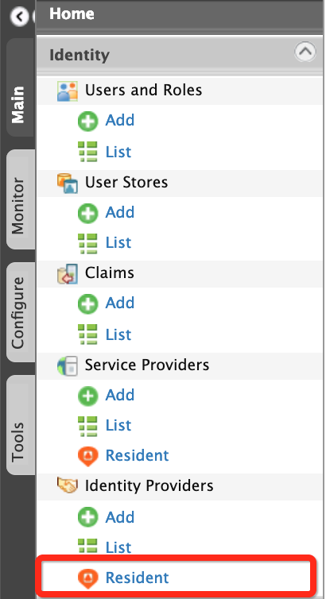
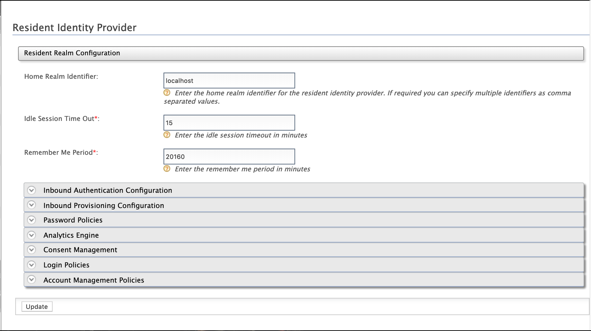
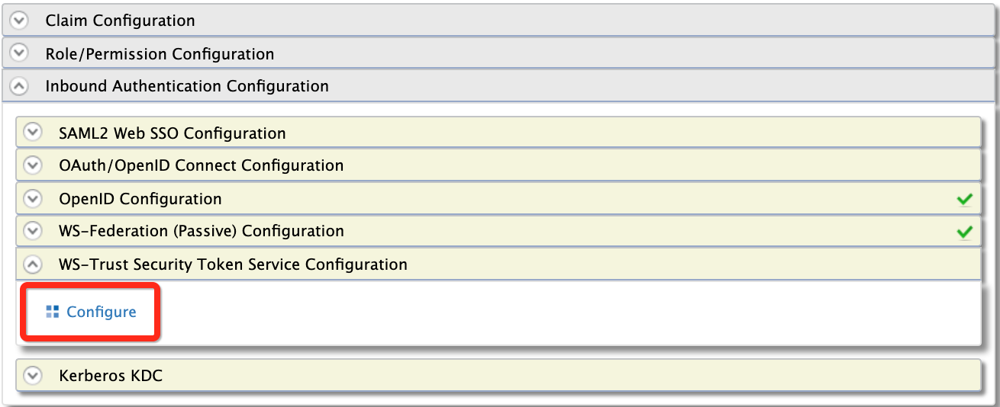

WSO2 Identity Server uses the security token service (STS) as the
[WS-Trust](./ws-trust.mdx) implementation. The STS is capable of issuing
SAML 1.1 and 2.0 security tokens and has a SOAP/XML API for token
issuance. This API can be secured with the
`         UserNameToken        ` or with any other WS-Security mechanism
as explained below.

#### Securing the Security Token Service

According to the Trust Brokering model defined in the WS-Trust
specification, the users should authenticate themselves to the STS
before obtaining a token. STS may use this authentication information
when constructing the security token. For example, STS may populate the
required claims based on the user name provided by the subject.
Therefore, the STS service needs to be secured.

STS is configured under the **Resident Identity Provider** section of
the WSO2 Identity Server [Management
Console](../../../../setup/install/getting-started-with-the-management-console/getting-started-with-the-management-console.mdx).

To secure the Security Token Service:

1.  On the **Main** tab, click **Identity \> Identity Providers \>
    Resident**.  
      
    The Resident Identity Provider page appears.  
    

2.  Enter the required values as given below.

    <table>
      <thead>
        <tr>
          <th>Field</th>
          <th>Description</th>
          <th>Sample Value</th>
        </tr>
      </thead>
      <tbody>
        <tr>
          <td>**Home Realm Identifier**</td>
          <td>This is the domain name of the identity provider. If you do not enter a value here, when an authentication request comes to WSO2 Identity Server, a user will be prompted to specify a domain. You can enter multiple identifiers as a comma-separated list.</td>
          <td>` localhost `</td>
        </tr>
        <tr>
          <td>**Idle Session Time Out**</td>
          <td>This is the duration in minutes for which an SSO session can be idle for. If WSO2 Identity Server does not receive any SSO authentication requests for the given duration, a session time out occurs. The default value is ` 15 ` .</td>
          <td>` 15 `</td>
        </tr>
        <tr>
          <td>**Remember Me Period**</td>
          <td>

            This is the duration in weeks for which WSO2 Identity Server should remember an SSO session given that the **Remember Me** option is selected in the WSO2 Identity Server login screen.

            The default value is ` 2 ` weeks.

          </td>
          <td>` 2 `</td>
        </tr>
      </tbody>
    </table>

3.  Under the **Inbound Authentication Configuration** section, click
    **Security Token Service Configuration &gt; Apply Security Policy**
    .  
    
4.  Select **Yes** in the **Enable Security?** drop down and  select a
    pre-configured security scenario according to your requirements. For
    this tutorial, use **UsernameToken** under the **Basic Scenarios**
    section.  
    

    :::note
    You can find further details about security policy scenarios from
    the **view scenario** option **.**

    
    :::

5.  Click **Next**. The user domain and user group selection appears.

    :::info
    Next steps may vary as per the security scenario that you have
    chosen under point (5) above. Below is for **UsernameToken**
    scenario.
    :::

6.  Provide the required details as follows:
    1.  Select **ALL-USER-STORE-DOMAINS**.
    2.  Select the role you created to grant permission to access
        secured service. In this example, the admin role is used.
        Next, click **Finish**.

        :::note
        The **Select Domain** drop-down lists many domains. The listed
        **User Groups** can vary depending on the domain selected.
        :::

        

7.  Click **Finish**.
8.  Click **Ok** on the confirmation dialog window that appears.
9.  Click **Update** to complete the process.

Now STS is configured and secured with a username and password. Only
users with the Admin role can consume the service.

The next step is to add a service provider to consume the STS.

#### Adding a service provider for the STS client

Do the following steps if you are using a Holder of Key **subject
confirmation method**. For more information, see [Configuring STS for
Obtaining Tokens with Holder-Of-Key Subject
Confirmation](../../identity-federation/identity-federation-with-ws-trust/configuring-sts-for-obtaining-tokens-with-holder-of-key-subject-confirmation.mdx).

:::info
The **Subject confirmation methods** define how a relying party (RP),
which is the end service can make sure a particular security token
issued by an STS is brought by the legitimate subject. If this is not
done, a third party can take the token from the wire and send any
request it wants including that token. The RP trusts that illegitimate
party.
:::

:::tip[Before you begin]
You must first
[register a service provider](../../../using-wso2-identity-server/identity-bus/adding-and-configuring-a-service-provider/adding-and-configuring-a-service-provider.mdx#adding-a-service-provider).
To register a service provider:

 1. Sign in to WSO2 Identity Server Management Console as an admin.
 2. On the Main menu, click **Identity** > **Service Providers** > **Add**.
 3. Enter a service provider name.
 4.    Click Register. The Service Provider Details page appears.
:::

1.  Under the **Inbound Authentication Configuration** section, click
    **WS-Trust Security Token Service Configuration** **&gt;**
    **Configure**. The STS Configuration page appears.  
    
2.  Enter the required details as given below.

    <table>
      <thead>
        <tr>
          <th>Field</th>
          <th>Description</th>
          <th>Sample Value</th>
        </tr>
      </thead>
      <tbody>
        <tr>
          <td>**Endpoint Address**</td>
          <td>

            Enter the trusted relying party's **endpoint address,** which is the endpoint address of the Security Token Service. For more information, see Broker Trust Relationship with WSO2 Identity Server.

            The endpoint must be used as the service ` URL ` to which the token gets delivered by the STS client. Then select the public certificate imported. Tokens issued are encrypted using the public certificate of the trusted relying party. Therefore, the consumer who obtains this token, to invoke the RP service, will not be able to see the token.

            :::note
            Make sure to upload the certificate of the relying party to the truststore. For instructions, see [Adding CA-signed certificates to keystores](https://docs.wso2.com/display/ADMIN44x/Creating+New+Keystores#CreatingNewKeystores-ca_certificateAddingCA-signedcertificatestokeystores).
            :::

             

          </td>
          <td>` https://localhost:9444/services/echo `</td>
        </tr>
        <tr>
          <td>**Certificate Alias**</td>
          <td>This is the alias of the certificate.</td>
          <td>` wso2carbon `</td>
        </tr>
      </tbody>
    </table>

    

3.  Click **Update** to save the changes made to the service provider.

    :::info[Related Topics]
    Run the STS client after configuring the service provider. For
    instructions on trying out a sample STS client, see [Running the STS
    Client](../../../using-wso2-identity-server/samples/running-the-sts-client.mdx).
    :::
