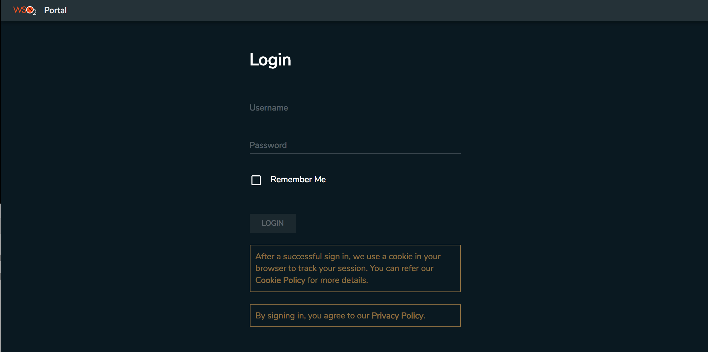
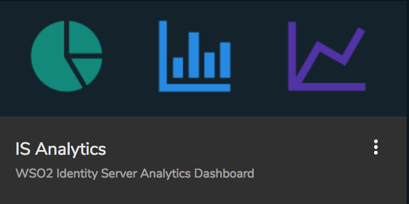
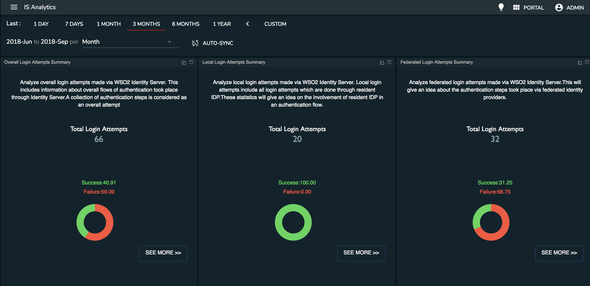
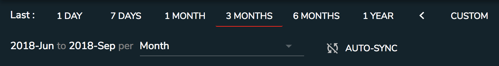

Follow the steps below to access the WSO2 IS Analytics Dashboard.

:::tip
**For testing purposes**

Follow the steps below to load test data to the system.

1.  Naviagte to the
    `          <IS_ANALYTICS_HOME>/samples/sample-clients/is-analytics-client         `
    directory on a command prompt.
2.  Run the following command.

    ```java
        ant -Dport=7612 -Dhost=0.0.0.0
    ```

The Analytics Dashboard cannot be viewed using the Internet Explorer 10
and older versions.
:::

1.  Access the WSO2 IS Analytics Portal using the following URL:
    http://&lt;HTTPS\_IS\_ANALYTICS\_HOST&gt;: 9643 /portal

     

2.  Enter the `           admin          ` as the
    `           username          ` and `           password          `
    and click **LOGIN**.

3.  Click **IS Analytics** tile.  
     

    The **Analytics Dashboard** appears with a summary of overall login
    attempts, local login attempts, and federated login attemts.

     

    1.  Select the duration within which you need to view the statistics
        using the top **duration filter**.

         

        This allows to filter the statistics within a day, week, month,
        three months, six months, year as well as a custom duration.

    2.  Click **AUTO-SYNC** to syncrhonize the dashboards automatically.

    3.  Click **bulb** icon at the top-right to change the dashboard
        theme.

         

    4.  Click **menu** icon at the top-left to view the **left
        navigator**.  
         

    5.  Click **View** to open the IS Analytics dashboard. The
        **Security Analytics** dashboard is displayed as shown in the
        example below.

## What's Next?

Explore the following topics:

   -   [Analyzing Overall Login Attempts](./analyzing-overall-login-attempts.mdx)    
   -   [Analyzing the Local Login Attempts](./analyzing-the-local-login-attempts.mdx)    
   -   [Analyzing the Federated Login Attempts](./analyzing-the-federated-login-attempts.mdx)
   -   [Analyzing Session Statistics](./analyzing-session-statistics.mdx)
