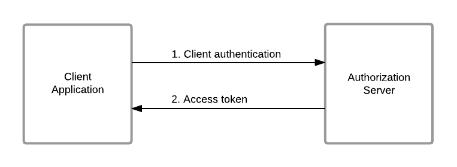

### Recommended use

This grant is suitable for machine-to-machine authentication or for a
client making requests to an API that does not require the user’s
permission. This grant should be allowed for use only by trusted
clients.

### The flow

The client can request an access token using only its client credentials
with this grant type. It is similar to the [resource owner password
credentials grant](./resource-owner-password-credentials-grant.mdx) type
except in this case, only the client’s credentials are used to
authenticate a request for an access token.

The diagram below illustrates the client credentials grant flow.



The cURL commands below can be used to try this grant type.

```java
curl -v -X POST -H "Authorization: Basic <base64 encoded client id:client secret value>" -k -d "grant_type=client_credentials" -H "Content-Type:application/x-www-form-urlencoded" https://localhost:9443/oauth2/token
```

```java
curl -u <client id>:<client secret> -k -d "grant_type=client_credentials" -H "Content-Type:application/x-www-form-urlencoded" https://localhost:9443/oauth2/token
```

You will receive a response similiar to the format below.

**Response**

```java
{"token_type":"Bearer","expires_in":2061,"access_token":"ca19a540f544777860e44e75f605d927"}
```

:::info[Support for refresh token grant - No]
This grant type doesn't issue a refresh token, which can be used to obtain new access tokens using the [refresh token grant](./refresh-token-grant.mdx).
:::

:::info[Related Topics]
See the [Try Client Credentials Grant](../../../samples/oauth2/oauth-2-0-with-wso2-playground/try-client-credentials-grant.mdx) topic to try out a sample of
the resource owner password credentials grant with WSO2 Identity
Server and WSO2 OAuth2 Playground.
:::
