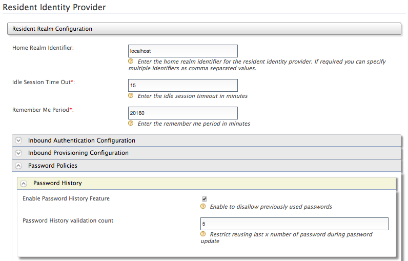

Recording user password history can provide better security for user
accounts. Through the WSO2 Identity Server, you can keep a history of
the user's past passwords according to a preconfigured count. This
enables you to prevent users from using passwords they have used in the
recent past. For example, if you configure a count of 5 passwords, users
will be prevented from reusing their last 5 passwords as the current
password. Follow the steps below to configure the count.

1.  Login to the management console.
2.  Click **Resident** under **Identity Providers** in the **Main** tab
    of the [management
    console](../../../../setup/install/getting-started-with-the-management-console/getting-started-with-the-management-console.mdx).
3.  Expand the **Password Policies** tab.
4.  Expand the **Password History** tab and select **Enable Password
    History Feature**. Specify the **Password History Validation
    Count** and click **Update**.

    :::note
    To configure this separately for different tenants in a
    multi-tenant environment, first login with Tenant A credentials and
    configure the password policy. Next, logout and login again with
    Tenant B credentials to configure a different policy for Tenant B.
    :::

     

:::info[Related Links]
By default, the claim values of the identity claims used in this feature are stored in 
the JDBC datasource based on a configuration. See [Configuring Claims](../claim-management/configuring-claims/configuring-claims.mdx) 
for more information on how to store the claim values in the user store.
:::
