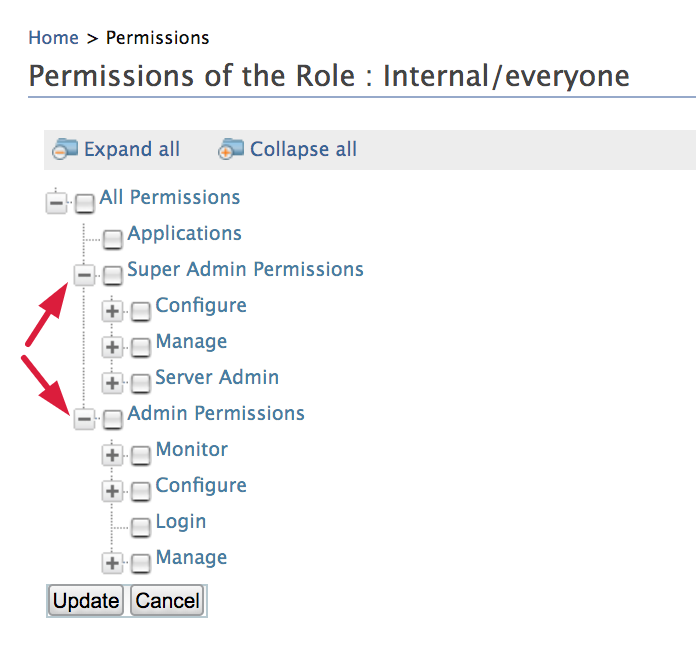
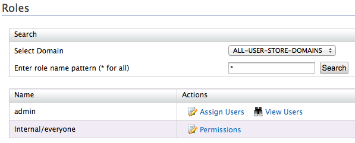
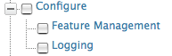
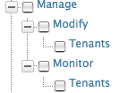
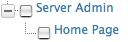

The **User Management** module in WSO2 products enable role-based
access. With this functionality, the permissions enabled for a
particular role determines what that user can do using the management
console of a WSO2 product. Permissions can be granted to a role at two
levels:

-   **Super tenant level:** A role with super tenant permissions is used
    for managing all the tenants in the system and also for managing the
    key features in the system, which are applicable to all the tenants.
-   **Tenant level:** A role with tenant level permissions is only
    applicable to individual tenant spaces.

The permissions navigator that you use to enable permissions for a role
is divided into these two categories (**Super Admin** permissions and
**Admin** permissions) as shown below. However, note that there may be
other categories of permissions enabled for a WSO2 product, depending on
the type of features that are installed in the product.

You can access the permissions navigator for a particular role by
clicking **Permissions** as shown below.  

By default, every WSO2 Identity Server comes with the default user and
role explained in
[this document](./configuring-roles-and-permissions.mdx)

-   The **Admin** role has all the permissions in the system enabled by
    default. Therefore, this is a super tenant, with all permissions
    enabled.

    :::tip
    You can change the default role name '**admin**' of the Administrative role as described [here](./configuring-roles-and-permissions.mdx#updating-role-names)
    :::

You can create new users and roles and configure permissions for the
roles using the management console. However, note that you cannot modify
the permissions of the **Admin** role. The possibility of managing
users, roles and permissions is granted by the **User Management**
permission.

### How permissions control access to operations available on the management console

The descriptions of permissions in the **Permissions** navigator are as
follows:

-   The **Login** permission defined under **Admin** permissions allows
    users to log in to the management console of the product. Therefore,
    this is the primary permission required for using the management
    console.

-   The following table describes the permissions at **Super Tenant**
    level. These are also referred to as **Super Admin** permissions.

    <table>
      <colgroup>
        <col style={{width: "50%"}} />
        <col style={{width: "50%"}} />
      </colgroup>
      <thead>
        <tr>
          <th>Permission</th>
          <th>Description of UI menus enabled</th>
        </tr>
      </thead>
      <tbody>
        <tr>
          <td>**Configuration** permissions:  </td>
          <td>The **Super Admin/Configuration** permissions are used to grant permission to the key functions in a product server, which are common to all the tenants. In each WSO2 product, several configuration permissions will be available depending on the type of features that are installed in the product.    **- Feature Management** permission ensures that a user can control the features installed in the product using the management console. That is, the **Features** option will be enabled under the **Configure** menu.  **- Logging** permission enables the possibility to configure server logging from the management console. That is, the **Logging** option will be enabled under the **Configure** menu.</td>
        </tr>
        <tr>
          <td>**Management** permissions:  </td>
          <td>

            The **Super Admin/Manage** permissions are used for adding new tenants and monitoring them.

            **- Modify/Tenants** permission enables the **Add New Tenant** option in the **Configure** menu of the management console, which allows users to add new tenants.  **- Monitor/Tenants** permission enables the **View Tenants** option in the **Configure** menu of the management console.

          </td>
        </tr>
        <tr>
          <td>**Server Admin** permissions:  </td>
          <td>Selecting the **Server Admin** permission enables the **Shutdown/Restart** option in the **Main** menu of the management console.</td>
        </tr>
      </tbody>
    </table>

-   The following table describes the permissions at **Tenant** level.
    These are also referred to as **Admin** permissions.

    :::info
    Note that when you select a node in the **Permissions** navigator,
    all the subordinate permissions that are listed under the selected
    node are also automatically enabled.
    :::

    :::note
    Also, not all the permissions available in the permission tree are listed here. You can get the information related to them throughout the documentation wherever applicable.
    :::

    <table>
      <colgroup>
        <col style={{width: "50%"}} />
        <col style={{width: "50%"}} />
      </colgroup>
      <thead>
        <tr>
          <th>Permission level</th>
          <th>Description of UI menus enabled</th>
        </tr>
      </thead>
      <tbody>
        <tr>
          <td>Admin</td>
          <td>

            When the **Admin** permission node is selected, the following menus are enabled in the management console:

            **- User Store Management:** This permission allows users to add new user stores and manage them with the management console. Note that only secondary user stores can be added using this option. See the topic on user store management for more details.  **- Identity Providers:** See the topic on [working with identity providers](../../identity-bus/adding-and-configuring-an-identity-provider/adding-and-configuring-an-identity-provider.mdx) for details on how to use this option.

            \- Additionally, all permissions listed under **Admin** in the permissions navigator are selected automatically.

          </td>
        </tr>
        <tr>
          <td>Admin/Configure</td>
          <td>When the **Admin/Configure** permission node is selected, the following menus are enabled in the management console:  **  - Main** menu **/PAP:** See the topic on [working with entitlement](../../../tutorials/access-control/working-with-entitlement/configuring-the-policy-administration-point/configuring-the-policy-administration-point.mdx) for details on how to use this option. **  - Main** menu **/PDP:** See the topic on [working with entitlement](../../../tutorials/access-control/working-with-entitlement/configuring-the-policy-administration-point/configuring-the-policy-administration-point.mdx) for details on how to use this option.  **  - Tools** menu **/Tryit (XACML):** See the topic on [working with the TryIt tool](../../../../administer/product-administration/using-tools/administer/using-the-xacml-tryit-tool.mdx) for details on how to use this option.     - Additionally, all permissions listed under **Configure** in the permissions navigator are selected automatically.</td>
        </tr>
        <tr>
          <td>Admin/Configure/Security</td>
          <td>When the **Admin/Configure/Security** permission node is selected, the following menus are enabled in the **Configure** menu of the management console:    **- Claim Management:** See the topic on [claim management](../claim-management/claim-management.mdx) for details on how to use this option.  **- Keystores:** See the topic on [keystores](../../../../administer/administer/encryption/asymmetric-encryption/creating-new-keystores.mdx) for details on how to use this option. ** ** **- Email Templates:** See the topics on [email templates](../customizing-automated-emails.mdx) for details on how to use this option.    - This permission will also enable the **Roles** option under **Configure/Users and Roles** . See the topic on [configuring users, roles and permissions](./configuring-users-roles-and-permissions.mdx) for more information.    - Additionally, all permissions listed under **Security** in the permissions navigator are selected automatically.</td>
        </tr>
        <tr>
          <td>Admin/Configure/Security/Identity Management/User Management</td>
          <td>This permission enables the possibility to add users from the management console. That is, the **Users** option will be enabled under **Configure/Users and Roles** .</td>
        </tr>
        <tr>
          <td>Admin/Configure/Security/Identity Management/Password Management</td>
          <td>This permission enables the **Change Password** option for the users listed in the **User Management/Users and Roles/Users** screen, which allows the log in user to change the passwords</td>
        </tr>
        <tr>
          <td>Admin/Configure/Security/Identity Management/Profile Management</td>
          <td>This permission enables the **User Profile** option for the users listed in the **User Management/Users and Roles/Users** screen, which allows the log in user to update user profiles.</td>
        </tr>
        <tr>
          <td>Admin/Manage</td>
          <td>When the **Admin/Manage** permission is selected, the following menus will be enabled in the management console:    **- Main** menu **/Service Providers:** See the topic on [working with service providers](../../identity-bus/adding-and-configuring-a-service-provider/adding-and-configuring-a-service-provider.mdx) for details on how to use this option.  ** ** - Additionally, all permissions listed under **Admin/Manage** in the permissions navigator will be enabled automatically.</td>
        </tr>
        <tr>
          <td>Admin/Manage/Resources/Browse</td>
          <td>This permission enables the **Browse** option under the **Registry** menu in the main navigator. This option allows users to browse the resources stored in the registry by using the **Registry** tree navigator. ** **</td>
        </tr>
        <tr>
          <td>Admin/Manage/Search</td>
          <td>This permission enables the **Search** option under the **Registry** sub menu in the **Main** menu. This option allows users to search for specific resources stored in the registry by filling in the search criteria. ** **</td>
        </tr>
        <tr>
          <td>Admin/Monitor</td>
          <td>When the **Admin/Monitor** permission node is selected, the following menus are enabled in the management console:    **- Monitor** menu **/System Statistics:** See the topic on [system statistics](../../../../setup/monitor/monitoring/system-statistics.mdx) for information on how to use this option.    - Additionally, all permissions listed under **Admin/Monitor** in the permissions navigator will be enabled automatically.</td>
        </tr>
        <tr>
          <td>Admin/Monitor/Logs</td>
          <td>When the **Admin/Monitor/Logs** permission node is selected, the following menus are enabled in the management console:    **- Monitor** menu **/Application Logs**  **- Monitor** menu **/System Logs**    See the topic on [system logs](../../../../setup/monitor/monitoring/monitoring-logs/monitoring-logs.mdx) for information on how to use these options.</td>
        </tr>
      </tbody>
    </table>
