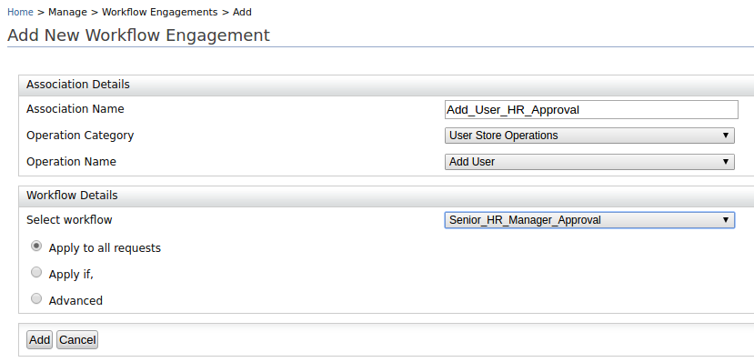
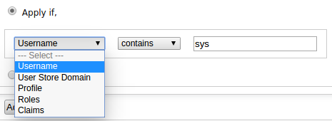
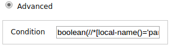

Workflows can be engaged in certain operations such as engaging the approval workflow for the operation of adding a user. This section explains the steps to do this.

1.  On the **Main** tab in the Management Console, click **Manage > Workflow Engagement > Add**.
2.  Enter the required details as given below.

     

    -   **Association name**: This is a name to identify the association.

    -   **Operation category**: This is the category of the operation to be selected to the workflow engagement.

    -   **Operation name**: This is the operation to be selected.

    -   **Workflow**: This is the workflow that you need to engage for the event. You may either use an existing workflow definition or [create a workflow definition](./adding-a-new-workflow-definition.mdx).

    -   **The Application condition**: There are three options which we can use to filter requests which
        need to be managed by the selected workflow.

        - **Apply to all Requests**: If this option is selected, the selected workflow will be triggered for all the requests of the selected operation.

        - **Apply If**: If this option is selected, the selected workflow only get triggered if the condition is satisfied. As an example, following configuration will select add user operations where username contains 'sys'. (This option supports simple conditions. If the condition is complex where multiple conditions are evaluated with connectors (and/or) use the Advance section.)

          

        - **Advanced**: If this option is selected, you can define an XPath expression to filter the requests that need to go through the selected workflow. As an example, following configuration will select add user operations where username contains 'sys'.

          \`\`\` boolean(//\*\[local-name()='parameter'\]\[@name='Username'\]/\*\[local-name()='value'\]/\*\[local-name()='itemValue'\]\[contains(text(),'sys')\]) \`\`\`

          

3.  Click **Add** to complete adding the engagement. You can view, disable, or delete the association by navigating to **Manage > WorkFlows Engagements > List**.  

### What's Next?

Now that all the configurations are done, when you add a user it will not be displayed under the users section immediately and the user will not be able to login. The user will be enabled once the user addition task is approved by a user who has the role of Manager. To try this out, see [Managing Human Tasks](./managing-human-tasks.mdx).
