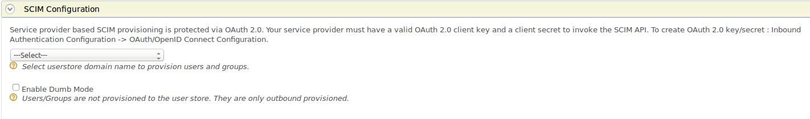

To configure [inbound provisioning](../../identity-administration-and-provisioning/identity-provisioning/inbound-provisioning/inbound-provisioning.mdx) for the
service provider, follow the steps below.

To register a service provider, do the following.

1.  Sign in. Enter your username and password to log on to the Management Console. 
2.  Navigate to the Main menu to access the Identity menu. Click Add under Service Providers.
3.  Fill in the Service Provider Name and provide a brief Description of the service provider. Only Service Provider Name is a required field.
4.  Click Register to add the new service provider.

Do the following to configure inbound provisioning.

1.  Expand the **Inbound Provisioning Configuration** section and expand
    the **SCIM/SOAP Configuration** form.  
    
2.  Select the user store domain name from the drop down list to
    provision users and groups.

:::info[Related Topics]
-   See [Configuring User Stores](../../../../setup/deploy/data-stores/working-with-users-roles-and-permissions/configuring-the-user-realm/configuring-user-stores/configuring-user-stores.mdx) for more
    information.
-   See [Inbound Provisioning](../../identity-administration-and-provisioning/identity-provisioning/inbound-provisioning/inbound-provisioning.mdx) for configuring
    user stores and service providers for inbound provisioning.
:::
