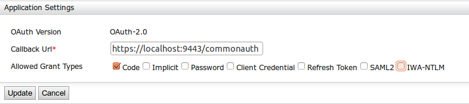
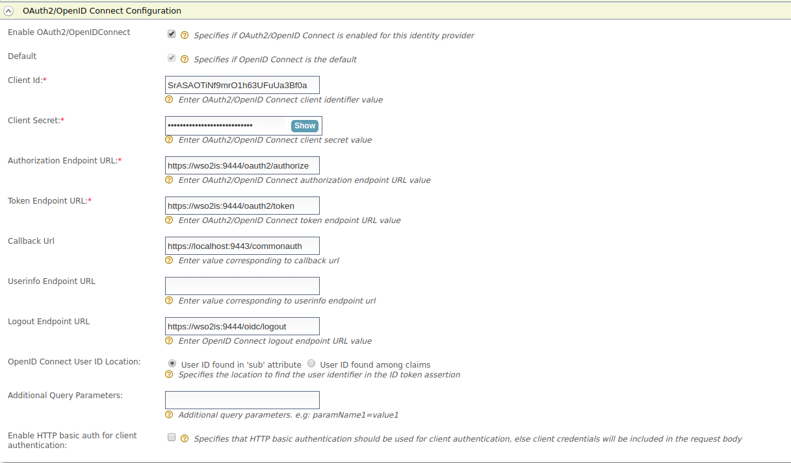
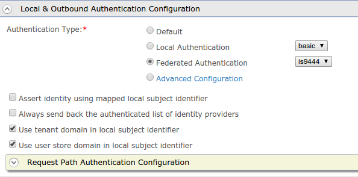
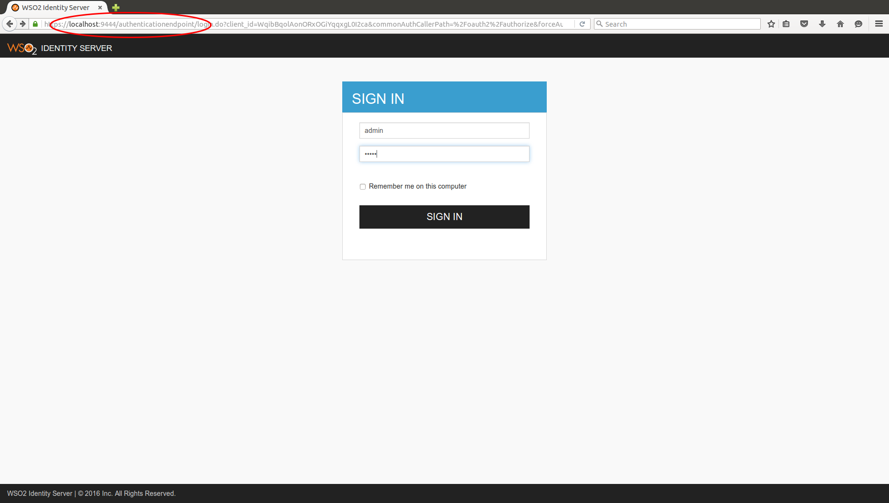

This tutorial guides you through setting up two instances of WSO2
Identity Server (WSO2 IS) and using one Identity Server to authenticate the user
and login to the other one.

1.  Start two WSO2 IS instances. Start the second instance with its hostname as `wso2is`. 

2.  Add a relevant certificate to the primary IS client-truststore, and a port offset of 1.  

    For more information on how to configure this instance, see [Default Ports of WSO2 Products](../../../references/default-ports-of-wso2-products.mdx#changing-the-offset-for-default-ports) and [Changing the 
    hostname](../../../setup/deploy/changing-the-hostname.mdx).

3.  Configure an OAuth/OIDC service provider in the second WSO2 IS instance. 
    For more infomation on how to do this, see [Configuring
    OAuth2-OpenID Connect
    Single-Sign-On](../../tutorials/single-sign-on/oauth2-openid-connect/configuring-oauth2-openid-connect-single-sign-on.mdx)
    .

    Callback Url: [https://localhost:9443/commonauth](https://localhost:9443/commonauth)

    

4.  Create an identity provider in the first Identity Server instance.  
    For more information on how to do this, see [Configuring OAuth2-OpenID Connect](../../tutorials/identity-federation/configuring-federated-authentication/configuring-oauth2-openid-connect.mdx). 

    Set the values as follows. 

    -   Enable OAuth2/OpenIDConnect: selected

    -   Default: selected

    -   Client Id: (client id of the service provider registered in
        the second identity server instance)

    -   Client Secret: (client secret of the service provider registered
        in the second identity server instance)

    -   Authorization Endpoint URL:
        [https://wso2is:9444/oauth2/authorize](https://wso2is:9444/oauth2/authorize)

    -   Token Endpoint URL: [https://wso2is:9444/oauth2/token](https://wso2is:9444/oauth2/token)

    -   Callback Url: [https://localhost:9443/commonauth](https://localhost:9443/commonauth)

    -   Logout Endpoint URL: [https://wso2is:9444/oidc/logout](https://wso2is:9444/oidc/logout)

       

5.  Setup the [playground sample](../../tutorials/deploying-the-sample-app.mdx#deploying-the-playground2-webapp) in the
    first Identity Server instance.
6.  Edit the service provider in the first Identity Server instance and select
    the **Federated Authentication** as the **Authentication type** in the **Local and
    Outbound Authentication Configuration**. 

7.  Now select the created identity provider from the dropdown menu in **Federated
    Authentication**.      

    

8.  Try the authorization code grant as described
    [here](./oauth2/oauth-2-0-with-wso2-playground/try-authorization-code-grant.mdx). You will be redirected to
    the second Identity Server instance instead of the first Identity Server instance for
    authentication. 
    
