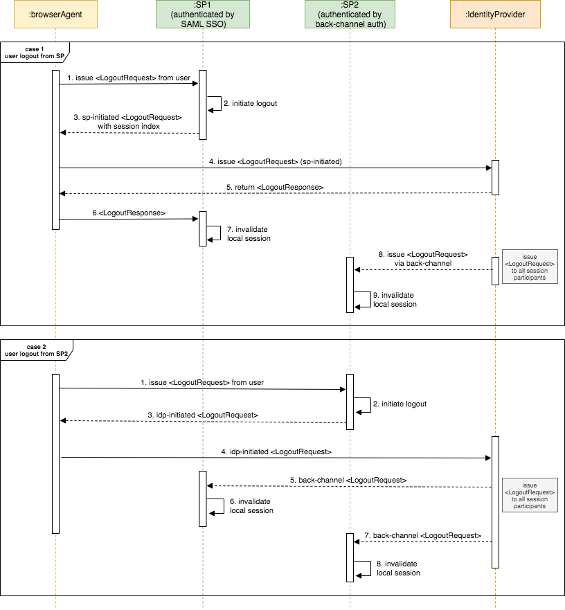

import SamlLogoutConcept from '../../../../../../partials/saml-logout-concept.mdx';

<SamlLogoutConcept />

---

## The flow

Back-channel logout has two different use cases:

1. **SP-initiated logout**: Logout initiated by the service provider application.

2. **IdP-initiated logout**: Logout initiated by the identity provider. 

The following diagram illustrates the two flows.

**Case 1: User attempts to log out from SP 1 (SAML SSO authenticated session)**

- Since the user is logged in to Service Provider 1 (SP1) by default in the SAML flow, SP1 sends an SP-initiated logout request.

- Once the logout request is received, the identity provider will send the back-channel logout requests to all the service providers which have Single Logout (SLO) enabled.

- Since Service Provider 2 (SP2) is logged in using back-channel authentication, it will invalidate the local session mapped to the session index ID.

- Finally, the identity provider sends a SAML logout response to SP1, and SP1 will invalidate the local session mapped to the session index ID.

**Case 2: User attempts to log out from SP2 (Back-channel authenticated session)**

- Since the user is logged in to Service Provider 2 (SP2) using back-channel authentication, SP2 will trigger an IdP-initiated SAML logout request.

- The identity provider will send a logout request to all the service providers in the same SAML SSO session (SP1 and SP2).

- All service providers will invalidate their local session and SP2 will be redirected to the return URL specified in the logout request.

:::info[Related topics]
- Concept: SAML 2.0
- Concept: SAML Front-Channel Logout
- [Guide: SAML Back-Channel Logout](../../../../../guides/authentication/single-logout/saml-flows/saml-back-channel-logout.mdx)
- Quick Start: SAML Back-Channel Logout
:::
