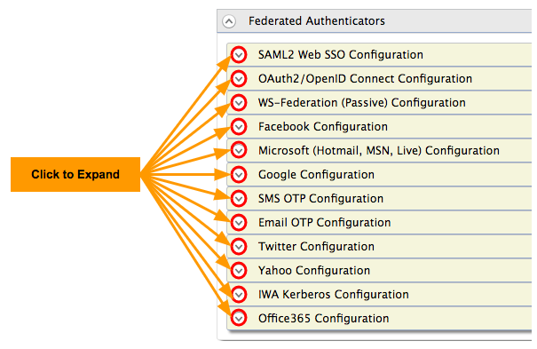

This topic includes information on how to configure federated authenticators in WSO2 Identity Server.

To navigate to the federated authenticators configuration section, do the following.

1. Sign in. Enter your username and password to log on to the Management Console.

2. Navigate to the Main menu to access the Identity menu. Click Add under Identity Providers. For more information, see Adding and Configuring an Identity Provider.

3. Fill in the details in the Basic Information section.

You can configure the following federated authenticators by expanding the Federated Authenticators section followed by the required subsections.

:::info
Some authenticators such as LinkedIn are not provided OOTB with WSO2 Identity Server but can be downloaded from the [WSO2 store](https://store.wso2.com/store/pages/top-assets) and plugged in to work with WSO2 IS.
:::