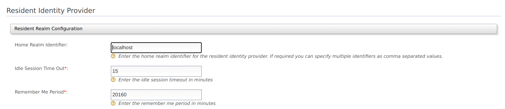

WSO2 Identity server can also act as an IdP, which provides identity for applications, rather than mediating authentication requests between service providers and identity providers.

In such cases, the Identity Server is known as the **resident identity provider**.

{/* !!! note
    The resident identity provider configuration helps service providers
    to send authentication or provisioning requests to WSO2 Identity Server via SAML, OpenID Connect, SCIM, or WS-Trust.

    For an example of how a resident identity provider is used to implement a security token service, see [Configuring WS-Trust Security Token Service]({{base_path}}/learn/configuring-ws-trust-security-token-service).
    
    The Resident identity provider configuration is a one-time configuration for a given tenant. It shows WSO2 Identity Server's metadata, e.g., endpoints. The resident identity provider configurations can be used to secure the WS-Trust endpoint with a security policy.
*/}

To configure a resident identity provider:

1. On the WSO2 Identity Server Management Console, go to **Main \> Identity \> Identity Providers \> Resident**.

2. On the expanded **Resident Realm Configurations** tab enter the required values as given below.
    

    <table>
      <thead>
        <tr>
          <th>Field</th>
          <th>Description</th>
          <th>Sample Value</th>
        </tr>
      </thead>
      <tbody>
        <tr>
          <td>**Home Realm Identifier**</td>
          <td>This is the domain name of the identity provider. If you do not enter a value here, when an authentication request comes to WSO2 Identity Server, a user will be prompted to specify a domain. You can enter multiple identifiers as a comma-separated list.</td>
          <td>`localhost`</td>
        </tr>
        <tr>
          <td>**Idle Session Time Out**</td>
          <td>This is the duration in minutes for which an SSO session can be idle for. The default value is `15` .</td>
          <td>`15`</td>
        </tr>
        <tr>
          <td>**Remember Me Period**</td>
          <td>

            This is the duration in weeks for which WSO2 Identity Server should remember an SSO session given that you have selected the **Remember Me** option in the WSO2 Identity Server login screen.

            The default value is `2` weeks.

          </td>
          <td>`2`</td>
        </tr>
      </tbody>
    </table>

3. Click **Update** to save the configurations.
