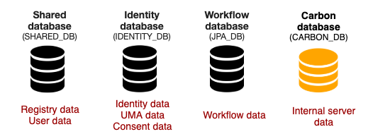

WSO2 Identity Server is shipped with an embedded H2 database for storing
data. These default databases are located in the
`         <IS_HOME>/repository/database        ` directory of the
product pack.

### Default databases

Explained below are the default databases that you will find in the
`         database        ` directory.

-   **Identity database** :`WSO2IDENTITY_DB.mv.db` WSO2 Identity Server has its this database its specific identity 
    related data.
-   **Shared database** :`WSO2SHARED_DB.mv.db` this database contains the registry and
    user management data.
-   **Carbon database:** `          WSO2CARBON_DB.mv.db         ` This database has the 
    internal data related to the product. This data is stored in the embedded H2 database.
-   **Workflow database:** `          jpadb.mv.db         ` This database has the 
    workflow related data. 

Following image shows the default databases and the data that are stored in each database.

### Changing the default databases

The embedded H2 databases shipped with your product are suitable for evaluation,
development and testing.For production environments, we recommend industry-standard RDBMSs such as
Oracle, PostgreSQL, MySQL, MS SQL, etc.

WSO2 products are shipped with scripts for creating the required tables
in all the required databases: The scripts for creating tables for user
management and registry data are stored in the
`         <IS_HOME>/dbscripts        ` folder.

**Changing the default database:** You simply have to set up new
physical databases, point the product server to the new databases by
updating the relevant configuration files, and create the required
tables using the scripts provided in the product pack. See the following
topics for instructions:

-   [Changing to MySQL](./changing-the-carbon-database/changing-to-mysql.mdx)
-   [Changing to Oracle](./changing-the-carbon-database/changing-to-oracle.mdx)
-   [Changing to MSSQL](./changing-the-carbon-database/changing-to-mssql.mdx)
-   [Changing to Oracle RAC](./changing-the-carbon-database/changing-to-oracle-rac.mdx)
-   [Changing to PostgreSQL](./changing-the-carbon-database/changing-to-postgresql.mdx)
-   [Changing to IBM DB2](./changing-the-carbon-database/changing-to-ibm-db2.mdx)
-   [Changing to MariaDB](./changing-the-carbon-database/changing-to-mariadb.mdx)
-   [Changing to Remote H2](./changing-the-carbon-database/changing-to-remote-h2.mdx)