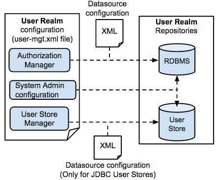

User management functionality is provided by default in WSO2 Identity Server and is configured in the
`         deployment.toml        ` file found in the
`         <IS_HOME>/repository/conf/        ` directory. The
following documentation explains the configurations that should be done
in WSO2 products in order to set up the User Management module.

The complete functionality and contents of the User Management module is
called a **user** **realm**. The realm includes the user management
classes, configurations and repositories that store information.
Therefore, configuring the User Management functionality in a WSO2
product involves setting up the relevant repositories and updating the
relevant configuration files.

The following diagram illustrates the required configurations and
repositories:  

See the following topics for instructions on setting up user stores.
