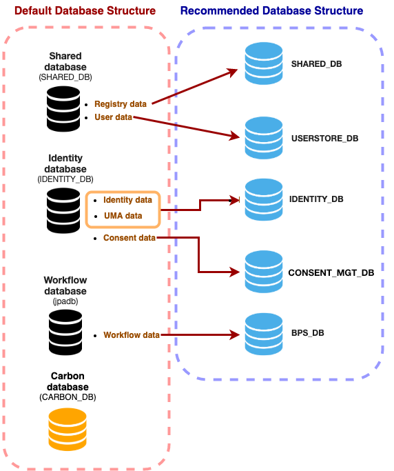

WSO2 Identity Server uses a database to store information such as
user management details and identity data. By
default, each WSO2 product is shipped with an embedded H2 database that
works for all types of data.

This section guides you through the logical separation of data that you
can do when clustering WSO2 Identity Server. 

::::warning[Embedded H2 is NOT RECOMMENDED in production]
The embedded H2 database is **NOT RECOMMENDED** for enterprise testing and 
production environments. It has lower performance, clustering
limitations, and can cause file corruption failures. Therefore, use an
industry-standard RDBMS such as Oracle, PostgreSQL, MySQL, or MS SQL
instead.

:::tip[Before you begin]
Creating separate databases as shown below **is not mandatory**. Instead, 
you can point all the following datasources accoridng to the default data structure. 
This will NOT make a difference in performance. For more information on default 
database structure, see [Working with Databases](../data-stores/working-with-databases/working-with-databases.mdx).
:::
::::

The following image shows the default database structure and a recommended 
database structure for a logical separation of data.

<table>
  <thead>
    <tr>
      <th>Database Name</th>
      <th>Description</th>
    </tr>
  </thead>
  <tbody>
    <tr>
      <td>` USERSTORE_DB `</td>
      <td>

        <li>Mainly contains users and roles of the system.</li>

        <li>Contains authorization manager configurations, internal permissions and roles.</li>

        <li>In the default database configuration, user data and registry data are located inside `SHARED_DB` .</li>

        <li>For more information, see [Configuring User Stores](../data-stores/working-with-users-roles-and-permissions/configuring-the-user-realm/configuring-user-stores/configuring-user-stores.mdx).</li>

      </td>
    </tr>
    <tr>
      <td>` IDENTITY_DB `</td>
      <td>

        <li>Contains identity related data. For example user sessions, OAuth 2.0, SAML 2.0, User Managed Access (UMA) etc.</li>

        <li>In the default database configuration, all the UMA, consent and identity data are located in the `IDENTITY_DB`. In a deplyment both identity and UMA can be separated for a single database while consent data is configured to a separate database \`CONSENT_MGT\`</li>

        <li>For more information, see [Working with Databases](../data-stores/working-with-databases/working-with-databases.mdx).</li>

      </td>
    </tr>
    <tr>
      <td>` BPS_DB `</td>
      <td>

        <li>This is used to create, drop, and truncate data pertaining to the workflow feature.</li>

        <li>For more information, see [Changing the Default Datasource for BPS](../data-stores/working-with-databases/changing-the-carbon-database/changing-datasource-bpsds.mdx).</li>

      </td>
    </tr>
    <tr>
      <td>` SHARED_DB `</td>
      <td>

        <li>Shared database for config and governance registry mounts in the product's nodes. This includes data on tenants and keystores.</li>

        <li>In the default database configuration, user data and registry data is located inside `SHARED_DB`. During a deployment, user data can be configured to a different database `USERSTORE_DB` while registry data remains in the `SHARED_DB` .</li>

        <li>For more information, see [Working with Databases](../data-stores/working-with-databases/working-with-databases.mdx).</li>

      </td>
    </tr>
    <tr>
      <td>` CONSENT_MGT `</td>
      <td>

        <li>Used for data pertaining to user consents.</li>

        <li>In the default database configuration, UMA, consent and identity data are located `IDENTITY_DB`. In a deplyment both identity and UMA can be separated for a single database while consent data is configured to a separate database.</li>

        <li>For more information, see [Changing the Default Datasource for Consent Management Database](../data-stores/working-with-databases/changing-the-carbon-database/changing-datasource-consent-management.mdx).</li>

      </td>
    </tr>
  </tbody>
</table>

:::note
For more information on `SHARED_DB` and `IDENTITY_DB`, 
see [Working with Databases](../data-stores/working-with-databases/working-with-databases.mdx).
:::
